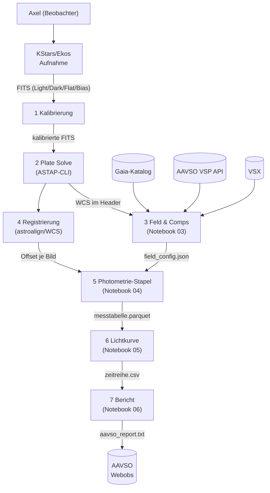
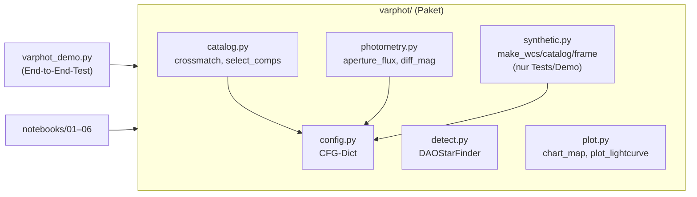

# Konzept: Differentielle Photometrie-Pipeline

**Projekt**: `photometrie-py`  
**Version**: 0.1 (2026-11-10)  
**Autor**: Axel Pospischil  
**Repo**: https://github.com/apos/photometrie-py

---

## 1. Grundlagen — warum dieses Projekt existiert

Ziel ist die Auswertung selbst aufgenommener FITS-Bilder zur Lichtkurvenbestimmung von
Veränderlichen Sternen (Fokus: Delta Cephei, Klasse Cepheid). Die Messungen sollen in das
AAVSO-Netz eingebracht werden. Siril deckt Kalibrierung und erste Sichtprüfung ab; alle
wissenschaftlichen Auswertungsschritte (Plate Solving, Comp-Auswahl, Aperturphotometrie,
differentielle Helligkeit, Lichtkurve, Periodensuche, AAVSO-Export) laufen in Python durch
reproduzierbare Jupyter-Notebooks.

**Aufbau**: Apo 80/540 (1,44″/px) oder C9.25/AP400 + QHY268M, Beobachtungsort Balkon.

---

## 2. Kontextabgrenzung (arc42 C1)



**Systemgrenzen**: FITS-Erzeugung (Ekos), Kalibrierung (Siril oder ccdproc), ASTAP-Binary
und alle externen Kataloge liegen außerhalb dieses Python-Projekts.

---

## 3. Bausteinsicht (arc42 C5)



| Modul | Aufgabe | Abhängigkeiten |
|---|---|---|
| `config.py` | Zentrales CFG-Dict; Ausgangspunkt für YAML-Config | — |
| `detect.py` | Quellendetektion via DAOStarFinder | astropy.stats, photutils |
| `catalog.py` | Crossmatch + Comp/Check-Auswahl mit QC-Flags | astropy.coordinates, config |
| `photometry.py` | Aperturphotometrie + Ensemble-Nullpunkt | photutils, config |
| `plot.py` | Sternkarte + 4-Panel-Lichtkurve | matplotlib, astropy.visualization |
| `synthetic.py` | Synthetische Testdaten (nur Demo/Tests) | numpy, astropy |

---

## 4. Laufzeitsicht / Datenfluss (arc42 C6)

```mermaid
flowchart LR
    FITS[/"FITS-Bilder\n(1 Nacht)"/] --> NB01["01 Kalibrierung"]
    NB01 --> KalFITS[/"kalibrierte\nFITS"/]
    KalFITS --> NB02["02 Plate Solve\n(ASTAP)"]
    NB02 --> WCS["FITS mit WCS\nim Header"]
    WCS --> NB03["03 Feld & Comps\n(Katalogabfrage)"]
    NB03 --> FC[/"field_config.json\nZiel · Comps · Check"/]
    WCS --> NB04["04 Photometrie-Stapel"]
    FC --> NB04
    NB04 --> MT[/"messtabelle.parquet\nje Bild & Stern"/]
    MT --> NB05["05 Lichtkurve\n& Periode"]
    NB05 --> ZR[/"zeitreihe.csv"/]
    ZR --> NB06["06 Bericht\n& AAVSO-Export"]
    NB06 --> REP[/"aavso_report.txt\nCSV"/]
```



**Prinzip**: Jede Stufe schreibt ein Zwischenergebnis, die nächste liest es. So ist jeder
Schritt einzeln wiederholbar, ohne die gesamte Pipeline neu starten zu müssen.

---

## 5. Querschnittliche Konzepte

### 5.1 Konfiguration

Alle Schwellen und Parameter liegen im zentralen `CFG`-Dict (`varphot/config.py`).
Nächster Schritt: ein pro-Ziel-YAML laden und über `CFG.update(yaml_data)` einmischen,
so dass dieselbe Pipeline für Delta Cephei und eta Aql unterschiedliche Aperturgrößen
verwenden kann.

```python
# Zukünftiges Muster (noch nicht implementiert)
import yaml
with open("config/delta_cep.yaml") as f:
    CFG.update(yaml.safe_load(f))
```

### 5.2 Qualitätstored (QC-Flags)

Bilder und Sterne fallen nicht stillschweigend aus der Pipeline. `select_comps()` gibt
für jeden verworfenen Kandidaten die Ablehnungsursache aus. Zukünftig: QC-Spalte in der
Messtabelle (`qc_flag`), damit jeder Ausschluss rekonstruierbar bleibt.

| QC-Grund | Bedeutung |
|---|---|
| `sat` | Peak > CFG['sat_adu'] — Sättigung oder Nichtlinearität |
| `edge` | Stern zu nah am Bildrand |
| `neighbor` | Nachbarstern im Aperturbereich |
| `bv` | B-V-Farbe zu weit vom Ziel entfernt |
| `var` | Als Veränderlicher (VSX) bekannt |
| `halo` | Im Halo des defokussierten Ziels |

### 5.3 Zeitstempel und BJD

`DATE-OBS` wird als Belichtungsbeginn interpretiert (nicht belegt; Header prüfen).
BJD_TDB-Umrechnung mit Beobachtungsort-Koordinaten via `astropy.time.Time` und
`astropy.coordinates.EarthLocation` — noch nicht implementiert; Priorität P1.

### 5.4 Fehlerrechnung

Aktuelle Implementierung: Poisson-Fehler (√Fluss). Für AAVSO-Einreichung benötigt:
Ausleserauschen + Hintergrundfehler + Szintillationsfehler (Young 1967). Priorität P1.

---

### 5.5 Gesättigte Ziele

**Reihenfolge der Mittel (Best Practice, soweit belegt):**
1. **Vermeiden:** defokussieren oder kürzer belichten, bis das Ziel im linearen Bereich bleibt (eigener Aufbau: defokussierte Apertur, `target_ap_r`). Standardempfehlung der Photometrie, hier nicht an einer Einzelquelle belegt (E).
2. **Ladungserhaltende CCDs:** Summe über eine Apertur, die die Bleed-Spur einschließt, bleibt linear — HST ACS Instrument Handbook §4.3 (F, Suchauszug: „… even when the central pixel is saturated by 10 times its full well depth"). Voraussetzung: kein Antiblooming, Spur nicht aus dem Bild heraus, Himmelsring frei von der Spur.
3. **Spur maskieren:** Pixel neben ≥ 3 gesättigten Pixeln entlang der Ausleserichtung markieren (KMTNet-Pipeline, arXiv:2607.09148, F).
4. **Halo-/Flügel-Photometrie:** nur die ungesättigten Pixel der PSF-Flügel verwenden (EVEREST/K2, arXiv:1702.05488; TESS, arXiv:2106.08341; F) — das Verfahren der Wahl, wenn die Spur zu lang ist oder der Verlust im Kern sitzt.
5. Gesättigte Sterne nicht als PSF-Vorlage benutzen (DECaPS2, arXiv:2206.11909, F: verfälschte die Photometrie eines ganzen CCDs).

**Hier angewendet (LCO δ Cep, 0,4 m, 1,3 s):** Mittel 2 half nicht — Aperturen bis 36 px (schließen die ~8 px lange Spur ein) änderten die Streuung nicht, der Verlust sitzt offenbar im
digital abgeschnittenen Kern (`SATURATE` 102 400 ADU; Schluss aus den Daten). Mittel 4 in Form einer **Kernmaske** (`core_r` = 1,5 px, Ringfluss mit dem Ringanteil ungesättigter Comps desselben Bildes hochgerechnet,
`light_curve(core_correct=True)`) halbierte die Reststreuung (0,129 → 0,068 mag) und beseitigte die Seeing-Abhängigkeit (Korrelation −0,69 → −0,07). Die Kombination ist eine **eigene Methode**; der Kernradius ist an diesen Daten gewählt (kleinstes Residuum),
die Modellamplitude hängt von ihm ab (0,75–0,99 mag bei 1,0–2,5 px, Literatur ~0,88). **Zu klären:** Antiblooming des LCO-Kameratyps (kb88), unabhängige Prüfung der Amplitude an einem zweiten gesättigten Datensatz.

## 6. Architektur-Entscheidungen (ADR)

### ADR-01: Aperturphotometrie vor PSF-Photometrie (2026-11-10)
**Kontext**: photutils bietet `IterativePSFPhotometry`. Für ein defokussiertes Ziel
(FWHM ~22 px) passt keine Standard-PSF.  
**Entscheidung**: Einstieg mit Aperturphotometrie; PSF-Option für zukünftige
fokussierte Felder offen halten.  
**Konsequenz**: Größere Apertur für das Ziel nötig; mehr Hintergrundrauschen.

### ADR-02: Paketstruktur `varphot/` + Notebooks (2026-11-10)
**Kontext**: Notebook-only-Ansatz führt zu Code-Duplikation zwischen Notebooks.  
**Entscheidung**: Wiederverwendbare Funktionen im Paket; Notebooks als dünne
Orchestrierungsschicht.  
**Konsequenz**: Notebooks können einfach ausgetauscht/erweitert werden; Paket
direkt per `import varphot` nutzbar.

### ADR-03: Eigene venv, getrennt von SORA/Astrometrie (2026-11-10)
**Kontext**: photutils-Versionen zwischen Projekten inkompatibel.  
**Entscheidung**: `.venv/` lokal im Projektordner, `requirements.txt` als Single
Point of Truth.

---

## 7. Installation und Verifikation

```bash
# Einmalig
/opt/homebrew/bin/python3.13 -m venv .venv
.venv/bin/pip install -r requirements.txt
```

**Verifikation** (erwartete Ausgabe in < 2 min):
```bash
.venv/bin/python varphot_demo.py
```
```
Comp-Auswahl: 30 Kandidaten verworfen (QC): …
Detektion: 46 Quellen, gematcht: 46, Comps: 8, Check: 19
Check-Stern: Soll V=8.903, Messung Mittel 8.9xx, Streuung 0.01xx mag
Lomb-Scargle Periode: 5.3xx d (Soll 5.366)
chart.png und lightcurve.png geschrieben.
```
Die eingebauten Assertions prüfen: ≥ 5 Comps, Check-Streuung < 0,05 mag, Periode ± 0,5 d.

**VSCode Kernel**: `.venv/bin/python` über *Python: Select Interpreter* auswählen.

---

## 8. Test-Strategie

| Was | Methode | Status |
|---|---|---|
| Gesamte Pipeline (synthetische Daten) | `varphot_demo.py` mit assert-Checks | ✅ Lokal getestet (M4, Python 3.13) |
| Einzelfunktionen | — | ❌ Noch keine Unit-Tests |
| Plate Solve (ASTAP) | Manuell mit echtem FITS | ❌ Nicht getestet |
| Katalogabfragen (Gaia/VSP) | Manuell, Mac + Netz nötig | ❌ Nicht getestet |
| Registrierung mit echten Bildern | Manuell | ❌ Nicht getestet |
| AAVSO-Export-Format | Manuell gegen Spezifikation | ❌ Nicht getestet |

Nächste Testprioritäten: Unit-Tests für `crossmatch` und `diff_mag`; Rauch-Test mit
einem echten FITS-Bild (Plate Solve + Sternkarte).

---

## 9. API-Referenz

### `varphot.detect(img, fwhm, nsigma)`
| Parameter | Typ | Default | Beschreibung |
|---|---|---|---|
| `img` | ndarray | — | 2D-Frame (ADU) |
| `fwhm` | float | 4.5 | Erwartete FWHM in Pixeln |
| `nsigma` | float | 8.0 | Erkennungsschwelle in σ |
**Rückgabe**: `(sources_table, median, std)`

### `varphot.crossmatch(src, cat, w, tol_arcsec)`
| Parameter | Typ | Default | Beschreibung |
|---|---|---|---|
| `src` | Table | — | Detektierte Quellen (photutils) |
| `cat` | Table | — | Referenzkatalog mit ra, dec, V, BV, var |
| `w` | WCS | — | Astropy-WCS des Referenzbilds |
| `tol_arcsec` | float | CFG | Matching-Radius |
**Rückgabe**: gefiltertes `src` mit Katalog-Spalten angehängt

### `varphot.select_comps(m, cat, w, cfg, target_id)`
**Rückgabe**: `(target_dict, comps_list, check_or_None)` — verworfene Kandidaten werden geloggt.

### `varphot.aperture_flux(img, xy, r_ap, r_in, r_out, cfg)`
**Rückgabe**: `(flux_array, err_array, bkg_array)` — Warnung bei Peak > `sat_adu`.

### `varphot.diff_mag(f_t, f_c, V_c, f_k)`
**Rückgabe**: `(mag_ziel, mag_check_or_nan, zp_scatter)`

---

## 10. Strategische Roadmap

Abhängigkeiten: **P0 blockiert P1; P1 blockiert P2.**

| Priorität | Aufwand | Thema | Abhängigkeit |
|---|---|---|---|
| P0 | S | Testbild plate-solven, Sternkarte über echtes FITS legen — **erledigt 2026-11-10** (M16-Testbild, NB02) | Mac + ASTAP + Testbilder |
| P0 | S | Comp-Auswahl für Delta Cephei mit VSP-Daten (Gaia/AAVSO) prüfen — **erledigt 2026-11-10** (`varphot/vsp.py`, NB03: 4 Comps rotationssicher, 7–8 bei bekanntem Kamerawinkel) | Netz + P0 oben |
| P0 | M | Notebooks 01–06 mit erstem echten Datensatz durchlaufen — **NB01–05 erledigt 2026-11-10** (LCO δ Cep V, 0m4-11, 98 brauchbare Bilder, Lichtkurve + LS-Periode 5,363 d, Residuum 0,07 mag mit Kernmaske für das gesättigte Ziel; NB06 offen) | P0 Plate Solve |
| P1 | M | BJD_TDB-Umrechnung mit Standort (Beobachterkoordinaten) — **erledigt 2026-11-10** (`varphot/timeutil.py`, Standort aus Header oder NB01) | P0 |
| P1 | M | Vollständiger Photometrie-Fehler (Poisson + RON + Szintillation) — **erledigt 2026-11-10** (CCD-Gleichung + Young-Szintillation; Gain/RON aus Header) | P0 |
| P1 | S | Pro-Ziel-YAML-Config laden (`config/delta_cep.yaml`) | P0 |
| P1 | M | Unit-Tests für `crossmatch` und `diff_mag` — `diff_mag` + `ensemble_mag` getestet 2026-11-10; `crossmatch` offen | P0 |
| P1 | L | Registrierung per `astroalign` mit echten Bildern verifizieren | P0 |
| P1 | M | Farbkamera: CFA-Kanäle (R, G, B) aus Roh-Bayer-Bildern extrahieren (Siril), Messtabelle je Kanal — siehe §11 | P0 |
| P2 | M | AAVSO Extended Format erzeugen und validieren (Filter `TG`/`TB`/`TR` bzw. `V`/`B`/`R` mit `TRANS`), Einreichen | P1 |
| P2 | L | Transformationskoeffizienten aus Standardfeld (M 67 / NGC 7790) für die Farbkamera; Export `TRANS=YES` — siehe §11 | P1 |
| P1 | M | **NB07 Kamera-Charakterisierung** (Gain, Ausleserauschen, Linearität, Dunkelstrom je Bayer-Kanal) — siehe §11.8 | P0 |
| P2 | L | **NB08 Transformationskoeffizienten** aus Standardfeld (Kameraprofil `transform.json`) — siehe §11.8 | NB07 |
| P2 | M | Beispieldaten One-Shot-Color beschaffen/aufnehmen (§11.9) | P1 |
| P2 | XL | PSF-Photometrie für fokussierte Felder (photutils PSFPhotometry) | P1 |
| P2 | L | Spektren-Auswertung SHG 700 (Neon-Kalibrierung) | eigenes Notebook |

**Offene Klärungen (blockieren P0)**:
- ~~Beobachtungsort-Koordinaten für BJD und Luftmasse~~ — erledigt 2026-11-10: NB01 Abschnitt 0 (Picker, lokal gespeichert, nicht im Repo)
- ~~AAVSO-Beobachtercode~~ — erledigt 2026-11-10: vorhanden, NB01 Abschnitt 0 (lokal gespeichert)
- Mac-Modell/macOS-Version für ASTAP-Freigabe (Apple Silicon Signing)


---

## 11. Farbkamera (One-Shot-Color, z. B. Player One Ares-C Pro): Siril, Transformation, AAVSO

Stand 2026-11-10. Prüfstatus der Quellen (§11.10): **G** = gelesen (Wortlaut), **F** = nur Suchauszug/Forumsaussage, **E** = aus dem Gedächtnis.
Nichts davon ist implementiert — dies ist das Konzept.

### 11.1 Ziel

Die Pipeline (bisher Monochrom-Bilder in V, LCO) soll Roh-Bayer-Aufnahmen einer Farbkamera auswerten und **AAVSO-konform** liefern.
Unterschiede zur Monochrom-Kamera: (1) der Stern liegt in R, G und B auf *verschiedenen Pixeln* (Bayer-Muster), (2) die Kanalempfindlichkeiten weichen von Johnson
B/V/R ab, (3) alle drei Farben entstehen im selben Bild — die Farbe des Sterns ist je Bild messbar.

### 11.2 Was AAVSO verlangt

- **Filtercodes `TG`, `TB`, `TR`** (G, Extended Format v1.2): „commonly the green-/blue-/red-channel in a DSLR or color CCD camera". `TG` nutzt **V-Band-Vergleichssterne**, `TB`
  **B-Band**, `TR` **R-Band**. Unsere V-Comps (VSP, Gaia) passen für `TG`; für `TB`/`TR` brauchen wir B- bzw. R-Magnituden der Comps.
- **Das Feld `FILTER` bezeichnet das Durchlassband des gemeldeten *Ergebnisses*, nicht den physischen Filter** (G, Forum 2022, Antwort eines erfahrenen Beobachters). Deshalb:
  untransformiert → `TG`/`TB`/`TR` mit `TRANS=NO`; **transformiert → `V`/`B`/`R` mit `TRANS=YES`**.
- **AAVSO-Mitarbeiter (G, Forum „Reporting Photometric Magnitudes", 2022):** „Yes, DSLR images can and should be transformed to J/C and reported as J/C"
  (George Silvis). Geplante Benennung der Koeffizienten, z. B. `tgTv_bv` = Transformation der `TG`-Instrumentalwerte auf Johnson V. Zusätzliche Angaben in `NOTES` sind erwünscht.
  Bedingungen eines Beobachters, die dort unwidersprochen blieben (Gary Hawkins, OSC-CMOS, RMS 0,04–0,06 mag): Ziele mit **(V−R) < 1**, **mindestens 4 Comps**.
  Ken Menzies: `TG` → V transformiert gut für die meisten Sterne, `TB`/`TR` schlechter (Emissions-/Absorptionslinien farbiger Sterne); Empfehlung: Standardfeld aufnehmen und
  `TR` (untransformiert) gegen `R` (transformiert) für sehr blaue/rote Comps vergleichen. Bei Sternen mit starken Emissions-/Absorptionsbändern `TB`/`TG`/`TR` melden.
- **`OBSTYPE` — Widerspruch in den Quellen:** Die Format-Seite (G) sagt „If you use a CMOS camera please report it as CCD". Die Zusammenfassung im selben Forum-Thread (G, Hawkins)
  nennt für **OSC-CMOS `OBSTYPE=DSLR`** (mit `TB`/`TG`/`TR`, `TRANS=NO` oder `B`/`V`/`R`, `TRANS=YES`); der Einwand eines Beobachters betraf andere Punkte, nicht diesen.
  **Entscheidung (vorläufig):** für die Farbkamera `OBSTYPE=DSLR`, in `NOTES` „OSC CMOS camera, Bayer RGGB, green channel"; vor der ersten Meldung bei der AAVSO bestätigen lassen.
- **Datum:** nur `JD`, `HJD` oder `EXCEL` (G), Mittenzeit in UT — **BJD_TDB nicht vorgesehen**: Export mit UTC-Mitte als JD; BJD_TDB bleibt der Auswertung vorbehalten.
- **Weitere Felder (G):** `#TYPE=Extended`, `#OBSCODE`, `#SOFTWARE`, `#DELIM`, `#DATE`, `#OBSTYPE`; je Zeile `MTYPE=STD`, `CNAME` (bei Ensemble `ENSEMBLE`, `CMAG=na`), `KNAME`/`KMAG`
  (Check-Stern, nicht im Ensemble), `AIRMASS`, `CHART` (VSP-Sequenz-ID; bei eigenen Comps Kommentarcode K „non-AAVSO chart", Comps in `NOTES`), `NOTES` mit Unterfeldern (`|VMAGINS=…|Tv_bv=…`).
- **IR-Sperrfilter:** Ohne UV/IR-Sperrfilter leckt IR in die Kanäle (F, Forum 2023); rote Sterne erscheinen dann deutlich zu hell. Der Aufbau gehört in die `NOTES`.
- **Das DSLR-Handbuch v1.4 (§6.5 Transformationsgleichungen, §6.7 Einreichen) ist nicht gelesen** (§11.10); es wird in den Quellen oben zitiert.

### 11.3 Rolle von Siril — und warum seine Lichtkurve die Transformation nicht ersetzt

Siril liefert die **Eingangsbilder**; unsere Pipeline rechnet.
1. **Kalibrierung im CFA-Bereich (ohne Debayern):** Bias/Dark/Flat auf den Roh-Bayer-Bildern. Debayern interpoliert zwischen Nachbarpixeln verschiedener Farben und verfälscht Flüsse.
   (E: Optionen wie `-cfa`/`-equalize_cfa` bei `calibrate` aus dem Gedächtnis, gegen die Siril-Doku prüfen.)
2. **Kanaltrennung:** *Split CFA* (vier Einkanalbilder R, G1, G2, B, je halbe Auflösung) oder *Extract Green* (mittelt die zwei Grün-Pixel: weniger Rauschen, halbierte Auflösung) — F, Siril-Doku „Split Channels".
3. **Danach NB02–NB05 je Kanal** (ASTAP auf dem Kanalbild; Pixelskala des halbierten Rasters beachten).

**„Sirils Lichtkurve ersetzt die Transformation nicht" — Erklärung:** Sirils `light_curve` (G, Siril-Doku) rechnet rein *differentiell*: `V_std = (V_ins − C_ins) + C_std`, also
Ziel minus Vergleichsstern plus Katalogwert des Vergleichssterns. Das stimmt nur, wenn das Instrument Ziel und Comp *gleich* behandelt — also gleiche Farbe oder ein exakt passender Filter.
Der Grün-Kanal einer Bayer-Kamera ist aber nicht Johnson V; die Abweichung hängt von der **Farbe** ab. Beispiel aus der Literatur (Canon EOS 500D, OEJV 2023; Steigung ≈ −0,08 mag je mag (B−V),
§11.5): ein Ziel mit 0,5 mag anderem (B−V) als der Comp wäre um ~0,04 mag falsch — mehr als die 0,01–0,03 mag Streuung, die man sonst erreicht. Die Transformation misst diese Steigung an einem
Standardfeld und rechnet sie heraus. Siril kann das nicht (die Doku erwähnt keine Farbterme), taugt also als **Gegenprobe der untransformierten `TG`-Werte**, nicht als Weg zu `V` mit `TRANS=YES`.

### 11.4 Ablauf in der Pipeline (Entwurf)

1. **Aufnahme:** Roh (CFA, FITS, 16 Bit), UV/IR-Sperrfilter im Strahlengang, **leicht defokussiert** (jeder Kanal sieht dann mehrere Pixel), Belichtung unter der Sättigung (Bittiefe beachten, §11.6),
   Darks zur Belichtung; **Standardfeld** (M 67 / NGC 7790) bei mehreren Luftmassen für die Koeffizienten.
2. **Siril:** Kalibrieren (CFA), Kanäle trennen → je Kanal ein Mono-FITS mit gleichen Zeitstempeln.
3. **Pipeline je Kanal** (Apertur, Ensemble) → instrumentelle Magnituden `r`, `g`, `b` derselben Sterne.
4. **Ohne Koeffizienten:** `TG`/`TB`/`TR`, `TRANS=NO`, `MTYPE=STD`, Comps im jeweiligen Band.
5. **Mit Koeffizienten:** Transformation (§11.5) → `V` (optional `B`, `R`), `TRANS=YES`, Koeffizienten in `NOTES`.

### 11.5 Transformation auf Johnson/Cousins (G: Kamenec 2023; Methode nach Benson 1998 und Henden & Kaitchuck 1982, dort zitiert)

Kamenec (OEJV 2023, Canon EOS 500D; Gleichungen im Wortlaut gelesen): Variable (Index 1) und Vergleichsstern (Index 2) stehen auf demselben Bild nahe beieinander (< 0,2°), daher entfallen
die Extinktionsterme. Instrumentelle Kanäle `b`, `g`, `r`, Katalogwerte `B`, `V`, `R`:

```
Δ(B − V) = T_bg · Δ(b − g)          Δ(V − R) = T_gr · Δ(g − r)
B1 = B2 + Δb + T_b · T_bg · Δ(b − g)
V1 = V2 + Δg + T_g · T_bg · Δ(b − g)      (oder  V1 = V2 + Δg + T_g · T_gr · Δ(g − r))
R1 = R2 + Δr + T_r · T_gr · Δ(g − r)
```
Koeffizienten aus einem Standardfeld (Landolt-Felder der AAVSO, hier Melotte 111, 24 Sterne): `T_bg` = Steigung von (B−V) gegen (b−g); `T_gr` = Steigung von (V−R) gegen (g−r); `T_b` = Steigung von
(B−b) gegen (B−V); `T_g` = Steigung von (V−g) gegen (B−V) oder (V−R); `T_r` = Steigung von (R−r) gegen (V−R). Ergebnis der Arbeit (Canon 500D): `T_bg` 3,186, `T_gr` 1,526, `T_b` 0,641, `T_g` −0,162,
`T_r` −0,537; mittlere Abweichung transformiert minus Katalog **B 0,113, V 0,019, Rc 0,032 mag** — Grün gelingt am besten, Blau am schlechtesten; Koeffizienten der Farbindizes sollten je Veränderlichem
bestimmt werden (Farbe ändert sich mit der Phase bei Pulsierenden). *Das sind Werte einer Canon, nicht der Ares-C.*

**Alternative/Gegenprobe, ohne Standardfeld (F; Software GPL-3.0, nur gelesen):** `astronomyk/seestar_photometry` kalibriert Bayer-Ebenen auf **Gaia-DR3-synthetisches Johnson V**
(`V = m_inst + ZP + k·(B−R)` auf der Grünebene). Dessen Dokumentation misst für die Seestar S50 (UV/IR-Sperrfilter, rote Kante 693 nm): `G_S50` liegt 8 nm von Johnson V, `R_S50` 4 nm von Sloan r, `B_S50` 60 nm
rot von Johnson B (die blaue Bayer-Farbe hat einen roten Ausläufer) — also dieselbe Reihenfolge wie bei Kamenec: Grün ≈ V gut, Blau schlecht. Die Gaia-Synthese reproduziert Gaias eigenes `v_jkc_mag` mit 8,2 mmag Streuung
(231 924 Sterne, nach Abzug von +0,0364 mag). Für die Ares-C bräuchte man dazu die absolute Kanalempfindlichkeit samt Sperrfilter; die Relativkurve der Herstellerangabe (§11.6) liegt nur als Bild vor.

### 11.6 Player One Ares-C Pro (IMX533) — Herstellerangaben (G: Ares-C Pro Camera Manual V1.0, Dec 2024) und Folgen

| Größe | Wert (Hersteller) | Folge für die Photometrie |
|---|---|---|
| Sensor / Pixel | Sony IMX533, 1″-Quadrat 11,31 × 11,31 mm, 3008 × 3008, 3,76 µm, Bayer **RGGB** | Feld bei 540 mm Brennweite ≈ 1,2° × 1,2°; Grünebene 1504 × 1504 (halbe Auflösung) |
| ADC | **14 bit** (Ausgabe als RAW16; 10 bit alternativ) | Sättigung bei 16 383 ADU *oder* ×4 skaliert 65 532 — im FITS prüfen (`SATURATE` setzen, NB01) |
| Systemgain (Hersteller-Diagramm) | 4,47 e⁻/ADU bei Gain 0 → ≈ 1,1 bei Gain 120; „HCG öffnet bei Gain 125" (Sprung) | Gain-Modus festlegen und **selbst messen** (NB07) |
| Ausleserauschen | 4,46 e⁻ (Gain 0, LRN) … 1,0 e⁻ (hoher Gain); Sprung bei Gain 125 (normal: 3,18 → 1,49 e⁻) | bei Himmelsrauschen-dominierten Feldern unerheblich (AAVSO-Forum, s. u.) |
| Full Well | 73 269 e⁻ (Gain 0, normal) / 72 889 e⁻ (LRN) | 72 889 / 4,449 = 16 383 → die A/D-Grenze, nicht die Pixeltiefe, begrenzt (Forum) |
| Dunkelstrom | 0,000044 e⁻/s/Pixel bei −20 °C; 0,000996 bei 0 °C | vernachlässigbar bei gekühlten Aufnahmen; Darks trotzdem nötig (Muster/Hotpixel) |
| Fenster | „D32×2 mm High Quality AR Plus (Anti Reflection) Multi-Layer Coating" — **kein IR-Sperrfilter genannt** | **UV/IR-Sperrfilter im Strahlengang nötig**; Relativ-QE aller drei Kanäle reicht bis 1000 nm (bei 850 nm Rot ~0,4, Grün/Blau ~0,35) |
| Verschluss | Rolling Shutter | Belichtungszeit ≥ einige Sekunden; Zeitstempel = Mitte der Zeile 0? (prüfen) |
| Relative QE | Blau-Peak ~465 nm, Grün ~530 nm, Rot ~610 nm (nur Bild) | Kanal ↔ Johnson: Grün ≈ V (nah), Blau/Rot breit |

Modell: Die Angaben gelten für die **Ares-C Pro**; die vom Nutzer genannte „Ares-C" ist zu bestätigen (Pro hat 73 ke⁻, die Basis-IMX533 50 ke⁻ laut Handbuch).
AAVSO-Forum „Player One IMX533 settings" (G, 2023/24, Mono-Version): ein Beobachter empfiehlt Gain 0 im LRN-Modus (kein Nachteil), warnt aber: „A number of observers have discovered that their actual camera behavior deviated in some significant ways from
the vendor curves" und fand eine nichtlineare Zählrate unter ~2000 ADU (+25 % ADU/s bei 500 ADU) — **Linearität selbst messen**.

### 11.7 Gaia als Referenz? Quantitative Prüfung gegen die AAVSO-Sequenz

AAVSO (VSP/APASS/Landolt) ist die Referenz des Johnson-Cousins-Systems; Gaia ist ein anderes System (G, BP, RP), das erst transformiert wird. Prüfung im Feld von δ Cep
(`tools/compare_gaia_vsp.py`; 31 VSP-Sterne V = 6…11, Gaia-Treffer ≤ 2″; Differenz *Gaia minus VSP*):

| Gaia-Größe | n | Mittel | Streuung | max |
|---|---|---|---|---|
| V aus G und BP−RP (Polynom, σ_Doku = 0,030) | 31 | +0,009 | 0,029 | 0,067 |
| synthetisches V (Gaia-XP, `v_jkc_mag`) | 31 | +0,018 | 0,030 | 0,087 |
| synthetisches B (`b_jkc_mag`) | 31 | −0,005 | 0,043 | 0,098 |
| synthetisches R (`r_jkc_mag`) gegen VSP-Rc | 17 | **+0,045** | 0,050 | 0,143 |

Für V > 10 liegen die Gaia-Werte überwiegend 0,02–0,07 mag zu schwach. **Folgerung:** (1) Gaia ist für **Auswahl und Prüfung** der Comps (Nachbarn, Variabilität, RUWE, V-Konsistenz) hervorragend, für
**gemeldete Magnituden** aber nur ein Notbehelf mit 0,03 mag (V) bis ≥ 0,05 mag (R, mit Systematik) Unsicherheit — in das Fehlerbudget aufnehmen. (2) Für AAVSO-Meldungen **VSP-Comps vorziehen**; Gaia-Comps nur mit Kennzeichnung
(Kommentarcode K, `NOTES`). (3) `TR` braucht R-Comps aus der VSP (Rc), nicht aus Gaia-XP (Systematik +0,045 mag). (4) Rote Sterne (BP−RP > 1,5) sind unsicherer (Check-Stern am LCO-Satz: +0,15 mag).

### 11.8 Kamera-Kalibrierung: eigene Notebooks (Entwurf)

Ja — Kamera-Charakterisierung und Transformationskoeffizienten gehören **nicht** in die Beobachtungsnotebooks, sondern in eigene, seltener laufende Notebooks, deren Ergebnis als „Kameraprofil" in
`PHOTOMETRIE_PY_DATA/` (neben `observer.json`) liegt und von NB04/05 gelesen wird:

- **NB07 Kamera-Charakterisierung** (Hardware, pro Gain-Modus): Gain und Ausleserauschen aus Flat-/Bias-Paaren (Photon-Transfer-Kurve), Linearität aus Flats steigender Belichtung (Abweichung von der Geraden,
  Sättigungsgrenze in ADU), Dunkelstrom gegen Temperatur, Bittiefe/Skalierung der FITS; je Bayer-Kanal. Ausgabe: `Camera` (Gain, RN, Dunkelstrom, Linearität, `SATURATE`) → NB01, NB04.
- **NB08 Transformationskoeffizienten** (Aufbau aus Kamera + Filter + Optik): Standardfeld-Bilder (M 67/NGC 7790) → je Kanal instrumentelle Magnituden → Regressionen aus §11.5 → `T_bg`, `T_gr`, `T_b`, `T_g`, `T_r` mit Fehlern,
  Gütetest (Abweichung transformiert minus Katalog), Gültigkeit ((V−R) < 1). Ausgabe: `transform.json` (mit Datum, Aufbau). Neubestimmung bei jeder Änderung des Aufbaus.
- Die AAVSO-Hilfsmittel *Transform Generator* (Python, G. Myers) und *TransformApplier* (jetzt in VPhot) sind Referenz zum Gegenrechnen (F).

### 11.9 Beispieldaten (nichts davon geladen; Lizenz und Freigabe vor dem Laden, siehe docs/entwicklung.md §2a)

| Kandidat | Inhalt | Stand |
|---|---|---|
| `astronomyk/seestar_photometry`, Beispieldaten (GitHub-Release `example-data-v1`, ~18 MB) | Seestar S50 (Bayer): drei Stacks und **fünf rohe 20-s-Bayer-Subs**, 1000 × 1000 Ausschnitte, Feld MW Cam, dazu Gaia-Tabelle mit synthetischem V; WCS-Sidecars | gelesen (README/Doku, G); Lizenz: Repo GPL-3.0 (laut GitHub), Daten-Lizenz nicht separat ausgewiesen → vor dem Laden klären |
| AAVSO-Forum „Examples: doing photometry with the Zwo Seestar S50" | T CrB, `TG` aus Seestar-FITS: 10 × 10 s gemittelt → ~0,01 mag; Phoranso-Workflow (Grün-Kanal, `FILTER`=V setzen, im Bericht V durch TG ersetzen); **VPhot zerlegt Farb-FITS in TB/TG/TR** (Teleskopprofil mit Plate Scale und Zuordnung TB, TG, TR → B, V, R) | gelesen (G); keine Dateien |
| AAVSO-Forum „Seestar public fit files" / Cloudy Nights | informelle Sammlung | nur gefunden (F) |
| Kamenec, OEJV 2023 (Canon EOS 500D, Melotte 111, V0523 Cas, XX Cyg, V0799 Aur) | Methode + Koeffizienten; Daten nicht bereitgestellt | gelesen (G) |
| LCO δ Cep in B (16) und r′ (86) | Monochrom, aber echte Wahrheit für die Transformationskette | Abfrage vorhanden, nicht geladen; Bedingungen wie `lco-dcep` (CC BY-NC 4.0) |
| Eigene Ares-C-Aufnahmen (M 67/NGC 7790, δ Cep defokussiert) | Koeffizienten und Validierung — der eigentlich nötige Satz | zu planen |

Warnung (F): Seestar-Firmware seit 08/2025 soll nichtlineare FITS erzeugen (BAA-VSS-Diskussion) — Linearität vor Nutzung prüfen.

### 11.10 Quellen und Prüfstatus

| Aussage | Quelle | Status |
|---|---|---|
| Filtercodes, `TRANS`, `OBSTYPE` (CMOS → CCD), Datumsformate, Pflichtfelder, Beispiele | AAVSO Extended File Format v1.2 (Stand 2021-12-02), <https://archive.aavso.org/aavso-extended-file-format> | **G** |
| OSC-CMOS → `OBSTYPE=DSLR`; transformiert → `V`/`B`/`R` + `TRANS=YES`; Silvis: „can and should be transformed"; Hawkins: (V−R) < 1, ≥ 4 Comps, RMS 0,04–0,06 | AAVSO-Forum „Reporting Photometric Magnitudes" (2022), <https://archive.aavso.org/node/88621> | **G** (Forum, keine Vorschrift) |
| `TG`/`TB`/`TR` ohne Koeffizienten; TG gut, TB/TR schlechter; Clear gilt nicht für OSC; IR-Leck | AAVSO-Forum „TR TG TB and CR CV Filters" (2023), <https://archive.aavso.org/tr-tg-tb-and-cr-cv-filters> | **G** (Forum) |
| Transformationsgleichungen und Koeffizientenbestimmung für Bayer-Kanäle | Kamenec, M. 2023, OEJV 243, doi:10.5817/OEJV2023-0243, <https://oejv.physics.muni.cz/issues/oejv_0243.pdf> | **G** (S. 1–9 gelesen) |
| Ares-C-Pro-Daten | Player One, Ares-C Pro Camera Manual V1.0, Dez. 2024, <https://player-one-astronomy.com/download/Product%20specification%20manual/Ares-C%20Pro%20camera%20Manual.pdf> | **G** (S. 1–17) |
| IMX533-Betriebsmodi, Nichtlinearität, „selbst messen" | AAVSO-Forum „Player One IMX533 settings" (2023/24), <https://archive.aavso.org/player-one-imx533-settings> | **G** (Forum) |
| Seestar-Beispiele, VPhot-Demosaik, Phoranso | AAVSO-Forum „Examples: doing photometry with the Zwo Seestar S50" (2024), <https://archive.aavso.org/examples-doing-photometry-zwo-seestar-s50> | **G** (Forum) |
| Gaia-synthetisches V, S50-Bänder | `astronomyk/seestar_photometry`, `docs/background-info/s50-photometric-system.md` (GPL-3.0) | **G** (Doku gelesen, nicht nachgerechnet) |
| Gaia-Photometrie-Beziehungen | Gaia-EDR3-Dokumentation Tab. 5.7/5.8; Riello et al. 2021, A&A 649, A3; Montegriffo et al. 2023, A&A 674, A33, doi:10.1051/0004-6361/202243709 | Tabellen **G**, Zitate per Suche geprüft |
| Gaia gegen VSP | `tools/compare_gaia_vsp.py` (eigene Messung, Netz) | **eigene Rechnung** |
| Siril: Lichtkurven, AAVSO-Export | Siril-Doku „Light curves", <https://siril.readthedocs.io/en/latest/photometry/lightcurves.html> | **G** (Auszug über WebFetch) |
| Siril: Split CFA / Extract Green | Siril-Doku „Split Channels", <https://siril.readthedocs.io/en/latest/processing/extraction.html> | **F** (Suchauszug) |
| DSLR Observing Manual v1.4 §6.5/§6.7 | <https://aavso.org/wp-content/uploads/2026/07/DSLR-English-1.4.pdf> | **nicht gelesen** (Download per Skript von der AAVSO-Seite gesperrt; im Browser-Pane lässt sich die PDF öffnen, aber nicht als Text auslesen; ein Versuch, sie per eingeschleustem Skript auszulesen, wurde abgelehnt und nicht umgangen) |
| Standardfelder M 67, NGC 7790; Transform Generator/Applier | AAVSO-Seiten und JAAVSO-Artikel (Suchauszug) | **F** |

**Offen:** (1) DSLR-Handbuch §6.5/§6.7 mit dem Nutzer gegenlesen (der Nutzer legt die PDF lokal ab). (2) Bestätigung der AAVSO zu `OBSTYPE` bei OSC-CMOS. (3) Modell Ares-C vs. Ares-C Pro; Bittiefe/Skalierung im FITS; Sperrfilter im Aufbau.
(4) Siril-Befehlsnamen in der installierten Version prüfen. (5) B-/R-Comp-Magnituden: VSP statt Gaia (§11.7).
