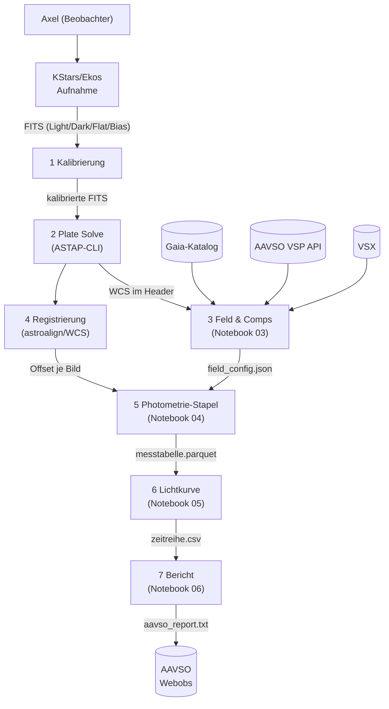
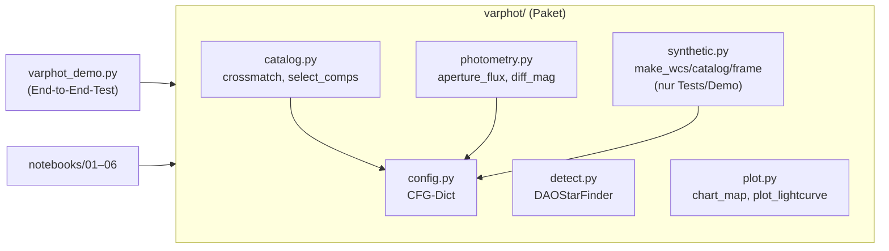

# Konzept: Differentielle Photometrie-Pipeline

**Projekt**: `photometrie-py`  
**Version**: 0.1 (2026-11-10)  
**Autor**: Axel Pospischil  
**Repo**: https://github.com/apos/photometrie-py

---

## 1. Grundlagen — warum dieses Projekt existiert

Ziel ist die Auswertung selbst aufgenommener FITS-Bilder zur Lichtkurvenbestimmung von
Veränderlichen Sternen (Fokus: Delta Cephei, Klasse Cepheid). Die Messungen sollen in das
AAVSO-Netz eingebracht werden. Siril deckt Kalibrierung und erste Sichtprüfung ab; alle
wissenschaftlichen Auswertungsschritte (Plate Solving, Comp-Auswahl, Aperturphotometrie,
differentielle Helligkeit, Lichtkurve, Periodensuche, AAVSO-Export) laufen in Python durch
reproduzierbare Jupyter-Notebooks.

**Aufbau**: Apo 80/540 (1,44″/px) oder C9.25/AP400 + QHY268M, Beobachtungsort Balkon.

---

## 2. Kontextabgrenzung (arc42 C1)



**Systemgrenzen**: FITS-Erzeugung (Ekos), Kalibrierung (Siril oder ccdproc), ASTAP-Binary
und alle externen Kataloge liegen außerhalb dieses Python-Projekts.

---

## 3. Bausteinsicht (arc42 C5)



| Modul | Aufgabe | Abhängigkeiten |
|---|---|---|
| `config.py` | Zentrales CFG-Dict; Ausgangspunkt für YAML-Config | — |
| `detect.py` | Quellendetektion via DAOStarFinder | astropy.stats, photutils |
| `catalog.py` | Crossmatch + Comp/Check-Auswahl mit QC-Flags | astropy.coordinates, config |
| `photometry.py` | Aperturphotometrie + Ensemble-Nullpunkt | photutils, config |
| `plot.py` | Sternkarte + 4-Panel-Lichtkurve | matplotlib, astropy.visualization |
| `synthetic.py` | Synthetische Testdaten (nur Demo/Tests) | numpy, astropy |

---

## 4. Laufzeitsicht / Datenfluss (arc42 C6)

```mermaid
flowchart LR
    FITS[/"FITS-Bilder\n(1 Nacht)"/] --> NB01["01 Kalibrierung"]
    NB01 --> KalFITS[/"kalibrierte\nFITS"/]
    KalFITS --> NB02["02 Plate Solve\n(ASTAP)"]
    NB02 --> WCS["FITS mit WCS\nim Header"]
    WCS --> NB03["03 Feld & Comps\n(Katalogabfrage)"]
    NB03 --> FC[/"field_config.json\nZiel · Comps · Check"/]
    WCS --> NB04["04 Photometrie-Stapel"]
    FC --> NB04
    NB04 --> MT[/"messtabelle.parquet\nje Bild & Stern"/]
    MT --> NB05["05 Lichtkurve\n& Periode"]
    NB05 --> ZR[/"zeitreihe.csv"/]
    ZR --> NB06["06 Bericht\n& AAVSO-Export"]
    NB06 --> REP[/"aavso_report.txt\nCSV"/]
```



**Prinzip**: Jede Stufe schreibt ein Zwischenergebnis, die nächste liest es. So ist jeder
Schritt einzeln wiederholbar, ohne die gesamte Pipeline neu starten zu müssen.

---

## 5. Querschnittliche Konzepte

### 5.1 Konfiguration

Alle Schwellen und Parameter liegen im zentralen `CFG`-Dict (`varphot/config.py`).
Nächster Schritt: ein pro-Ziel-YAML laden und über `CFG.update(yaml_data)` einmischen,
so dass dieselbe Pipeline für Delta Cephei und eta Aql unterschiedliche Aperturgrößen
verwenden kann.

```python
# Zukünftiges Muster (noch nicht implementiert)
import yaml
with open("config/delta_cep.yaml") as f:
    CFG.update(yaml.safe_load(f))
```

### 5.2 Qualitätstored (QC-Flags)

Bilder und Sterne fallen nicht stillschweigend aus der Pipeline. `select_comps()` gibt
für jeden verworfenen Kandidaten die Ablehnungsursache aus. Zukünftig: QC-Spalte in der
Messtabelle (`qc_flag`), damit jeder Ausschluss rekonstruierbar bleibt.

| QC-Grund | Bedeutung |
|---|---|
| `sat` | Peak > CFG['sat_adu'] — Sättigung oder Nichtlinearität |
| `edge` | Stern zu nah am Bildrand |
| `neighbor` | Nachbarstern im Aperturbereich |
| `bv` | B-V-Farbe zu weit vom Ziel entfernt |
| `var` | Als Veränderlicher (VSX) bekannt |
| `halo` | Im Halo des defokussierten Ziels |

### 5.3 Zeitstempel und BJD

`DATE-OBS` wird als Belichtungsbeginn interpretiert (nicht belegt; Header prüfen).
BJD_TDB-Umrechnung mit Beobachtungsort-Koordinaten via `astropy.time.Time` und
`astropy.coordinates.EarthLocation` — noch nicht implementiert; Priorität P1.

### 5.4 Fehlerrechnung

Aktuelle Implementierung: Poisson-Fehler (√Fluss). Für AAVSO-Einreichung benötigt:
Ausleserauschen + Hintergrundfehler + Szintillationsfehler (Young 1967). Priorität P1.

---

### 5.5 Gesättigte Ziele

**Reihenfolge der Mittel (Best Practice, soweit belegt):**
1. **Vermeiden:** defokussieren oder kürzer belichten, bis das Ziel im linearen Bereich bleibt (eigener Aufbau: defokussierte Apertur, `target_ap_r`). Standardempfehlung der Photometrie, hier nicht an einer Einzelquelle belegt (E).
2. **Ladungserhaltende CCDs:** Summe über eine Apertur, die die Bleed-Spur einschließt, bleibt linear — HST ACS Instrument Handbook §4.3 (F, Suchauszug: „… even when the central pixel is saturated by 10 times its full well depth"). Voraussetzung: kein Antiblooming, Spur nicht aus dem Bild heraus, Himmelsring frei von der Spur.
3. **Spur maskieren:** Pixel neben ≥ 3 gesättigten Pixeln entlang der Ausleserichtung markieren (KMTNet-Pipeline, arXiv:2607.09148, F).
4. **Halo-/Flügel-Photometrie:** nur die ungesättigten Pixel der PSF-Flügel verwenden (EVEREST/K2, arXiv:1702.05488; TESS, arXiv:2106.08341; F) — das Verfahren der Wahl, wenn die Spur zu lang ist oder der Verlust im Kern sitzt.
5. Gesättigte Sterne nicht als PSF-Vorlage benutzen (DECaPS2, arXiv:2206.11909, F: verfälschte die Photometrie eines ganzen CCDs).

**Hier angewendet (LCO δ Cep, 0,4 m, 1,3 s):** Mittel 2 half nicht — Aperturen bis 36 px (schließen die ~8 px lange Spur ein) änderten die Streuung nicht, der Verlust sitzt offenbar im
digital abgeschnittenen Kern (`SATURATE` 102 400 ADU; Schluss aus den Daten). Mittel 4 in Form einer **Kernmaske** (`core_r` = 1,5 px, Ringfluss mit dem Ringanteil ungesättigter Comps desselben Bildes hochgerechnet,
`light_curve(core_correct=True)`) halbierte die Reststreuung (0,129 → 0,068 mag) und beseitigte die Seeing-Abhängigkeit (Korrelation −0,69 → −0,07). Die Kombination ist eine **eigene Methode**; der Kernradius ist an diesen Daten gewählt (kleinstes Residuum),
die Modellamplitude hängt von ihm ab (0,75–0,99 mag bei 1,0–2,5 px, Literatur ~0,88). **Zu klären:** Antiblooming des LCO-Kameratyps (kb88), unabhängige Prüfung der Amplitude an einem zweiten gesättigten Datensatz.

## 6. Architektur-Entscheidungen (ADR)

### ADR-01: Aperturphotometrie vor PSF-Photometrie (2026-11-10)
**Kontext**: photutils bietet `IterativePSFPhotometry`. Für ein defokussiertes Ziel
(FWHM ~22 px) passt keine Standard-PSF.  
**Entscheidung**: Einstieg mit Aperturphotometrie; PSF-Option für zukünftige
fokussierte Felder offen halten.  
**Konsequenz**: Größere Apertur für das Ziel nötig; mehr Hintergrundrauschen.

### ADR-02: Paketstruktur `varphot/` + Notebooks (2026-11-10)
**Kontext**: Notebook-only-Ansatz führt zu Code-Duplikation zwischen Notebooks.  
**Entscheidung**: Wiederverwendbare Funktionen im Paket; Notebooks als dünne
Orchestrierungsschicht.  
**Konsequenz**: Notebooks können einfach ausgetauscht/erweitert werden; Paket
direkt per `import varphot` nutzbar.

### ADR-03: Eigene venv, getrennt von SORA/Astrometrie (2026-11-10)
**Kontext**: photutils-Versionen zwischen Projekten inkompatibel.  
**Entscheidung**: `.venv/` lokal im Projektordner, `requirements.txt` als Single
Point of Truth.

---

## 7. Installation und Verifikation

```bash
# Einmalig
/opt/homebrew/bin/python3.13 -m venv .venv
.venv/bin/pip install -r requirements.txt
```

**Verifikation** (erwartete Ausgabe in < 2 min):
```bash
.venv/bin/python varphot_demo.py
```
```
Comp-Auswahl: 30 Kandidaten verworfen (QC): …
Detektion: 46 Quellen, gematcht: 46, Comps: 8, Check: 19
Check-Stern: Soll V=8.903, Messung Mittel 8.9xx, Streuung 0.01xx mag
Lomb-Scargle Periode: 5.3xx d (Soll 5.366)
chart.png und lightcurve.png geschrieben.
```
Die eingebauten Assertions prüfen: ≥ 5 Comps, Check-Streuung < 0,05 mag, Periode ± 0,5 d.

**VSCode Kernel**: `.venv/bin/python` über *Python: Select Interpreter* auswählen.

---

## 8. Test-Strategie

| Was | Methode | Status |
|---|---|---|
| Gesamte Pipeline (synthetische Daten) | `varphot_demo.py` mit assert-Checks | ✅ Lokal getestet (M4, Python 3.13) |
| Einzelfunktionen | — | ❌ Noch keine Unit-Tests |
| Plate Solve (ASTAP) | Manuell mit echtem FITS | ❌ Nicht getestet |
| Katalogabfragen (Gaia/VSP) | Manuell, Mac + Netz nötig | ❌ Nicht getestet |
| Registrierung mit echten Bildern | Manuell | ❌ Nicht getestet |
| AAVSO-Export-Format | Manuell gegen Spezifikation | ❌ Nicht getestet |

Nächste Testprioritäten: Unit-Tests für `crossmatch` und `diff_mag`; Rauch-Test mit
einem echten FITS-Bild (Plate Solve + Sternkarte).

---

## 9. API-Referenz

### `varphot.detect(img, fwhm, nsigma)`
| Parameter | Typ | Default | Beschreibung |
|---|---|---|---|
| `img` | ndarray | — | 2D-Frame (ADU) |
| `fwhm` | float | 4.5 | Erwartete FWHM in Pixeln |
| `nsigma` | float | 8.0 | Erkennungsschwelle in σ |
**Rückgabe**: `(sources_table, median, std)`

### `varphot.crossmatch(src, cat, w, tol_arcsec)`
| Parameter | Typ | Default | Beschreibung |
|---|---|---|---|
| `src` | Table | — | Detektierte Quellen (photutils) |
| `cat` | Table | — | Referenzkatalog mit ra, dec, V, BV, var |
| `w` | WCS | — | Astropy-WCS des Referenzbilds |
| `tol_arcsec` | float | CFG | Matching-Radius |
**Rückgabe**: gefiltertes `src` mit Katalog-Spalten angehängt

### `varphot.select_comps(m, cat, w, cfg, target_id)`
**Rückgabe**: `(target_dict, comps_list, check_or_None)` — verworfene Kandidaten werden geloggt.

### `varphot.aperture_flux(img, xy, r_ap, r_in, r_out, cfg)`
**Rückgabe**: `(flux_array, err_array, bkg_array)` — Warnung bei Peak > `sat_adu`.

### `varphot.diff_mag(f_t, f_c, V_c, f_k)`
**Rückgabe**: `(mag_ziel, mag_check_or_nan, zp_scatter)`

---

## 10. Strategische Roadmap

Abhängigkeiten: **P0 blockiert P1; P1 blockiert P2.**

| Priorität | Aufwand | Thema | Abhängigkeit |
|---|---|---|---|
| P0 | S | Testbild plate-solven, Sternkarte über echtes FITS legen — **erledigt 2026-11-10** (M16-Testbild, NB02) | Mac + ASTAP + Testbilder |
| P0 | S | Comp-Auswahl für Delta Cephei mit VSP-Daten (Gaia/AAVSO) prüfen — **erledigt 2026-11-10** (`varphot/vsp.py`, NB03: 4 Comps rotationssicher, 7–8 bei bekanntem Kamerawinkel) | Netz + P0 oben |
| P0 | M | Notebooks 01–06 mit erstem echten Datensatz durchlaufen — **NB01–05 erledigt 2026-11-10** (LCO δ Cep V, 0m4-11, 98 brauchbare Bilder, Lichtkurve + LS-Periode 5,363 d, Residuum 0,07 mag mit Kernmaske für das gesättigte Ziel; NB06 offen) | P0 Plate Solve |
| P1 | M | BJD_TDB-Umrechnung mit Standort (Beobachterkoordinaten) — **erledigt 2026-11-10** (`varphot/timeutil.py`, Standort aus Header oder NB01) | P0 |
| P1 | M | Vollständiger Photometrie-Fehler (Poisson + RON + Szintillation) — **erledigt 2026-11-10** (CCD-Gleichung + Young-Szintillation; Gain/RON aus Header) | P0 |
| P1 | S | Pro-Ziel-YAML-Config laden (`config/delta_cep.yaml`) | P0 |
| P1 | M | Unit-Tests für `crossmatch` und `diff_mag` — `diff_mag` + `ensemble_mag` getestet 2026-11-10; `crossmatch` offen | P0 |
| P1 | L | Registrierung per `astroalign` mit echten Bildern verifizieren | P0 |
| P1 | M | Farbkamera: CFA-Kanäle (R, G, B) aus Roh-Bayer-Bildern extrahieren (Siril), Messtabelle je Kanal — siehe §11 | P0 |
| P2 | M | AAVSO Extended Format erzeugen und validieren (Filter `TG`/`TB`/`TR` bzw. `V`/`B`/`R` mit `TRANS`), Einreichen | P1 |
| P2 | L | Transformationskoeffizienten aus Standardfeld (M 67 / NGC 7790) für die Farbkamera; Export `TRANS=YES` — siehe §11 | P1 |
| P1 | M | **NB00 Planung und Probebilder** (Ziel, Methode, FWHM/Sättigung aus Probebildern, Plan) — **umgesetzt 2026-11-10** (`varphot/plan.py`, Demo-Modus; mit echten Probebildern steht aus) — siehe §12 | P0 |
| P1 | M | **NB07 Kamera-Charakterisierung** (Gain, Ausleserauschen, Linearität, Dunkelstrom je Bayer-Kanal) — **umgesetzt 2026-11-10** (`varphot/camera.py`, Demo-Modus mit bekannter Wahrheit getestet; Messung mit echten Ares-C-Bildern steht aus) — siehe §11.8 | P0 |
| P2 | L | **NB08 Transformationskoeffizienten** aus Standardfeld (`transform_<Kamera>_<Einstellung>.json`) — **umgesetzt 2026-11-10** (`varphot/transform.py`, Demo-Modus mit bekannter Wahrheit; mit echten Standardfeld-Aufnahmen steht aus; Anwendung in NB05/NB06 noch nicht eingebaut) — siehe §11.8 | NB07 |
| P2 | M | Beispieldaten One-Shot-Color beschaffen/aufnehmen (§11.9) | P1 |
| P2 | XL | PSF-Photometrie für fokussierte Felder (photutils PSFPhotometry) | P1 |
| P2 | L | Spektren-Auswertung SHG 700 (Neon-Kalibrierung) | eigenes Notebook |

**Offene Klärungen (blockieren P0)**:
- ~~Beobachtungsort-Koordinaten für BJD und Luftmasse~~ — erledigt 2026-11-10: NB01 Abschnitt 0 (Picker, lokal gespeichert, nicht im Repo)
- ~~AAVSO-Beobachtercode~~ — erledigt 2026-11-10: vorhanden, NB01 Abschnitt 0 (lokal gespeichert)
- Mac-Modell/macOS-Version für ASTAP-Freigabe (Apple Silicon Signing)


---

## 11. Farbkamera (One-Shot-Color, z. B. Player One Ares-C Pro): Siril, Transformation, AAVSO

Stand 2026-11-10. Prüfstatus der Quellen (§11.10): **G** = gelesen (Wortlaut), **F** = nur Suchauszug/Forumsaussage, **E** = aus dem Gedächtnis.
Nichts davon ist implementiert — dies ist das Konzept.

### 11.1 Ziel

Die Pipeline (bisher Monochrom-Bilder in V, LCO) soll Roh-Bayer-Aufnahmen einer Farbkamera auswerten und **AAVSO-konform** liefern.
Unterschiede zur Monochrom-Kamera: (1) der Stern liegt in R, G und B auf *verschiedenen Pixeln* (Bayer-Muster), (2) die Kanalempfindlichkeiten weichen von Johnson
B/V/R ab, (3) alle drei Farben entstehen im selben Bild — die Farbe des Sterns ist je Bild messbar.

### 11.2 Was AAVSO verlangt

- **Filtercodes `TG`, `TB`, `TR`** (G, Extended Format v1.2): „commonly the green-/blue-/red-channel in a DSLR or color CCD camera". `TG` nutzt **V-Band-Vergleichssterne**, `TB`
  **B-Band**, `TR` **R-Band**. Unsere V-Comps (VSP, Gaia) passen für `TG`; für `TB`/`TR` brauchen wir B- bzw. R-Magnituden der Comps.
- **Das Feld `FILTER` bezeichnet das Durchlassband des gemeldeten *Ergebnisses*, nicht den physischen Filter** (G, Forum 2022, Antwort eines erfahrenen Beobachters). Deshalb:
  untransformiert → `TG`/`TB`/`TR` mit `TRANS=NO`; **transformiert → `V`/`B`/`R` mit `TRANS=YES`**.
- **AAVSO-Mitarbeiter (G, Forum „Reporting Photometric Magnitudes", 2022):** „Yes, DSLR images can and should be transformed to J/C and reported as J/C"
  (George Silvis). Geplante Benennung der Koeffizienten, z. B. `tgTv_bv` = Transformation der `TG`-Instrumentalwerte auf Johnson V. Zusätzliche Angaben in `NOTES` sind erwünscht.
  Bedingungen eines Beobachters, die dort unwidersprochen blieben (Gary Hawkins, OSC-CMOS, RMS 0,04–0,06 mag): Ziele mit **(V−R) < 1**, **mindestens 4 Comps**.
  Ken Menzies: `TG` → V transformiert gut für die meisten Sterne, `TB`/`TR` schlechter (Emissions-/Absorptionslinien farbiger Sterne); Empfehlung: Standardfeld aufnehmen und
  `TR` (untransformiert) gegen `R` (transformiert) für sehr blaue/rote Comps vergleichen. Bei Sternen mit starken Emissions-/Absorptionsbändern `TB`/`TG`/`TR` melden.
- **`OBSTYPE`:** Die Format-Seite (G) sagt „If you use a CMOS camera please report it as CCD“; das Handbuch (G, §6.7) verlangt für Dateien mit DSLR-Daten „Be sure that the ‚OBSTYPE‘ in that output file is set to DSLR“ und nennt
  `TG`/`TB`/`TR` ausdrücklich als Kennzeichen für „DSLR (and one shot color CCD) photometry“ (§6.2.3); die Zusammenfassung im Forum-Thread (G, Hawkins, 2022) nennt für **OSC-CMOS `OBSTYPE=DSLR`**.
  **Entscheidung (vorläufig):** Farbkamera → `OBSTYPE=DSLR`, in `NOTES` „OSC CMOS camera, Bayer RGGB, green channel“; die Lücke (Handbuch kennt OSC-CMOS nicht namentlich) vor der ersten Meldung bei der AAVSO bestätigen lassen.
- **Datum:** nur `JD`, `HJD` oder `EXCEL` (G), Mittenzeit in UT — **BJD_TDB nicht vorgesehen**: Export mit UTC-Mitte als JD; BJD_TDB bleibt der Auswertung vorbehalten.
- **Weitere Felder (G):** `#TYPE=Extended`, `#OBSCODE`, `#SOFTWARE`, `#DELIM`, `#DATE`, `#OBSTYPE`; je Zeile `MTYPE=STD`, `CNAME` (bei Ensemble `ENSEMBLE`, `CMAG=na`), `KNAME`/`KMAG`
  (Check-Stern, nicht im Ensemble), `AIRMASS`, `CHART` (VSP-Sequenz-ID; bei eigenen Comps Kommentarcode K „non-AAVSO chart", Comps in `NOTES`), `NOTES` mit Unterfeldern (`|VMAGINS=…|Tv_bv=…`).
- **IR-Sperrfilter:** Ohne UV/IR-Sperrfilter leckt IR in die Kanäle (F, Forum 2023); rote Sterne erscheinen dann deutlich zu hell. Der Aufbau gehört in die `NOTES`.
- **AAVSO DSLR Observing Manual, Version 1.4** (G; © 2016 AAVSO, ISBN 978-1-939538-07-9; Redaktion M. Blackford, Kap. 6 Kloppenborg & Henden; gelesen: Kap. 4–6, Anhang A und E). Wichtigste Regeln:
  - **Standardisierte Magnitude** (§6.2.3): „Standardized Mag ≈ Δmag + C_catalog“ (Gl. 6.7–6.10); `TG` = Grünkanal mit dem Katalog-V des Comps, `TB` Blaukanal mit B, `TR` Rotkanal mit R. Das ≈ steht dort, weil die Kanäle nicht exakt Johnson/Cousins sind.
  - **Ensemble-Eintrag** (§6.7): „ensemble“ im Comp-Label, „na“ als Comp-Mag; im Check-Mag-Feld die *transformierte* (nicht instrumentelle) Magnitude. Mehrere Farben desselben Bildes: gleiche `GROUP`-Nummer.
  - **Comps** (§6.3.1): AAVSO-Sequenzen bevorzugen; (B−V) zwischen +0,3 und +1,0 (Mittel 0,7), keine roten/sehr blauen Sterne, ähnliche Helligkeit wie das Ziel, keine Begleiter, **S/N ≥ 100**, ähnliche Fehler (< 0,01–0,02 mag), nicht nahe der Sättigung. Katalogquellen für Sterne ohne Sequenz: Mermilliod-UBV (II/168), SeqPlot (APASS, Tycho-2, GCPD).
  - **Sättigung/Linearität** (§4.5.2): alle Sterne (Ziel, Comps, Check) unter **75 % des Maximalwerts** halten (14 bit: ≈ 12 300 ADU); „impossible to obtain meaningful photometry of the saturated star“. Linearität selbst testen (Anhang E).
  - **Abtastung** (§5.5.1): FWHM der Sterne im Rohbild (vor Kanaltrennung) **≥ 8–10 Pixel**, damit jeder der vier Bayer-Kanäle gut abgetastet ist; zu scharfe Sterne erzeugen Kanalschwankungen durch die Pixelfarbe unter dem Zentroid (Beispiel V1369 Cen).
  - **Kanaltrennung** (§5.4): „The best procedure is to extract both green channels, average them together, and perform photometry on the resulting image“; Trennung vor oder nach der Kalibrierung ist gleichwertig, solange alles gleich behandelt wird. Aperturradius = 1,2–1,5 × FWHM des größten Sterns (§6.1.1), Himmelsring mit mindestens so vielen Pixeln wie die Apertur.
  - **Dunkelbilder** (§4.4.2): „Classical dark correction“ (mindestens 16 Darks bei gleichen Einstellungen) empfohlen; belichtungsskalierte Darks nicht für Canon/Nikon-RAW — für andere Kameras testen (→ NB07).
  - **Nicht transformieren** bei Sternen mit starken Emissions-/Absorptionslinien (Nova V1369 Cen: transformiertes R 0,43 mag zu schwach, B +0,15, V +0,07 mag zu hell) — dann nur `TB`/`TG`/`TR` melden. Für geeignete Sterne (E1-Standardsterne, 15 Stück): transformiertes V innerhalb 0,02 mag des Katalogs, Präzision < 10 mmag (Tab. 6.1).

### 11.3 Rolle von Siril — und warum seine Lichtkurve die Transformation nicht ersetzt

Siril liefert die **Eingangsbilder**; unsere Pipeline rechnet.
1. **Kalibrierung im CFA-Bereich (ohne Debayern):** Bias/Dark/Flat auf den Roh-Bayer-Bildern. Debayern interpoliert zwischen Nachbarpixeln verschiedener Farben und verfälscht Flüsse.
   (E: Optionen wie `-cfa`/`-equalize_cfa` bei `calibrate` aus dem Gedächtnis, gegen die Siril-Doku prüfen.)
2. **Kanaltrennung:** *Split CFA* (vier Einkanalbilder R, G1, G2, B, je halbe Auflösung) oder *Extract Green* (mittelt die zwei Grün-Pixel: weniger Rauschen, halbierte Auflösung) — F, Siril-Doku „Split Channels".
3. **Danach NB02–NB05 je Kanal** (ASTAP auf dem Kanalbild; Pixelskala des halbierten Rasters beachten).

**„Sirils Lichtkurve ersetzt die Transformation nicht" — Erklärung:** Sirils `light_curve` (G, Siril-Doku) rechnet rein *differentiell*: `V_std = (V_ins − C_ins) + C_std`, also
Ziel minus Vergleichsstern plus Katalogwert des Vergleichssterns. Das stimmt nur, wenn das Instrument Ziel und Comp *gleich* behandelt — also gleiche Farbe oder ein exakt passender Filter.
Der Grün-Kanal einer Bayer-Kamera ist aber nicht Johnson V; die Abweichung hängt von der **Farbe** ab. Beispiel aus der Literatur (Canon EOS 500D, OEJV 2023; Steigung ≈ −0,08 mag je mag (B−V),
§11.5): ein Ziel mit 0,5 mag anderem (B−V) als der Comp wäre um ~0,04 mag falsch — mehr als die 0,01–0,03 mag Streuung, die man sonst erreicht. Die Transformation misst diese Steigung an einem
Standardfeld und rechnet sie heraus. Siril kann das nicht (die Doku erwähnt keine Farbterme), taugt also als **Gegenprobe der untransformierten `TG`-Werte**, nicht als Weg zu `V` mit `TRANS=YES`.

### 11.4 Ablauf in der Pipeline (Entwurf)

1. **Aufnahme:** Roh (CFA, FITS, 16 Bit), UV/IR-Sperrfilter im Strahlengang, **defokussiert auf FWHM ≥ 8–10 px im Rohbild** (Handbuch §5.5.1), Sterne unter 75 % des Maximalwerts, Darks zur Belichtung (klassisch); **Standardfeld** (M 67 / NGC 7790) bei mehreren Luftmassen für die Koeffizienten.
   Darks zur Belichtung; **Standardfeld** (M 67 / NGC 7790) bei mehreren Luftmassen für die Koeffizienten.
2. **Siril:** Kalibrieren (CFA), Kanäle trennen → je Kanal ein Mono-FITS mit gleichen Zeitstempeln.
3. **Pipeline je Kanal** (Apertur, Ensemble) → instrumentelle Magnituden `r`, `g`, `b` derselben Sterne.
4. **Ohne Koeffizienten:** `TG`/`TB`/`TR`, `TRANS=NO`, `MTYPE=STD`, Comps im jeweiligen Band.
5. **Mit Koeffizienten:** Transformation (§11.5) → `V` (optional `B`, `R`), `TRANS=YES`, Koeffizienten in `NOTES`.

### 11.5 Transformation auf Johnson/Cousins (G: AAVSO DSLR Observing Manual §6.5–6.6; Variante Kamenec 2023)

**Handbuch (maßgeblich), Gl. 6.11–6.14 — enge Felder, Differenzextinktion vernachlässigbar** (alle Größen differentiell gegen den Comp; Δb = b_var − b_comp usw.):

```
B_var = Δb + Tb_bv · Δ(B−V) + B_comp
V_var = Δv + Tv_bv · Δ(B−V) + V_comp          (v = Grünkanal)
R_var = Δr + Tr_bv · Δ(B−V) + R_comp
Δ(B−V) = Tbv · Δ(b−v)                           (Δ(B−V) = Katalog-(B−V) des Ziels minus des Comps)
```

Koeffizienten aus einem Standardfeld (Gl. 6.15–6.18): `(b−v) = 1/Tbv · (B−V) + ZP` (Tbv = Kehrwert der Steigung); `(B−b) = Tb_bv·(B−V) + ZP_b`, `(V−v) = Tv_bv·(B−V) + ZP_v`,
`(R−r) = Tr_bv·(B−V) + ZP_r` (Steigungen). Die „normale Praxis“ war, nur Gl. 6.12 mit Katalog-(B−V) zu nutzen; das ist bei **Veränderlichen, die ihre Farbe ändern** (δ Cep!) systematisch falsch.
Besser: Δ(B−V) aus den instrumentellen Kanälen (Gl. 6.14), also Blau- und Rotkanal mitzutransformieren. Für **weite Felder/große Zenitdistanz** kommt ein Extinktionsterm hinzu (Gl. 6.19–6.21, `−k·ΔX`);
die Ebenenanpassung `(V−v) = −kv·X + Tv_bv·(B−V) + ZPv` (Gl. 6.22–6.25, Citizen-Sky-Verfahren, Kloppenborg et al., JAAVSO 40, 2012) braucht **mindestens 3, empfohlen ≥ 6 Comps**. Das Handbuch liefert dazu eine Auswertetabelle
(<https://www.aavso.org/dslr-camera-photometry-guide>, „Additional Material“). Bei kleinem Feld (Ares-C Pro an 540 mm: ~1,2°) und Zenitnähe gelten Gl. 6.11–6.14.

**Variante Kamenec (OEJV 2023, Canon EOS 500D; Gleichungen gelesen)** nach Benson 1998 und Henden & Kaitchuck 1982: gleiche Struktur, aber andere Koeffizientendefinition (z. B. `V1 = V2 + Δg + T_g·T_bg·Δ(b−g)`,
`T_bg` = Steigung (B−V) gegen (b−g)); Ergebnis Melotte 111: mittlere Abweichung transformiert − Katalog **B 0,113, V 0,019, Rc 0,032 mag** — Grün gelingt am besten, Blau am schlechtesten. *Werte einer Canon, nicht der Ares-C.*

**Alternative/Gegenprobe ohne Standardfeld (F; Software GPL-3.0, nur gelesen):** `astronomyk/seestar_photometry` kalibriert Bayer-Ebenen auf **Gaia-DR3-synthetisches Johnson V** (`V = m_inst + ZP + k·(B−R)` auf der Grünebene).
Dessen Doku misst für die Seestar S50: `G_S50` 8 nm von Johnson V, `R_S50` 4 nm von Sloan r, `B_S50` 60 nm rot von Johnson B — dieselbe Reihenfolge wie bei Kamenec. Die Gaia-Synthese reproduziert Gaias `v_jkc_mag` mit 8,2 mmag Streuung
(231 924 Sterne). Für die Ares-C bräuchte man die absolute Kanalempfindlichkeit samt Sperrfilter; die Relativkurve der Herstellerangabe (§11.6) liegt nur als Bild vor.

### 11.6 Player One Ares-C Pro (IMX533) — Herstellerangaben (G: Ares-C Pro Camera Manual V1.0, Dec 2024) und Folgen

| Größe | Wert (Hersteller) | Folge für die Photometrie |
|---|---|---|
| Sensor / Pixel | Sony IMX533, 1″-Quadrat 11,31 × 11,31 mm, 3008 × 3008, 3,76 µm, Bayer **RGGB** | Feld bei 540 mm Brennweite ≈ 1,2° × 1,2°; Grünebene 1504 × 1504 (halbe Auflösung) |
| ADC | **14 bit** (Ausgabe als RAW16; 10 bit alternativ) | Sättigung bei 16 383 ADU *oder* ×4 skaliert 65 532 — im FITS prüfen (`SATURATE` setzen, NB01) |
| Systemgain (Hersteller-Diagramm) | 4,47 e⁻/ADU bei Gain 0 → ≈ 1,1 bei Gain 120; „HCG öffnet bei Gain 125" (Sprung) | Gain-Modus festlegen und **selbst messen** (NB07) |
| Ausleserauschen | 4,46 e⁻ (Gain 0, LRN) … 1,0 e⁻ (hoher Gain); Sprung bei Gain 125 (normal: 3,18 → 1,49 e⁻) | bei Himmelsrauschen-dominierten Feldern unerheblich (AAVSO-Forum, s. u.) |
| Full Well | 73 269 e⁻ (Gain 0, normal) / 72 889 e⁻ (LRN) | 72 889 / 4,449 = 16 383 → die A/D-Grenze, nicht die Pixeltiefe, begrenzt (Forum) |
| Dunkelstrom | 0,000044 e⁻/s/Pixel bei −20 °C; 0,000996 bei 0 °C | vernachlässigbar bei gekühlten Aufnahmen; Darks trotzdem nötig (Muster/Hotpixel) |
| Fenster | „D32×2 mm High Quality AR Plus (Anti Reflection) Multi-Layer Coating" — **kein IR-Sperrfilter genannt** | **UV/IR-Sperrfilter im Strahlengang nötig**; Relativ-QE aller drei Kanäle reicht bis 1000 nm (bei 850 nm Rot ~0,4, Grün/Blau ~0,35) |
| Verschluss | Rolling Shutter | Belichtungszeit ≥ einige Sekunden; Zeitstempel = Mitte der Zeile 0? (prüfen) |
| Relative QE | Blau-Peak ~465 nm, Grün ~530 nm, Rot ~610 nm (nur Bild) | Kanal ↔ Johnson: Grün ≈ V (nah), Blau/Rot breit |

Modell: **Ares-C Pro mit Kühlung** (vom Nutzer bestätigt 2026-11-10); die Herstellerangaben oben gelten genau für dieses Modell (Pro: 73 ke⁻, Basis-IMX533: 50 ke⁻ laut Handbuch).
AAVSO-Forum „Player One IMX533 settings" (G, 2023/24, Mono-Version): ein Beobachter empfiehlt Gain 0 im LRN-Modus (kein Nachteil), warnt aber: „A number of observers have discovered that their actual camera behavior deviated in some significant ways from
the vendor curves" und fand eine nichtlineare Zählrate unter ~2000 ADU (+25 % ADU/s bei 500 ADU) — **Linearität selbst messen**.

### 11.7 Gaia als Referenz? Quantitative Prüfung gegen die AAVSO-Sequenz

AAVSO (VSP/APASS/Landolt) ist die Referenz des Johnson-Cousins-Systems; Gaia ist ein anderes System (G, BP, RP), das erst transformiert wird. Prüfung im Feld von δ Cep
(`tools/compare_gaia_vsp.py`; 31 VSP-Sterne V = 6…11, Gaia-Treffer ≤ 2″; Differenz *Gaia minus VSP*):

| Gaia-Größe | n | Mittel | Streuung | max |
|---|---|---|---|---|
| V aus G und BP−RP (Polynom, σ_Doku = 0,030) | 31 | +0,009 | 0,029 | 0,067 |
| synthetisches V (Gaia-XP, `v_jkc_mag`) | 31 | +0,018 | 0,030 | 0,087 |
| synthetisches B (`b_jkc_mag`) | 31 | −0,005 | 0,043 | 0,098 |
| synthetisches R (`r_jkc_mag`) gegen VSP-Rc | 17 | **+0,045** | 0,050 | 0,143 |

Für V > 10 liegen die Gaia-Werte überwiegend 0,02–0,07 mag zu schwach. **Folgerung:** (1) Gaia ist für **Auswahl und Prüfung** der Comps (Nachbarn, Variabilität, RUWE, V-Konsistenz) hervorragend, für
**gemeldete Magnituden** aber nur ein Notbehelf mit 0,03 mag (V) bis ≥ 0,05 mag (R, mit Systematik) Unsicherheit — in das Fehlerbudget aufnehmen. (2) Für AAVSO-Meldungen **VSP-Comps vorziehen**; Gaia-Comps nur mit Kennzeichnung
(Kommentarcode K, `NOTES`). (3) `TR` braucht R-Comps aus der VSP (Rc), nicht aus Gaia-XP (Systematik +0,045 mag). (4) Rote Sterne (BP−RP > 1,5) sind unsicherer (Check-Stern am LCO-Satz: +0,15 mag).

### 11.8 Kamera-Kalibrierung: eigene Notebooks (Entwurf)

Ja — Kamera-Charakterisierung und Transformationskoeffizienten gehören **nicht** in die Beobachtungsnotebooks, sondern in eigene, seltener laufende Notebooks, deren Ergebnis als „Kameraprofil" in
`PHOTOMETRIE_PY_DATA/` (neben `observer.json`) liegt und von NB04/05 gelesen wird:

- **NB07 Kamera-Charakterisierung** (umgesetzt: `notebooks/07_kamera_charakterisierung.ipynb`, `varphot/camera.py`; Hardware, pro Gain-Modus): Gain und Ausleserauschen aus Flat-/Bias-Paaren (Photon-Transfer-Kurve), Linearität aus Flats steigender Belichtung (Abweichung von der Geraden, Verfahren nach Handbuch Anhang A und E (G): Maximalwert und Offset aus Über-/Nullbelichtung, Gain/Ausleserauschen/Full Well aus Bias-, Dark-, Flat-Paaren je Einstellung; **Rausch-Kenngrößen an einer einzelnen Farbebene (R, B oder G1) messen, nicht am gemittelten Grün** (das hat kleinere Streuung und verfälscht Gain/RN); Linearität aus Belichtungsreihe (2, 4, 6 … s, je dreimal): Zählrate (ADU/s) gegen Belichtung, Residuum in % — linearer Bereich dort, wo das Residuum ≈ 0 ist; Belichtungen unter ~10 s können durch die reale Verschlusszeit abweichen (Rolling Shutter der Ares-C beachten).
  Sättigungsgrenze in ADU), Dunkelstrom gegen Temperatur, Bittiefe/Skalierung der FITS; je Bayer-Kanal. Ausgabe: `Camera` (Gain, RN, Dunkelstrom, Linearität, `SATURATE`) → NB01, NB04.
- **NB08 Transformationskoeffizienten** (umgesetzt: `notebooks/08_transformation.ipynb`, `varphot/transform.py`; Katalog: **AAVSO-Standardfelder direkt per Programm** (`fetch_std_field`: VSP-Schnittstelle mit `special=std_field`, ohne Anmeldung; M 67 190 Sterne, NGC 7790 178, M 11 415, NGC 3532 226, NGC 1252 22, Melotte 111 85; Liste der AAVSO: <https://www.aavso.org/apps/vsd/stdfields>), eigene CSV (`id, ra, dec, B, V, R`) oder die VSP-Sequenz des Zielfeldes (wenige Sterne); Gaia ist als Katalog gesperrt (§11.7); Ablauf: Messtabellen je Kanal → mittlere instrumentelle Magnituden mit Bildnullpunkt-Abzug → Geraden (Sigma-Clipping) → Leave-one-out-Gütetest → Entscheidung `TG`/`V` je Band): (Aufbau aus Kamera + Filter + Optik): Standardfeld-Bilder (M 67/NGC 7790) → je Kanal instrumentelle Magnituden → Regressionen aus §11.5 → `T_bg`, `T_gr`, `T_b`, `T_g`, `T_r` mit Fehlern,
  Gütetest (Abweichung transformiert minus Katalog), Gültigkeit ((V−R) < 1). Ausgabe: `transform.json` (mit Datum, Aufbau). Neubestimmung bei jeder Änderung des Aufbaus.
- Die AAVSO-Hilfsmittel *Transform Generator* (Python, G. Myers) und *TransformApplier* (jetzt in VPhot) sind Referenz zum Gegenrechnen (F).

### 11.9 Beispieldaten (nichts davon geladen; Lizenz und Freigabe vor dem Laden, siehe docs/entwicklung.md §2a)

| Kandidat | Inhalt | Stand |
|---|---|---|
| `astronomyk/seestar_photometry`, Beispieldaten (GitHub-Release `example-data-v1`, ~18 MB) | Seestar S50 (Bayer): drei Stacks und **fünf rohe 20-s-Bayer-Subs**, 1000 × 1000 Ausschnitte, Feld MW Cam, dazu Gaia-Tabelle mit synthetischem V; WCS-Sidecars | gelesen (README/Doku, G); Lizenz: Repo GPL-3.0 (laut GitHub), Daten-Lizenz nicht separat ausgewiesen → vor dem Laden klären |
| AAVSO-Forum „Examples: doing photometry with the Zwo Seestar S50" | T CrB, `TG` aus Seestar-FITS: 10 × 10 s gemittelt → ~0,01 mag; Phoranso-Workflow (Grün-Kanal, `FILTER`=V setzen, im Bericht V durch TG ersetzen); **VPhot zerlegt Farb-FITS in TB/TG/TR** (Teleskopprofil mit Plate Scale und Zuordnung TB, TG, TR → B, V, R) | gelesen (G); keine Dateien |
| AAVSO-Forum „Seestar public fit files" / Cloudy Nights | informelle Sammlung | nur gefunden (F) |
| Kamenec, OEJV 2023 (Canon EOS 500D, Melotte 111, V0523 Cas, XX Cyg, V0799 Aur) | Methode + Koeffizienten; Daten nicht bereitgestellt | gelesen (G) |
| LCO δ Cep in B (16) und r′ (86) | Monochrom, aber echte Wahrheit für die Transformationskette | Abfrage vorhanden, nicht geladen; Bedingungen wie `lco-dcep` (CC BY-NC 4.0) |
| Eigene Ares-C-Aufnahmen (M 67/NGC 7790, δ Cep defokussiert) | Koeffizienten und Validierung — der eigentlich nötige Satz | zu planen |

Warnung (F): Seestar-Firmware seit 08/2025 soll nichtlineare FITS erzeugen (BAA-VSS-Diskussion) — Linearität vor Nutzung prüfen.

### 11.11 Weitere Kamera: Panasonic Lumix S9 (Vollformat, spiegellos)

Die Pipeline und NB07 unterstützen mehrere Kameras über **Vorlagen** (`varphot/camera_presets.py`: Ares-C Pro, Lumix S9, „Eigene Kamera“); Messprofile werden je **Modell und Einstellung** (Gain-Modus bzw. ISO) gespeichert (`observer.json`, Liste `cameras`; NB01 wählt die aktive Kamera).
Prüfstatus: G = Panasonic-Spezifikation gelesen (<https://help.na.panasonic.com/answers/features-and-specifications-lumix-s-series-model-dc-s9k/>, 2026-11-10), F = Testberichte (Newsshooter, DPReview-Suchauszug), E = Annahme/abgeleitet.

| Größe | Wert | Status | Folge |
|---|---|---|---|
| Sensor | 35-mm-Vollformat-CMOS, ≈ 24,2 MP effektiv (25,3 MP gesamt) | G | gleicher Sensor wie Lumix S5 II laut Testberichten (F) |
| Ausgabe (L, 3:2) | 6000 × 4000 px | G | Ebenen je 3000 × 2000 px; Grünebene beide Grün gemittelt |
| Pixelabstand | ≈ 5,93 µm (35,6 mm / 6000 px) | E | nicht amtlich; Sensorbreite aus einem Testbericht |
| Formate | JPEG und RAW; **RAW-Bittiefe nicht angegeben** | G | Bittiefe wird in NB07 aus dem Maximalwert abgeleitet; ein Blog nennt 12 Bit im elektronischen Modus (F, unbestätigt) |
| Verschluss | **nur elektronisch** (kein mechanischer genannt); längste Belichtung ca. 60 s, über ISO 1600 kürzer | G | Rolling Shutter: nicht sehr kurz belichten; Zeitstempel = Mitte der Belichtung (Zeilenversatz prüfen); max. ~60 s |
| ISO | 100–51 200 (erweitert 50–204 800); Dual Native ISO 100/640 (Standard-Aufnahme) | G / F | **je ISO ein eigenes Profil** (mindestens ISO 100 und 640) |
| Stabilisierung | 5-Achsen-Sensor-Shift, Dual I.S.2 | G | für Photometrie aus (Annahme E) — auch Objektivstabilisierung |
| Bayer-Muster | RGGB (übliche Annahme) | E | an den Ebenen bzw. `BAYERPAT` prüfen |
| IR-Sperrfilter | nicht in der Spezifikation genannt; **Kamera im Originalzustand (nicht astro-modifiziert), vom Nutzer bestätigt 2026-11-10** | G (Nutzer) | Werkseitiger Sperrfilter vor dem Sensor ist anzunehmen (E); die Kanalbänder bleiben dadurch auf das sichtbare Licht begrenzt, Transformation nach §11.5 ist sinnvoll möglich |
| Gain, Rauschen, Full Well | keine Herstellerangaben gefunden | ? | messen (NB07) |

**Einordnung AAVSO (G, DSLR-Handbuch v1.4, Kap. 1–6):** Spiegellose Kameras laufen dort unter „DSLR / Mirrorless Cameras“; Auswertung wie in §11.2–11.5 (Grünkanal `TG`, ggf. Transformation, `OBSTYPE=DSLR`).
**Arbeitsablauf:** RAW (RW2) → Siril `convertraw` **ohne** `-debayer` (`tools/siril_convert_raw.ssf`; nach der Doku, nicht mit einer RW2-Datei getestet) → FITS (CFA) → NB07 je ISO → Beobachtungsbilder wie §11.4. Nach der Wandlung prüfen: `EXPTIME`/ISO in der Kopfzeile (die Siril-Doku nennt die Übernahme nicht),
`BAYERPAT`, Bildmaxima. Ungekühlt: Darks bei gleicher Sensortemperatur (Handbuch §4.4.2.3: Darks vor und nach der Serie), **keine** belichtungsskalierten Darks, ohne Test (dort für Canon/Nikon belegt). Langzeit-Rauschminderung der Kamera ausschalten (Handbuch §4.4.2.2: „in-camera long exposure noise reduction … should be disabled“).
**Zu prüfen bei RAW-Daten:** komprimierte/„companded“ RAW-Formate zeigen Lücken im Histogramm (nicht jeder ADU-Wert kommt vor) — würde Gain und Rauschen verfälschen; im Flat-Histogramm nachsehen. Seit 2026-11-10 Teil von NB07 (Schritt 3b, `histogram_gaps`; an echten Kameradaten noch nicht geprüft).

### 11.12 Mono-Kamera mit RGB-Filterrad (QHY268M) statt Bayer-Kamera?

**Ja, das geht — mit derselben Methode.** Das AAVSO-Extended-Format kennt `TB`/`TG`/`TR` ausdrücklich auch für „Astroimaging B/G/R filter“ (G, Format-Seite v1.2: „TG: Green Filter (or Tri-color green) … or Astroimaging G filter. These observations use V-band comp star magnitudes“; TB mit B-, TR mit R-Comps).
Die AAVSO-Forum-Zusammenfassung (G, Thread „Reporting Photometric Magnitudes“) zählt „CMOS mono with RGB filters“ zu „DSLR“: `OBSTYPE=DSLR`, untransformiert `TB`/`TG`/`TR` mit `TRANS=NO`, transformiert `B`/`V`/`R` mit `TRANS=YES` nach den Gleichungen des DSLR-Handbuchs §6.5 (NB08).
Für die Pipeline sind die drei Filterbilder die drei Kanäle `b`, `g`, `r` (Methode `monorgb` in NB00): **keine** CFA-Trennung, NB04 je Filter-Bildsatz, NB08 mit den drei Messtabellen, NB05/NB06 wie bei der Farbkamera.

| | Bayer-Kamera (Ares-C Pro, Lumix) | Mono (QHY268M) + RGB-Filter |
|---|---|---|
| Auflösung/Empfindlichkeit | je Kanal halbe Auflösung, nur ein Teil der Pixel | volle Auflösung, volle Empfindlichkeit je Filter |
| Abtastung | Rohbild-FWHM ≥ 8–10 px nötig (Handbuch §5.5.1) | entfällt (nur Sättigung/Fokus nach NB00) |
| Farbe | alle Kanäle **im selben Bild** (Farbindex je Bild) | **drei Aufnahmen nacheinander**: Farbindex aus zeitlich versetzten Bildern; bei Veränderlichen (δ Cep ändert (B−V) mit der Phase) Aufnahmen eng gruppieren und die Phasenänderung beachten |
| Zeit/Aufwand | eine Belichtung | drei Belichtungen + Filterwechsel; GROUP-Nummer je Dreiersatz |
| Filterbänder | festes Bayer-Muster, breite Bänder | RGB-Astroimaging-Filter: breit, Durchlass je Hersteller verschieden; **IR-Leck prüfen** (viele RGB-Filter sperren IR nicht, ein IR-Sperrfilter ist nötig) |

**Besser noch:** Das README nennt für die QHY268M einen **Johnson-Cousins-Satz (Baader Bessel B, V, Rc, Ic)**. Der liegt den Standardbändern näher als jedes RGB-Set; Aufnahmen damit gelten als `CCD` mit Filter `B`/`V`/`R` (laut Forum-Zusammenfassung dort `TRANS=NO`, auch wenn nach dem CCD-Guide Kap. 6 gerechnet wurde — widersprüchlich diskutiert, Ken Menzies im Thread: bei eigener Transformation `TRANS=YES`; bei der AAVSO klären).
Empfehlung: Hauptdaten mit dem Bessel-V-Filter (Lichtkurve, wie der LCO-Test), RGB nur zusätzlich (Farbindex, Gegenprobe der Bayer-Kameras). Koeffizienten gelten **je Aufbau** (Kamera + Filtersatz + Optik) — auch für das RGB-Rad eigene Koeffizienten bestimmen (NB08, Standardfeld).
**Offen:** Welche RGB-Filter genau (Hersteller, IR-Sperre)? NB07 für Mono wertet vier verschachtelte Teilbilder aus (geht für Gain/Rauschen).

### 11.13 Export (NB06) und Kanaltrennung

**AAVSO-Export** (`varphot/aavso.py`, `notebooks/06_bericht.ipynb`): schreibt das Extended Format v1.2 (Parameter, 15 Felder, `ENSEMBLE`, JD der Belichtungsmitte, `GROUP`) und **prüft es vor dem Hochladen** gegen die Regeln der Format-Seite (Beispiele der AAVSO als Tests); die Datei wird nur bei fehlerfreier Prüfung geschrieben (`PHOTOMETRIE_PY_DATA/exports/`), ein Upload findet nicht statt.
Testdaten fremder Beobachter (LCO) werden mit Code `TST01` und dem Dateinamenszusatz `_TESTDATEN_NICHT_EINREICHEN` geschrieben — **nie unter dem eigenen Code**. Transformierter Export (`V`/`B`/`R`, `TRANS=YES`) nur, wenn der Gütetest aus NB08 für das Band bestanden ist; sonst `TG`/`TB`/`TR`. Sequenz-ID (`CHART`) von der VSP-Seite von Hand eintragen (`VARPHOT_CHART_ID`).
**Kanaltrennung:** Siril kalibriert im CFA-Bereich ohne Debayern (`tools/siril_calibrate_cfa.ssf`, nach der Befehlsreferenz, ungetestet); `tools/split_cfa.py` / `varphot/cfa.py` trennt in R, G (beide Grün gemittelt) und B mit angepasster WCS und Pixelskala (getestet). Sirils eigene `seqsplit_cfa`/`seqextract_Green` existieren, ihre Dateireihenfolge und WCS-Behandlung sind in der Doku nicht beschrieben.

### 11.14 Inhaltsprüfung, Reifegrad, Automatisierung (2026-11-10)

**Was automatisch geschieht, was gefragt wird:**
- *Automatisch:* Sequenz-ID (`CHART`) aus der VSP-Antwort (`chartid`, NB03 → `field_config.json` → NB06); Feldgröße aus Sensor und Brennweite (`field_of_view_deg`, NB00 → Plan → NB03; ein Referenzbild hat Vorrang); transformierte Check-Magnitude (`transformed_with_check`, NB05 → KMAG in NB06).
- *Warnung/Abfrage:* `OBSTYPE` bei Farbkamera/RGB-Filter (Lesart A Forum „DSLR“ / B Format-Seite „CMOS → CCD“; `VARPHOT_OBSTYPE`, nach Klärung bei der AAVSO `VARPHOT_OBSTYPE_CONFIRMED=1`); Plan ohne Brennweite; Check-Stern weicht > 0,05 mag vom Katalog ab.
- *Reifegrad* (`varphot/maturity.py`): Funktionen, die nicht an echten Daten geprüft sind (Transformation, CFA-Trennung, Siril-Skript, `monorgb`, OBSTYPE-Regel), werden in NB05/NB06 genannt und stehen im Bericht. Die Stufe wird nur hochgesetzt, wenn die Funktion an echten Daten lief.
- **Inhaltsprüfung** (`check_plausibility`, NB06 Schritt 4b): `ERROR` blockiert das Schreiben (Zeit in der Zukunft/vor 2000, doppelte Zeilen, Helligkeit weit außerhalb des Sternbereichs, fehlende/negative Fehler, Filter/`TRANS`/`OBSTYPE`-Widerspruch, Luftmasse < 1); `WARN` landet unter „Offene Punkte“ im Bericht (CHART fehlt/Gaia/Form, Check-Stern streut oder weicht ab, Sprünge, `TRANS=YES` ohne Koeffizienten, wenige Punkte, Fehler konstant/zu groß/zu klein). Schwellen sind Startwerte.
  Bei den LCO-Testdaten meldet sie z. B. die tatsächliche Streuung des Check-Sterns (0,065 mag) und die Gaia-Comps.
- **Lokale KI als zweite Leserin** (`varphot/aireview.py`, NB01 Vorbedingungen, NB06 Schritt 6): liest den Berichtstext gegen eine feste Prüfliste (Filter/`TRANS`/`OBSTYPE`, Zeitraum, Fehlergröße, `CHART`, Warnungen, Fehlendes); **nur Anmerkungen, nie Zahlen, ändert nichts**.
  *Reihenfolge:* (1) der stärkere Rechner im Heimnetz (Adressen der Reihe nach, z. B. LAN dann WireGuard): erst prüfen, ob Opencode dort vorhanden ist (per `ssh`; der **Aufruf** per ssh ist noch nicht eingebaut → Ollama wird benutzt), sonst Ollama dort; (2) lokal: erst Opencode, dann Ollama.
  *Konfiguration:* Schlüssel `ai` in der privaten `observer.json` (Rechnername, Adressen, Ollama-Port, ssh-Alias — **nicht im Repo**); `VARPHOT_AI=off` schaltet ab, `VARPHOT_AI_REVIEW=0` überspringt NB06 Schritt 6.
  *Datenschutz:* nur Ziele im privaten Netz (`is_private_host`, explizite Netzliste); Opencode nur mit **lokalem** Modell — die vorgegebenen `opencode/*`-Modelle laufen in der Cloud und werden **nicht** benutzt (auf diesem Mac aktuell nur diese vorhanden → Opencode lokal „nicht benutzbar“; lokalen Anbieter in Opencode einrichten, dann wird er automatisch genommen).
  *macOS:* Homebrew-Python bekommt im Heimnetz teils „No route to host“ (Freigabe „Lokales Netzwerk“), `curl`/`nc`/`ssh` nicht — dann weicht der Code automatisch auf `curl`/`nc` aus.
  *Qualität (Probelauf 2026-11-10, Ollama im Heimnetz, GPU 6 GB):* Mit einer Prüfliste im Prompt finden die 7–9-Mrd.-Modelle die meisten gestellten Fehler (TG mit `TRANS=YES`, `OBSTYPE=CCD` bei Farbkamera, verkehrter Zeitraum), aber **jedes Modell** hatte Fehlalarme (z. B. DSLR bei Mono-Kamera verlangt) und übersah Fehler (Fehler 0,0004 mag); ohne Liste meldeten alle „Keine Auffälligkeiten“. Reihenfolge deshalb gemma2:9b, llama3.1:8b, qwen2.5:7b. → Hinweis, nie Entscheidungsgrundlage.
  *Offen:* Opencode-Aufruf auf dem starken Rechner per ssh; lokaler Opencode-Anbieter (Ollama) in der Opencode-Konfiguration.

### 11.10 Quellen und Prüfstatus

| Aussage | Quelle | Status |
|---|---|---|
| Filtercodes, `TRANS`, `OBSTYPE` (CMOS → CCD), Datumsformate, Pflichtfelder, Beispiele | AAVSO Extended File Format v1.2 (Stand 2021-12-02), <https://archive.aavso.org/aavso-extended-file-format> | **G** |
| OSC-CMOS → `OBSTYPE=DSLR`; transformiert → `V`/`B`/`R` + `TRANS=YES`; Silvis: „can and should be transformed"; Hawkins: (V−R) < 1, ≥ 4 Comps, RMS 0,04–0,06 | AAVSO-Forum „Reporting Photometric Magnitudes" (2022), <https://archive.aavso.org/node/88621> | **G** (Forum, keine Vorschrift) |
| `TG`/`TB`/`TR` ohne Koeffizienten; TG gut, TB/TR schlechter; Clear gilt nicht für OSC; IR-Leck | AAVSO-Forum „TR TG TB and CR CV Filters" (2023), <https://archive.aavso.org/tr-tg-tb-and-cr-cv-filters> | **G** (Forum) |
| Transformationsgleichungen und Koeffizientenbestimmung für Bayer-Kanäle | Kamenec, M. 2023, OEJV 243, doi:10.5817/OEJV2023-0243, <https://oejv.physics.muni.cz/issues/oejv_0243.pdf> | **G** (S. 1–9 gelesen) |
| Ares-C-Pro-Daten | Player One, Ares-C Pro Camera Manual V1.0, Dez. 2024, <https://player-one-astronomy.com/download/Product%20specification%20manual/Ares-C%20Pro%20camera%20Manual.pdf> | **G** (S. 1–17) |
| IMX533-Betriebsmodi, Nichtlinearität, „selbst messen" | AAVSO-Forum „Player One IMX533 settings" (2023/24), <https://archive.aavso.org/player-one-imx533-settings> | **G** (Forum) |
| Seestar-Beispiele, VPhot-Demosaik, Phoranso | AAVSO-Forum „Examples: doing photometry with the Zwo Seestar S50" (2024), <https://archive.aavso.org/examples-doing-photometry-zwo-seestar-s50> | **G** (Forum) |
| Gaia-synthetisches V, S50-Bänder | `astronomyk/seestar_photometry`, `docs/background-info/s50-photometric-system.md` (GPL-3.0) | **G** (Doku gelesen, nicht nachgerechnet) |
| Gaia-Photometrie-Beziehungen | Gaia-EDR3-Dokumentation Tab. 5.7/5.8; Riello et al. 2021, A&A 649, A3; Montegriffo et al. 2023, A&A 674, A33, doi:10.1051/0004-6361/202243709 | Tabellen **G**, Zitate per Suche geprüft |
| Gaia gegen VSP | `tools/compare_gaia_vsp.py` (eigene Messung, Netz) | **eigene Rechnung** |
| Siril: Lichtkurven, AAVSO-Export | Siril-Doku „Light curves", <https://siril.readthedocs.io/en/latest/photometry/lightcurves.html> | **G** (Auszug über WebFetch) |
| Siril: Split CFA / Extract Green | Siril-Doku „Split Channels", <https://siril.readthedocs.io/en/latest/processing/extraction.html> | **F** (Suchauszug) |
| AAVSO DSLR Observing Manual v1.4 (© 2016 AAVSO, ISBN 978-1-939538-07-9): §4.4–4.5, §5.4–5.5, §6.1–6.7, Anhang A, E | <https://aavso.org/wp-content/uploads/2026/07/DSLR-English-1.4.pdf> (Link von <https://aavso.org/manuals/>, Rubrik „DSLR / Mirrorless Cameras“, „English (v1.4)“); vom Nutzer lokal abgelegt, mit `pdftotext` gelesen | **G** (Kap. 4–6, Anhang A/E im Wortlaut gelesen; Kap. 1–3, 7, Anhänge B–D nur überflogen) |
| Standardfelder M 67, NGC 7790; Transform Generator/Applier | AAVSO-Seiten und JAAVSO-Artikel (Suchauszug) | **F** |

**Offen:** (1) Bestätigung der AAVSO zu `OBSTYPE` bei OSC-CMOS (Handbuch kennt nur DSLR/„one shot color CCD“). (2) Bittiefe/Skalierung im FITS; Sperrfilter im Aufbau (Modell Ares-C Pro mit Kühlung bestätigt). (3) Siril-Befehlsnamen in der installierten Version prüfen. (4) B-/R-Comp-Magnituden: VSP statt Gaia (§11.7); Comp-Regeln für die Farbkamera nach Handbuch §6.3.1 (B−V 0,3–1,0, S/N ≥ 100) in NB03 abbilden.
(4) Siril-Befehlsnamen in der installierten Version prüfen. (5) B-/R-Comp-Magnituden: VSP statt Gaia (§11.7).


---

## 12. Beobachtungsplanung und Probebilder (NB00)

Stand 2026-11-10. Idee des Nutzers: vor einer Aufnahmereihe erst **Probebilder** für FWHM und Sättigungsabstand aufnehmen, verbunden mit einer **Planung** (Ziel und Methode: DSLR, Farbkamera oder Monochrom + Filter);
die Werte werden gespeichert und von den Folge-Notebooks genutzt.

**Warum:** Die schwersten Fehler der bisherigen Auswertung (gesättigtes Ziel bei δ Cep, §5.5; zu scharfe Sterne bei Bayer-Kameras, §11.2) entstehen bei der Aufnahme und sind danach nicht mehr zu beheben.

**Ablauf (`notebooks/00_planung.ipynb`, `varphot/plan.py`):**
1. **Ziel, Methode, Kamera:** Ziel über SIMBAD (V, Koordinaten), Methode `mono` / `osc` / `dslr` → Meldefilter (`V`, `TG`/`TB`/`TR`) und `OBSTYPE` (§11.2, vorläufig), Kamera-Profil aus NB07 (Offset, Maximalwert, **gemessene Linearitätsgrenze**) oder Vorlage.
2. **Sichtbarkeit:** Standort aus NB01; Zeitfenster mit Sonne < −12° und Ziel > 30° (ohne Mond/Wetter).
3. **Probebilder** (3–5 Aufnahmen desselben Feldes, unterschiedlich belichtet): hellster Stern (Spitzenwert, gesättigt?) und FWHM aus ungesättigten Sternen (Gauß-Anpassung, `photutils.psf.fit_fwhm`); bei Bayer-Kameras auf der Grünebene (beide Grün gemittelt), Rohbild-FWHM = 2 × Ebenen-FWHM.
4. **Empfehlung:** längste Belichtung bis zur Obergrenze (lineare Skalierung, Minimum über die ungesättigten Probebilder; Korrektur auf die hellste Phase des Veränderlichen), empfohlen 80 %; Aperturen 1,5 × FWHM, Himmelsring nach Handbuch; Warnungen.
5. **Plan speichern** (`PHOTOMETRIE_PY_DATA/plans/<Ziel>-<Methode>-<Kamera>-<Einstellung>.json`): Ziel, Methode, Meldefilter, `OBSTYPE`, Kamera/Einstellung, FWHM (Ebene/Rohbild), Aperturen, Grenzen, Belichtung, Warnungen. **NB04** übernimmt die Aperturen (`VARPHOT_PLAN=<Datei>`), NB06 soll Meldefilter und `OBSTYPE` daraus nehmen.

**Regeln (AAVSO DSLR Observing Manual v1.4, im Wortlaut gelesen):** Sterne unter 75 % des Maximalwerts (§4.5.2; 14 bit ≈ 12 300 ADU); Aperturradius 1,2–1,5 × FWHM des größten Sterns (§6.1.1); Himmelsring innen „several pixels“ über der Apertur, Fläche mindestens gleich, besser größer (§6.1.2);
FWHM im Rohbild ≥ 8–10 px bei Bayer-Kameras (§5.5.1). Mit NB07-Profil gilt statt der 75 % die **gemessene** Linearitätsgrenze (`linear_max_adu`).

**Ergänzt 2026-11-10:** (1) **Jeder Katalogstern wird einzeln geprüft** (`check_field_stars`: Ziel, Comps, Check gegen die Obergrenze und S/N ≥ 100; Ziel in der hellsten Phase; begrenzender Stern, `V_comp_min` = hellster zulässiger Comp bei der empfohlenen Belichtung). (2) **Mond** in der Sichtbarkeit (Höhe, Abstand zum Ziel, Beleuchtung; „Mond ok“ = unter dem Horizont oder > 40° bei < 50 % Beleuchtung, Startwerte).
(3) **NB03 liest den Plan** (`VARPHOT_PLAN`): `comp_v_range` unten = `V_comp_min`, bei Bayer-/RGB-Methoden `comp_bv_abs` (0,3–1,0, Handbuch §6.3.1), bei `TB`/`TR`/`B`/`R` keine Gaia-Ergänzung. (4) **NB06 liest den Plan** (Meldefilter, `OBSTYPE`). (5) Methode `monorgb` (§11.12).
**Grenzen:** Das Ziel muss in seiner hellsten Phase geplant werden; die Skalierung setzt Linearität und gleiche Bedingungen voraus; Gauß-FWHM ist bei stark defokussierten (ringförmigen) Sternen ungenau; Probebilder sind nur mit synthetischen Daten und nicht mit echten Aufnahmen getestet.
**Offen:** Feldgröße aus dem Aufbau (Brennweite/Sensor) in NB03; Mondstreulicht-Modell; echte Probebilder.
