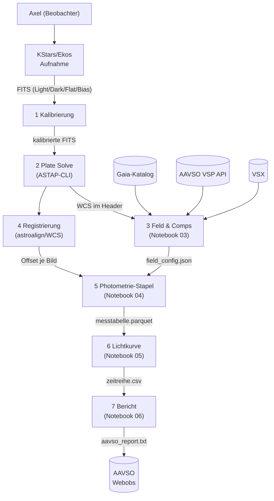
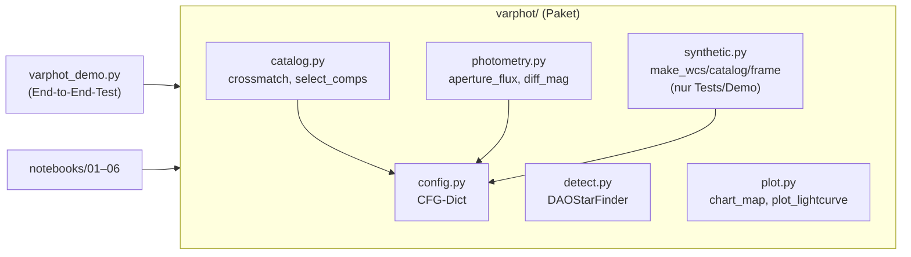

# Konzept: Differentielle Photometrie-Pipeline

**Projekt**: `photometrie-py`  
**Version**: 0.1 (2026-11-10)  
**Autor**: Axel Pospischil  
**Repo**: https://github.com/apos/photometrie-py

---

## 1. Grundlagen — warum dieses Projekt existiert

Ziel ist die Auswertung selbst aufgenommener FITS-Bilder zur Lichtkurvenbestimmung von
Veränderlichen Sternen (Fokus: Delta Cephei, Klasse Cepheid). Die Messungen sollen in das
AAVSO-Netz eingebracht werden. Siril deckt Kalibrierung und erste Sichtprüfung ab; alle
wissenschaftlichen Auswertungsschritte (Plate Solving, Comp-Auswahl, Aperturphotometrie,
differentielle Helligkeit, Lichtkurve, Periodensuche, AAVSO-Export) laufen in Python durch
reproduzierbare Jupyter-Notebooks.

**Aufbau**: Apo 80/540 (1,44″/px) oder C9.25/AP400 + QHY268M, Beobachtungsort Balkon.

---

## 2. Kontextabgrenzung (arc42 C1)



**Systemgrenzen**: FITS-Erzeugung (Ekos), Kalibrierung (Siril oder ccdproc), ASTAP-Binary
und alle externen Kataloge liegen außerhalb dieses Python-Projekts.

---

## 3. Bausteinsicht (arc42 C5)



| Modul | Aufgabe | Abhängigkeiten |
|---|---|---|
| `config.py` | Zentrales CFG-Dict; Ausgangspunkt für YAML-Config | — |
| `detect.py` | Quellendetektion via DAOStarFinder | astropy.stats, photutils |
| `catalog.py` | Crossmatch + Comp/Check-Auswahl mit QC-Flags | astropy.coordinates, config |
| `photometry.py` | Aperturphotometrie + Ensemble-Nullpunkt | photutils, config |
| `plot.py` | Sternkarte + 4-Panel-Lichtkurve | matplotlib, astropy.visualization |
| `synthetic.py` | Synthetische Testdaten (nur Demo/Tests) | numpy, astropy |

---

## 4. Laufzeitsicht / Datenfluss (arc42 C6)

```mermaid
flowchart LR
    FITS[/"FITS-Bilder\n(1 Nacht)"/] --> NB01["01 Kalibrierung"]
    NB01 --> KalFITS[/"kalibrierte\nFITS"/]
    KalFITS --> NB02["02 Plate Solve\n(ASTAP)"]
    NB02 --> WCS["FITS mit WCS\nim Header"]
    WCS --> NB03["03 Feld & Comps\n(Katalogabfrage)"]
    NB03 --> FC[/"field_config.json\nZiel · Comps · Check"/]
    WCS --> NB04["04 Photometrie-Stapel"]
    FC --> NB04
    NB04 --> MT[/"messtabelle.parquet\nje Bild & Stern"/]
    MT --> NB05["05 Lichtkurve\n& Periode"]
    NB05 --> ZR[/"zeitreihe.csv"/]
    ZR --> NB06["06 Bericht\n& AAVSO-Export"]
    NB06 --> REP[/"aavso_report.txt\nCSV"/]
```



**Prinzip**: Jede Stufe schreibt ein Zwischenergebnis, die nächste liest es. So ist jeder
Schritt einzeln wiederholbar, ohne die gesamte Pipeline neu starten zu müssen.

---

## 5. Querschnittliche Konzepte

### 5.1 Konfiguration

Alle Schwellen und Parameter liegen im zentralen `CFG`-Dict (`varphot/config.py`).
Nächster Schritt: ein pro-Ziel-YAML laden und über `CFG.update(yaml_data)` einmischen,
so dass dieselbe Pipeline für Delta Cephei und eta Aql unterschiedliche Aperturgrößen
verwenden kann.

```python
# Zukünftiges Muster (noch nicht implementiert)
import yaml
with open("config/delta_cep.yaml") as f:
    CFG.update(yaml.safe_load(f))
```

### 5.2 Qualitätstored (QC-Flags)

Bilder und Sterne fallen nicht stillschweigend aus der Pipeline. `select_comps()` gibt
für jeden verworfenen Kandidaten die Ablehnungsursache aus. Zukünftig: QC-Spalte in der
Messtabelle (`qc_flag`), damit jeder Ausschluss rekonstruierbar bleibt.

| QC-Grund | Bedeutung |
|---|---|
| `sat` | Peak > CFG['sat_adu'] — Sättigung oder Nichtlinearität |
| `edge` | Stern zu nah am Bildrand |
| `neighbor` | Nachbarstern im Aperturbereich |
| `bv` | B-V-Farbe zu weit vom Ziel entfernt |
| `var` | Als Veränderlicher (VSX) bekannt |
| `halo` | Im Halo des defokussierten Ziels |

### 5.3 Zeitstempel und BJD

`DATE-OBS` wird als Belichtungsbeginn interpretiert (nicht belegt; Header prüfen).
BJD_TDB-Umrechnung mit Beobachtungsort-Koordinaten via `astropy.time.Time` und
`astropy.coordinates.EarthLocation` — noch nicht implementiert; Priorität P1.

### 5.4 Fehlerrechnung

Aktuelle Implementierung: Poisson-Fehler (√Fluss). Für AAVSO-Einreichung benötigt:
Ausleserauschen + Hintergrundfehler + Szintillationsfehler (Young 1967). Priorität P1.

---

## 6. Architektur-Entscheidungen (ADR)

### ADR-01: Aperturphotometrie vor PSF-Photometrie (2026-11-10)
**Kontext**: photutils bietet `IterativePSFPhotometry`. Für ein defokussiertes Ziel
(FWHM ~22 px) passt keine Standard-PSF.  
**Entscheidung**: Einstieg mit Aperturphotometrie; PSF-Option für zukünftige
fokussierte Felder offen halten.  
**Konsequenz**: Größere Apertur für das Ziel nötig; mehr Hintergrundrauschen.

### ADR-02: Paketstruktur `varphot/` + Notebooks (2026-11-10)
**Kontext**: Notebook-only-Ansatz führt zu Code-Duplikation zwischen Notebooks.  
**Entscheidung**: Wiederverwendbare Funktionen im Paket; Notebooks als dünne
Orchestrierungsschicht.  
**Konsequenz**: Notebooks können einfach ausgetauscht/erweitert werden; Paket
direkt per `import varphot` nutzbar.

### ADR-03: Eigene venv, getrennt von SORA/Astrometrie (2026-11-10)
**Kontext**: photutils-Versionen zwischen Projekten inkompatibel.  
**Entscheidung**: `.venv/` lokal im Projektordner, `requirements.txt` als Single
Point of Truth.

---

## 7. Installation und Verifikation

```bash
# Einmalig
/opt/homebrew/bin/python3.13 -m venv .venv
.venv/bin/pip install -r requirements.txt
```

**Verifikation** (erwartete Ausgabe in < 2 min):
```bash
.venv/bin/python varphot_demo.py
```
```
Comp-Auswahl: 30 Kandidaten verworfen (QC): …
Detektion: 46 Quellen, gematcht: 46, Comps: 8, Check: 19
Check-Stern: Soll V=8.903, Messung Mittel 8.9xx, Streuung 0.01xx mag
Lomb-Scargle Periode: 5.3xx d (Soll 5.366)
chart.png und lightcurve.png geschrieben.
```
Die eingebauten Assertions prüfen: ≥ 5 Comps, Check-Streuung < 0,05 mag, Periode ± 0,5 d.

**VSCode Kernel**: `.venv/bin/python` über *Python: Select Interpreter* auswählen.

---

## 8. Test-Strategie

| Was | Methode | Status |
|---|---|---|
| Gesamte Pipeline (synthetische Daten) | `varphot_demo.py` mit assert-Checks | ✅ Lokal getestet (M4, Python 3.13) |
| Einzelfunktionen | — | ❌ Noch keine Unit-Tests |
| Plate Solve (ASTAP) | Manuell mit echtem FITS | ❌ Nicht getestet |
| Katalogabfragen (Gaia/VSP) | Manuell, Mac + Netz nötig | ❌ Nicht getestet |
| Registrierung mit echten Bildern | Manuell | ❌ Nicht getestet |
| AAVSO-Export-Format | Manuell gegen Spezifikation | ❌ Nicht getestet |

Nächste Testprioritäten: Unit-Tests für `crossmatch` und `diff_mag`; Rauch-Test mit
einem echten FITS-Bild (Plate Solve + Sternkarte).

---

## 9. API-Referenz

### `varphot.detect(img, fwhm, nsigma)`
| Parameter | Typ | Default | Beschreibung |
|---|---|---|---|
| `img` | ndarray | — | 2D-Frame (ADU) |
| `fwhm` | float | 4.5 | Erwartete FWHM in Pixeln |
| `nsigma` | float | 8.0 | Erkennungsschwelle in σ |
**Rückgabe**: `(sources_table, median, std)`

### `varphot.crossmatch(src, cat, w, tol_arcsec)`
| Parameter | Typ | Default | Beschreibung |
|---|---|---|---|
| `src` | Table | — | Detektierte Quellen (photutils) |
| `cat` | Table | — | Referenzkatalog mit ra, dec, V, BV, var |
| `w` | WCS | — | Astropy-WCS des Referenzbilds |
| `tol_arcsec` | float | CFG | Matching-Radius |
**Rückgabe**: gefiltertes `src` mit Katalog-Spalten angehängt

### `varphot.select_comps(m, cat, w, cfg, target_id)`
**Rückgabe**: `(target_dict, comps_list, check_or_None)` — verworfene Kandidaten werden geloggt.

### `varphot.aperture_flux(img, xy, r_ap, r_in, r_out, cfg)`
**Rückgabe**: `(flux_array, err_array, bkg_array)` — Warnung bei Peak > `sat_adu`.

### `varphot.diff_mag(f_t, f_c, V_c, f_k)`
**Rückgabe**: `(mag_ziel, mag_check_or_nan, zp_scatter)`

---

## 10. Strategische Roadmap

Abhängigkeiten: **P0 blockiert P1; P1 blockiert P2.**

| Priorität | Aufwand | Thema | Abhängigkeit |
|---|---|---|---|
| P0 | S | Testbild plate-solven, Sternkarte über echtes FITS legen — **erledigt 2026-11-10** (M16-Testbild, NB02) | Mac + ASTAP + Testbilder |
| P0 | S | Comp-Auswahl für Delta Cephei mit VSP-Daten (Gaia/AAVSO) prüfen — **erledigt 2026-11-10** (`varphot/vsp.py`, NB03: 4 Comps rotationssicher, 7–8 bei bekanntem Kamerawinkel) | Netz + P0 oben |
| P0 | M | Notebooks 01–06 mit erstem echten Datensatz durchlaufen — **NB01–05 erledigt 2026-11-10** (LCO δ Cep V, 0m4-11, 98 brauchbare Bilder, Lichtkurve + LS-Periode 5,363 d, Residuum 0,07 mag mit Kernmaske für das gesättigte Ziel; NB06 offen) | P0 Plate Solve |
| P1 | M | BJD_TDB-Umrechnung mit Standort (Beobachterkoordinaten) — **erledigt 2026-11-10** (`varphot/timeutil.py`, Standort aus Header oder NB01) | P0 |
| P1 | M | Vollständiger Photometrie-Fehler (Poisson + RON + Szintillation) — **erledigt 2026-11-10** (CCD-Gleichung + Young-Szintillation; Gain/RON aus Header) | P0 |
| P1 | S | Pro-Ziel-YAML-Config laden (`config/delta_cep.yaml`) | P0 |
| P1 | M | Unit-Tests für `crossmatch` und `diff_mag` — `diff_mag` + `ensemble_mag` getestet 2026-11-10; `crossmatch` offen | P0 |
| P1 | L | Registrierung per `astroalign` mit echten Bildern verifizieren | P0 |
| P1 | M | Farbkamera: CFA-Kanäle (R, G, B) aus Roh-Bayer-Bildern extrahieren (Siril), Messtabelle je Kanal — siehe §11 | P0 |
| P2 | M | AAVSO Extended Format erzeugen und validieren (Filter `TG`/`TB`/`TR` bzw. `V`/`B`/`R` mit `TRANS`), Einreichen | P1 |
| P2 | L | Transformationskoeffizienten aus Standardfeld (M 67 / NGC 7790) für die Farbkamera; Export `TRANS=YES` — siehe §11 | P1 |
| P2 | M | Beispieldaten One-Shot-Color beschaffen/aufnehmen (§11.6) | P1 |
| P2 | XL | PSF-Photometrie für fokussierte Felder (photutils PSFPhotometry) | P1 |
| P2 | L | Spektren-Auswertung SHG 700 (Neon-Kalibrierung) | eigenes Notebook |

**Offene Klärungen (blockieren P0)**:
- ~~Beobachtungsort-Koordinaten für BJD und Luftmasse~~ — erledigt 2026-11-10: NB01 Abschnitt 0 (Picker, lokal gespeichert, nicht im Repo)
- ~~AAVSO-Beobachtercode~~ — erledigt 2026-11-10: vorhanden, NB01 Abschnitt 0 (lokal gespeichert)
- Mac-Modell/macOS-Version für ASTAP-Freigabe (Apple Silicon Signing)


---

## 11. Farbkamera (One-Shot-Color, z. B. Player One Ares-C): Siril, Transformation, AAVSO

Stand 2026-11-10. **Prüfstatus** der Quellen steht in §11.7: gelesen (G), nur als Suchergebnis/Forumsaussage (F),
aus dem Gedächtnis (E). Es ist noch **nichts davon implementiert** — dies ist das Konzept.

### 11.1 Ziel

Die Pipeline (bisher Monochrom-Bilder in V, LCO) soll auch Roh-Bayer-Aufnahmen einer Farbkamera auswerten und die
Ergebnisse **AAVSO-konform** liefern. Monochrom-Kamera mit Filtern und Farbkamera unterscheiden sich in drei Punkten:
(1) der Stern liegt in R, G und B auf *verschiedenen Pixeln* (Bayer-Muster), (2) die Kanalempfindlichkeiten weichen von
Johnson B/V/R ab, (3) alle drei Farben entstehen im selben Bild — die Farbe des Sterns ist je Bild messbar.

### 11.2 Was AAVSO verlangt (Extended File Format v1.2, G; Forumsaussagen F)

- **Filtercodes `TG`, `TB`, `TR`** („Tri-color"): „commonly the green-/blue-/red-channel in a DSLR or color CCD camera".
  Dabei gilt (G): `TG` nutzt **V-Band-Vergleichssterne**, `TB` **B-Band**, `TR` **R-Band**. Unser Vergleichssternkonzept (V aus VSP/
  Gaia) passt also für `TG`; für `TB`/`TR` brauchen wir B- bzw. R-Magnituden der Comps (VSP liefert B, V, Rc, Ic; aus Gaia
  wären sie per Transformation abzuleiten — offen).
- **Nicht transformiert → `TG`/`TB`/`TR` mit `TRANS=NO`; transformiert → `V`/`B`/`R` mit `TRANS=YES`** (F: AAVSO-Mitarbeiter im
  Forum, 2023: „unless you have obtained transformation coefficients for your set up. If so then you would use V,B,R for the
  transformed magnitudes"). `CV`/`CR` (Clear) gelten **nicht** für Bayer-Kameras (F). `TRANS`: „YES if transformed using the Landolt
  Standards or those fields that contain secondary standards … Document the method used … in the NOTES" (G).
- **Qualität der Transformation (F):** „TG filter magnitudes transform well to V, TB and TR … do not transform as well for targets of very blue or red
  colors"; es sei umstritten, ob man `TB`/`TR` überhaupt transformieren sollte. **Empfehlung hier:** `TG` transformieren
  (→ V), `TB`/`TR` zunächst untransformiert melden.
- **`OBSTYPE`:** `CCD`, `DSLR` oder `PEP`; „If you use a CMOS camera please report it as CCD" (G). Die Ares-C (CMOS, astronomische
  Kamera) wird also als `CCD` gemeldet; `DSLR` bleibt Spiegelreflex/Spiegellosen vorbehalten (Auslegung, nicht ausdrücklich geklärt).
- **Datum:** nur `JD`, `HJD` oder `EXCEL` (G) — Mittenzeit in UT. **BJD_TDB ist im Format nicht vorgesehen**; für den
  Export wird die UTC-Mitte als JD geliefert, BJD_TDB bleibt der Auswertung vorbehalten.
- **Weitere Pflichtfelder (G):** `#TYPE=Extended`, `#OBSCODE`, `#SOFTWARE`, `#DELIM`, `#DATE`, `#OBSTYPE`; je Zeile u. a. `MTYPE=STD`,
  `CNAME` (bei Ensemble `ENSEMBLE`, `CMAG=na`), `KNAME`/`KMAG` (Check-Stern), `AIRMASS`, `CHART` (Sequenz-ID der VSP-Karte), `NOTES` mit
  Unterfeldern (`|VMAGINS=…|CREFMAG=…|Tv_bv=…`). Der Check-Stern darf nicht im Ensemble stecken (bei uns umgesetzt).
- **IR-Sperrfilter (F, Forumsdiskussion):** Ohne UV/IR-Sperrfilter leckt IR in die Kanäle; die Magnituden roter Sterne werden dann
  deutlich zu hell. Der Aufbau (Filter im Strahlengang) gehört in die `NOTES`; nur Daten *mit* Sperrfilter mischen.

### 11.3 Rolle von Siril

Siril ersetzt **nicht** unsere Photometrie und Transformation, liefert aber die richtigen Eingangsbilder:

1. **Kalibrierung im CFA-Bereich (ohne Debayern):** Bias/Dark/Flat auf den Roh-Bayer-Bildern. Für Photometrie wird *nicht*
   interpoliert (Debayern mischt Nachbarpixel verschiedener Farben und verfälscht die Flüsse). (E: Skriptoptionen wie `-cfa`/
   `-equalize_cfa` bei `calibrate` sind aus dem Gedächtnis, gegen die Siril-Doku prüfen.)
2. **Kanaltrennung:** *Split CFA* erzeugt vier Einkanalbilder (R, G1, G2, B; je halbe Auflösung, G); *Extract Green* mittelt die zwei
   Grün-Pixel (weniger Rauschen, Auflösung ebenfalls halbiert, G — Dokumentation „Split Channels"). Für `TG` wird Grün genutzt (G1/G2 gemittelt
   oder getrennt gemessen und gemittelt). Skriptnamen in 1.4 (`seqsplit_cfa`, `seqextract_Green`) sind unbestätigt (F) → in Siril mit `help …` prüfen.
3. **Danach unsere Pipeline:** NB02 (ASTAP-Plate-Solve auf dem Kanalbild — Pixelskala und WCS sind für das halbierte Raster zu beachten), NB03
   (Comps), NB04 (Photometrie je Kanal), NB05 (Lichtkurve).
4. **Sirils eigene Photometrie** (`light_curve`, Export „Tools ▸ Photometry ▸ Create Output", G) arbeitet differentiell gegen *einen* Comp-Stern
   mit `V_std = (V_ins − C_ins) + C_std` und erwähnt weder CFA-Besonderheiten noch Transformation; sie eignet sich als **Gegenprobe**, nicht als Weg zur
   transformierten AAVSO-Meldung.
5. **Sättigung/Bittiefe:** Rohdaten mit 12/14 Bit liegen oft in einem 16-Bit-Container; Sirils Photometrie nimmt Sättigung bei 60 000 ADU an (F), die echte Grenze
   liegt bei 4095·2^n. `SATURATE` je Kamera setzen, Linearität messen (§ Kameradaten, NB01).

### 11.4 Ablauf in der Pipeline (Entwurf)

1. Aufnahme: Roh (CFA, FITS, 16 Bit), Sperrfilter im Strahlengang, **leicht defokussiert** (Sterne ≥ 4 px FWHM im Rohraster, damit jeder Kanal mehrere
   Pixel trifft), Belichtung unter der Sättigung, Darks passend zur Belichtung (DSLR-Darks lassen sich nicht skalieren, F — für CMOS prüfen).
2. Siril: Kalibrieren (CFA), Kanäle trennen → je Kanal ein Mono-FITS (`R`, `G`, `B`) mit gleichen Zeitstempeln.
3. Pipeline je Kanal wie bisher (Apertur, Ensemble) → instrumentelle Magnituden `r`, `g`, `b` *derselben* Comps/Ziele.
4. **Ohne Koeffizienten:** `TG` (V-Comps), `TB` (B-Comps), `TR` (R-Comps), `TRANS=NO`, `MTYPE=STD`.
5. **Mit Koeffizienten:** Transformation (§11.5) → `V` (und optional `B`, `R`), `TRANS=YES`, Koeffizienten in `NOTES`.

### 11.5 Umrechnung auf Johnson/Cousins (Standardverfahren, E)

Differentielle Form gegen einen Comp `c` (Kanal `g` übernimmt die Rolle des Filters V, `b` die von B), mit Transformationskoeffizienten
`Tbv` und `Tv_bv` aus Beobachtungen eines **Standardfeldes**:

```
(B − V)_Ziel = (B − V)_c + Tbv   · [(b − g)_Ziel − (b − g)_c]
V_Ziel       = V_c        + (g_Ziel − g_c) + Tv_bv · [(B − V)_Ziel − (B − V)_c]
```

- **Koeffizienten bestimmen:** Standardfeld (AAVSO nennt **M 67 und NGC 7790**, G/F) mehrfach bei verschiedenen Luftmassen aufnehmen; je Kanal die
  Katalog-Magnituden der Standardsterne gegen die instrumentellen Farbindizes auftragen (Steigungen = `Tbv`, `Tv_bv`, …; Achsenabschnitte = Nullpunkte).
  Werkzeug der AAVSO: *Transform Generator* (Python, G. Myers) und *TransformApplier* (jetzt in VPhot) (F); für Bayer-Kanäle ist die Anwendung auf
  „Filter" = Kanal naheliegend, aber **nicht belegt**.
- **Farbe des Ziels:** Weil alle Kanäle gleichzeitig entstehen, ist `(b − g)` je Bild messbar — ein Vorteil gegenüber Monochrom (dort muss die Farbe
  geschätzt oder aus Katalogen genommen werden; AAVSO-Forum: ein einzelnes Filterbild lässt sich nur transformieren, wenn die Farbe bekannt ist, F).
- **Grenzen:** Veränderliche mit sehr blauer/roter Farbe (Langperiodische!) → `TB`/`TR` unzuverlässig (F); Extinktion zweiter Ordnung wird bei kleinem Feld und nahen Comps
  vernachlässigt; Koeffizienten gelten für *diesen* Aufbau (Kamera, Filter, Optik) und müssen bei Änderung neu bestimmt werden.
- **Alternative (modern, nicht AAVSO-Standard):** Kalibrierung auf **Gaia-DR3-synthetische Photometrie** — die Kanalempfindlichkeit (Kamera-QE × Filter) wird mit
  Gaia-XP-Spektren gefaltet, der Farbterm entfällt (so beschrieben im GitHub-Projekt `astronomyk/seestar_photometry`, F). Als Gegenprobe zu den
  Standardfeld-Koeffizienten vorgesehen, nicht als Ersatz.
- **Validierung vor der ersten echten Meldung:** (a) δ Cep mit der Farbkamera aufnehmen und gegen die bekannte Lichtkurve prüfen (wie LCO, §Testdaten);
  (b) Standardfeld → Koeffizienten → Test an einem zweiten Feld; (c) Vergleich `TG` vs. transformiertes `V` bei Sternen verschiedener Farbe.

### 11.6 Beispieldaten (zu beschaffen — nichts davon ist geladen)

| Kandidat | Inhalt | Stand |
|---|---|---|
| AAVSO „Examples: doing photometry with the Zwo Seestar S50" (<https://archive.aavso.org/examples-doing-photometry-zwo-seestar-s50>) | Beispiele `TG`-Photometrie aus Seestar-FITS (OSC) | gefunden (F), Inhalt/Dateien nicht gesichtet |
| GitHub `astronomyk/seestar_photometry` | Pipeline mit Gaia-DR3-synthetischem V, Seestar-Stacks | gefunden (F), Daten/Lizenz nicht gesichtet |
| Cloudy Nights „Seestar public fit files" | Informelle Google-Drive-Sammlung | gefunden (F), Qualität unbekannt |
| AAVSO DSLR-Handbuch v1.4, Tutorials, Datenreduktionstabelle (<https://aavso.org/manuals/>) | Verfahren, Tabelle für Transformationen, Beispielbilder | Handbuch selbst **nicht gelesen** (PDF im Browser nicht auslesbar) |
| **LCO δ Cep in B (16 Bilder) und r′ (86 Bilder)**, gleiche Quelle wie `lco-dcep` | Monochrom, aber echte B-/R-Wahrheit zur Prüfung der Transformationskette | im Archiv vorhanden (Abfrage, nicht geladen) |
| **Eigene Aufnahmen Ares-C** (M 67/NGC 7790, δ Cep defokussiert) | Koeffizienten und Validierung — der eigentlich nötige Satz | zu planen |

**Warnung (F):** Seestar-Firmware seit 08/2025 soll nichtlineare FITS erzeugen (BAA-VSS-Diskussion) — vor Nutzung Linearität prüfen.
Download nur nach Freigabe (Datei, Quelle, Größe), Nutzungsbedingungen je Quelle beachten.

### 11.7 Quellen und Prüfstatus

| Aussage | Quelle | Status |
|---|---|---|
| Filtercodes, `TRANS`, `OBSTYPE`, CMOS→CCD, Datumsformate, Beispielzeilen | AAVSO Extended File Format v1.2 (Stand 2021-12-02), <https://archive.aavso.org/aavso-extended-file-format> | **G** (gelesen) |
| `TG`/`TB`/`TR` unbehandelt melden, `V`/`B`/`R` nur nach Transformation; TG transformiert gut, TB/TR schlecht; Clear gilt nicht für OSC | AAVSO-Forum „TR TG TB and CR CV Filters" (Mitarbeiter-Beiträge, 2023), <https://archive.aavso.org/tr-tg-tb-and-cr-cv-filters> | **G** (gelesen; Forum, keine Vorschrift) |
| DSLR-Grundlagen, einkanalige Photometrie, Kamera charakterisieren | AAVSO-Forum „Dslr Photometry" (2012), <https://archive.aavso.org/dslr-photometry> | **G** (Forum, alt) |
| Siril Lichtkurven, AAVSO-Export | Siril-Dokumentation „Light curves", <https://siril.readthedocs.io/en/latest/photometry/lightcurves.html> | **G** |
| Siril Split CFA / Extract Green | Siril-Dokumentation „Split Channels", <https://siril.readthedocs.io/en/latest/processing/extraction.html> | **F** (Suchauszug) |
| Transformationsgleichungen, Standardfelder M 67/NGC 7790, Transform Generator/Applier | AAVSO DSLR Observing Manual v1.4 §6.5, AAVSO CCD/CMOS Photometry Guide Kap. 6; Hubble-/Henden-Standardverfahren | **E** (Handbuch **nicht gelesen**) — vor Implementierung prüfen |
| Gaia-DR3-synthetische Photometrie als Alternative | GitHub `astronomyk/seestar_photometry`; Montegriffo et al. 2023, A&A 674, A33 | **F/E** |

**Offene Punkte:** Sensor/Bittiefe/Gain-Modi der Ares-C; Sperrfilter im Aufbau; B-/R-Comp-Magnituden aus Gaia (Transformation nach Riello et al. 2021,
Tab. C.2); Siril-Befehlsnamen in der installierten Version; DSLR-Handbuch v1.4 §6.5 lesen (PDF `https://aavso.org/wp-content/uploads/2026/07/DSLR-English-1.4.pdf`,
automatischer Abruf scheitert am Bot-Schutz — im Browser öffnen und die Gleichungen abgleichen).
