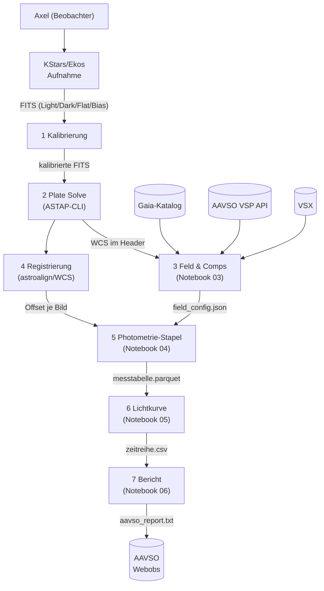
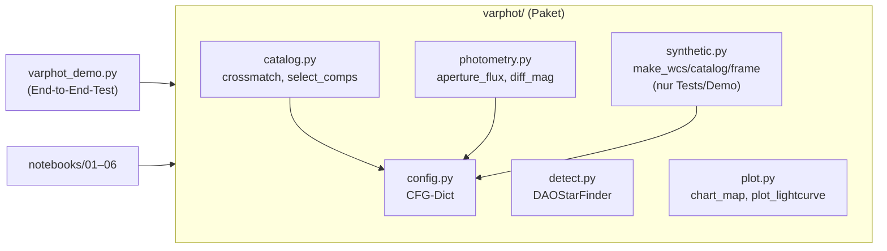

# Konzept: Differentielle Photometrie-Pipeline

**Projekt**: `photometrie-py`  
**Version**: 0.1 (2026-11-10)  
**Autor**: Axel Pospischil  
**Repo**: https://github.com/apos/photometrie-py

---

## 1. Grundlagen — warum dieses Projekt existiert

Ziel ist die Auswertung selbst aufgenommener FITS-Bilder zur Lichtkurvenbestimmung von
Veränderlichen Sternen (Fokus: Delta Cephei, Klasse Cepheid). Die Messungen sollen in das
AAVSO-Netz eingebracht werden. Siril deckt Kalibrierung und erste Sichtprüfung ab; alle
wissenschaftlichen Auswertungsschritte (Plate Solving, Comp-Auswahl, Aperturphotometrie,
differentielle Helligkeit, Lichtkurve, Periodensuche, AAVSO-Export) laufen in Python durch
reproduzierbare Jupyter-Notebooks.

**Aufbau**: Apo 80/540 (1,44″/px) oder C9.25/AP400 + QHY268M, Beobachtungsort Balkon.

---

## 2. Kontextabgrenzung (arc42 C1)



**Systemgrenzen**: FITS-Erzeugung (Ekos), Kalibrierung (Siril oder ccdproc), ASTAP-Binary
und alle externen Kataloge liegen außerhalb dieses Python-Projekts.

---

## 3. Bausteinsicht (arc42 C5)



| Modul | Aufgabe | Abhängigkeiten |
|---|---|---|
| `config.py` | Zentrales CFG-Dict; Ausgangspunkt für YAML-Config | — |
| `detect.py` | Quellendetektion via DAOStarFinder | astropy.stats, photutils |
| `catalog.py` | Crossmatch + Comp/Check-Auswahl mit QC-Flags | astropy.coordinates, config |
| `photometry.py` | Aperturphotometrie + Ensemble-Nullpunkt | photutils, config |
| `plot.py` | Sternkarte + 4-Panel-Lichtkurve | matplotlib, astropy.visualization |
| `synthetic.py` | Synthetische Testdaten (nur Demo/Tests) | numpy, astropy |

---

## 4. Laufzeitsicht / Datenfluss (arc42 C6)

```mermaid
flowchart LR
    FITS[/"FITS-Bilder\n(1 Nacht)"/] --> NB01["01 Kalibrierung"]
    NB01 --> KalFITS[/"kalibrierte\nFITS"/]
    KalFITS --> NB02["02 Plate Solve\n(ASTAP)"]
    NB02 --> WCS["FITS mit WCS\nim Header"]
    WCS --> NB03["03 Feld & Comps\n(Katalogabfrage)"]
    NB03 --> FC[/"field_config.json\nZiel · Comps · Check"/]
    WCS --> NB04["04 Photometrie-Stapel"]
    FC --> NB04
    NB04 --> MT[/"messtabelle.parquet\nje Bild & Stern"/]
    MT --> NB05["05 Lichtkurve\n& Periode"]
    NB05 --> ZR[/"zeitreihe.csv"/]
    ZR --> NB06["06 Bericht\n& AAVSO-Export"]
    NB06 --> REP[/"aavso_report.txt\nCSV"/]
```



**Prinzip**: Jede Stufe schreibt ein Zwischenergebnis, die nächste liest es. So ist jeder
Schritt einzeln wiederholbar, ohne die gesamte Pipeline neu starten zu müssen.

---

## 5. Querschnittliche Konzepte

### 5.1 Konfiguration

Alle Schwellen und Parameter liegen im zentralen `CFG`-Dict (`varphot/config.py`).
Nächster Schritt: ein pro-Ziel-YAML laden und über `CFG.update(yaml_data)` einmischen,
so dass dieselbe Pipeline für Delta Cephei und eta Aql unterschiedliche Aperturgrößen
verwenden kann.

```python
# Zukünftiges Muster (noch nicht implementiert)
import yaml
with open("config/delta_cep.yaml") as f:
    CFG.update(yaml.safe_load(f))
```

### 5.2 Qualitätstored (QC-Flags)

Bilder und Sterne fallen nicht stillschweigend aus der Pipeline. `select_comps()` gibt
für jeden verworfenen Kandidaten die Ablehnungsursache aus. Zukünftig: QC-Spalte in der
Messtabelle (`qc_flag`), damit jeder Ausschluss rekonstruierbar bleibt.

| QC-Grund | Bedeutung |
|---|---|
| `sat` | Peak > CFG['sat_adu'] — Sättigung oder Nichtlinearität |
| `edge` | Stern zu nah am Bildrand |
| `neighbor` | Nachbarstern im Aperturbereich |
| `bv` | B-V-Farbe zu weit vom Ziel entfernt |
| `var` | Als Veränderlicher (VSX) bekannt |
| `halo` | Im Halo des defokussierten Ziels |

### 5.3 Zeitstempel und BJD

`DATE-OBS` wird als Belichtungsbeginn interpretiert (nicht belegt; Header prüfen).
BJD_TDB-Umrechnung mit Beobachtungsort-Koordinaten via `astropy.time.Time` und
`astropy.coordinates.EarthLocation` — noch nicht implementiert; Priorität P1.

### 5.4 Fehlerrechnung

Aktuelle Implementierung: Poisson-Fehler (√Fluss). Für AAVSO-Einreichung benötigt:
Ausleserauschen + Hintergrundfehler + Szintillationsfehler (Young 1967). Priorität P1.

---

## 6. Architektur-Entscheidungen (ADR)

### ADR-01: Aperturphotometrie vor PSF-Photometrie (2026-11-10)
**Kontext**: photutils bietet `IterativePSFPhotometry`. Für ein defokussiertes Ziel
(FWHM ~22 px) passt keine Standard-PSF.  
**Entscheidung**: Einstieg mit Aperturphotometrie; PSF-Option für zukünftige
fokussierte Felder offen halten.  
**Konsequenz**: Größere Apertur für das Ziel nötig; mehr Hintergrundrauschen.

### ADR-02: Paketstruktur `varphot/` + Notebooks (2026-11-10)
**Kontext**: Notebook-only-Ansatz führt zu Code-Duplikation zwischen Notebooks.  
**Entscheidung**: Wiederverwendbare Funktionen im Paket; Notebooks als dünne
Orchestrierungsschicht.  
**Konsequenz**: Notebooks können einfach ausgetauscht/erweitert werden; Paket
direkt per `import varphot` nutzbar.

### ADR-03: Eigene venv, getrennt von SORA/Astrometrie (2026-11-10)
**Kontext**: photutils-Versionen zwischen Projekten inkompatibel.  
**Entscheidung**: `.venv/` lokal im Projektordner, `requirements.txt` als Single
Point of Truth.

---

## 7. Installation und Verifikation

```bash
# Einmalig
/opt/homebrew/bin/python3.13 -m venv .venv
.venv/bin/pip install -r requirements.txt
```

**Verifikation** (erwartete Ausgabe in < 2 min):
```bash
.venv/bin/python varphot_demo.py
```
```
Comp-Auswahl: 30 Kandidaten verworfen (QC): …
Detektion: 46 Quellen, gematcht: 46, Comps: 8, Check: 19
Check-Stern: Soll V=8.903, Messung Mittel 8.9xx, Streuung 0.01xx mag
Lomb-Scargle Periode: 5.3xx d (Soll 5.366)
chart.png und lightcurve.png geschrieben.
```
Die eingebauten Assertions prüfen: ≥ 5 Comps, Check-Streuung < 0,05 mag, Periode ± 0,5 d.

**VSCode Kernel**: `.venv/bin/python` über *Python: Select Interpreter* auswählen.

---

## 8. Test-Strategie

| Was | Methode | Status |
|---|---|---|
| Gesamte Pipeline (synthetische Daten) | `varphot_demo.py` mit assert-Checks | ✅ Lokal getestet (M4, Python 3.13) |
| Einzelfunktionen | — | ❌ Noch keine Unit-Tests |
| Plate Solve (ASTAP) | Manuell mit echtem FITS | ❌ Nicht getestet |
| Katalogabfragen (Gaia/VSP) | Manuell, Mac + Netz nötig | ❌ Nicht getestet |
| Registrierung mit echten Bildern | Manuell | ❌ Nicht getestet |
| AAVSO-Export-Format | Manuell gegen Spezifikation | ❌ Nicht getestet |

Nächste Testprioritäten: Unit-Tests für `crossmatch` und `diff_mag`; Rauch-Test mit
einem echten FITS-Bild (Plate Solve + Sternkarte).

---

## 9. API-Referenz

### `varphot.detect(img, fwhm, nsigma)`
| Parameter | Typ | Default | Beschreibung |
|---|---|---|---|
| `img` | ndarray | — | 2D-Frame (ADU) |
| `fwhm` | float | 4.5 | Erwartete FWHM in Pixeln |
| `nsigma` | float | 8.0 | Erkennungsschwelle in σ |
**Rückgabe**: `(sources_table, median, std)`

### `varphot.crossmatch(src, cat, w, tol_arcsec)`
| Parameter | Typ | Default | Beschreibung |
|---|---|---|---|
| `src` | Table | — | Detektierte Quellen (photutils) |
| `cat` | Table | — | Referenzkatalog mit ra, dec, V, BV, var |
| `w` | WCS | — | Astropy-WCS des Referenzbilds |
| `tol_arcsec` | float | CFG | Matching-Radius |
**Rückgabe**: gefiltertes `src` mit Katalog-Spalten angehängt

### `varphot.select_comps(m, cat, w, cfg, target_id)`
**Rückgabe**: `(target_dict, comps_list, check_or_None)` — verworfene Kandidaten werden geloggt.

### `varphot.aperture_flux(img, xy, r_ap, r_in, r_out, cfg)`
**Rückgabe**: `(flux_array, err_array, bkg_array)` — Warnung bei Peak > `sat_adu`.

### `varphot.diff_mag(f_t, f_c, V_c, f_k)`
**Rückgabe**: `(mag_ziel, mag_check_or_nan, zp_scatter)`

---

## 10. Strategische Roadmap

Abhängigkeiten: **P0 blockiert P1; P1 blockiert P2.**

| Priorität | Aufwand | Thema | Abhängigkeit |
|---|---|---|---|
| P0 | S | Testbild plate-solven, Sternkarte über echtes FITS legen — **erledigt 2026-11-10** (M16-Testbild, NB02) | Mac + ASTAP + Testbilder |
| P0 | S | Comp-Auswahl für Delta Cephei mit VSP-Daten (Gaia/AAVSO) prüfen — **erledigt 2026-11-10** (`varphot/vsp.py`, NB03: 4 Comps rotationssicher, 7–8 bei bekanntem Kamerawinkel) | Netz + P0 oben |
| P0 | M | Notebooks 01–06 mit erstem echten Datensatz durchlaufen — **NB01–05 erledigt 2026-11-10** (LCO δ Cep V, 0m4-11, 98 brauchbare Bilder, Lichtkurve + LS-Periode 5,363 d, Residuum 0,07 mag mit Kernmaske für das gesättigte Ziel; NB06 offen) | P0 Plate Solve |
| P1 | M | BJD_TDB-Umrechnung mit Standort (Beobachterkoordinaten) — **erledigt 2026-11-10** (`varphot/timeutil.py`, Standort aus Header oder NB01) | P0 |
| P1 | M | Vollständiger Photometrie-Fehler (Poisson + RON + Szintillation) — **erledigt 2026-11-10** (CCD-Gleichung + Young-Szintillation; Gain/RON aus Header) | P0 |
| P1 | S | Pro-Ziel-YAML-Config laden (`config/delta_cep.yaml`) | P0 |
| P1 | M | Unit-Tests für `crossmatch` und `diff_mag` — `diff_mag` + `ensemble_mag` getestet 2026-11-10; `crossmatch` offen | P0 |
| P1 | L | Registrierung per `astroalign` mit echten Bildern verifizieren | P0 |
| P2 | M | AAVSO Extended Format validieren und einreichen | P1 |
| P2 | L | Transformation auf Johnson B/V mit Standardfeld | P1 |
| P2 | XL | PSF-Photometrie für fokussierte Felder (photutils PSFPhotometry) | P1 |
| P2 | L | Spektren-Auswertung SHG 700 (Neon-Kalibrierung) | eigenes Notebook |

**Offene Klärungen (blockieren P0)**:
- ~~Beobachtungsort-Koordinaten für BJD und Luftmasse~~ — erledigt 2026-11-10: NB01 Abschnitt 0 (Picker, lokal gespeichert, nicht im Repo)
- ~~AAVSO-Beobachtercode~~ — erledigt 2026-11-10: vorhanden, NB01 Abschnitt 0 (lokal gespeichert)
- Mac-Modell/macOS-Version für ASTAP-Freigabe (Apple Silicon Signing)
