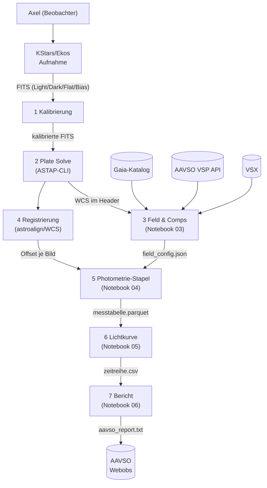
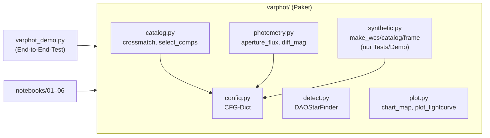

# Konzept: Differentielle Photometrie-Pipeline

**Projekt**: `photometrie-py`  
**Version**: 0.1 (2026-11-10)  
**Autor**: Axel Pospischil  
**Repo**: https://github.com/apos/photometrie-py  
**Quellen**: [QUELLEN.md](QUELLEN.md) — alle referenzierten Vorträge, Handbücher und Fachpublikationen

---

## 1. Grundlagen — warum dieses Projekt existiert

Ziel ist die Auswertung selbst aufgenommener FITS-Bilder zur Lichtkurvenbestimmung von
Veränderlichen Sternen (Fokus: Delta Cephei, Klasse Cepheid). Die Messungen sollen in das
AAVSO-Netz eingebracht werden. Siril deckt Kalibrierung und erste Sichtprüfung ab; alle
wissenschaftlichen Auswertungsschritte (Plate Solving, Comp-Auswahl, Aperturphotometrie,
differentielle Helligkeit, Lichtkurve, Periodensuche, AAVSO-Export) laufen in Python durch
reproduzierbare Jupyter-Notebooks.

**Aufbau**: Apo 80/540 (1,44″/px) oder C9.25/AP400 + QHY268M, Beobachtungsort Balkon.

---

## 2. Kontextabgrenzung (arc42 C1)



**Systemgrenzen**: FITS-Erzeugung (Ekos), Kalibrierung (Siril oder ccdproc), ASTAP-Binary
und alle externen Kataloge liegen außerhalb dieses Python-Projekts.

---

## 3. Bausteinsicht (arc42 C5)



| Modul | Aufgabe | Abhängigkeiten |
|---|---|---|
| `config.py` | Zentrales CFG-Dict; Ausgangspunkt für YAML-Config | — |
| `detect.py` | Quellendetektion via DAOStarFinder | astropy.stats, photutils |
| `catalog.py` | Crossmatch + Comp/Check-Auswahl mit QC-Flags | astropy.coordinates, config |
| `photometry.py` | Aperturphotometrie + Ensemble-Nullpunkt | photutils, config |
| `plot.py` | Sternkarte + 4-Panel-Lichtkurve | matplotlib, astropy.visualization |
| `synthetic.py` | Synthetische Testdaten (nur Demo/Tests) | numpy, astropy |

---

## 4. Laufzeitsicht / Datenfluss (arc42 C6)

```mermaid
flowchart LR
    FITS[/"FITS-Bilder\n(1 Nacht)"/] --> NB01["01 Kalibrierung"]
    NB01 --> KalFITS[/"kalibrierte\nFITS"/]
    KalFITS --> NB02["02 Plate Solve\n(ASTAP)"]
    NB02 --> WCS["FITS mit WCS\nim Header"]
    WCS --> NB03["03 Feld & Comps\n(Katalogabfrage)"]
    NB03 --> FC[/"field_config.json\nZiel · Comps · Check"/]
    WCS --> NB04["04 Photometrie-Stapel"]
    FC --> NB04
    NB04 --> MT[/"messtabelle.parquet\nje Bild & Stern"/]
    MT --> NB05["05 Lichtkurve\n& Periode"]
    NB05 --> ZR[/"zeitreihe.csv"/]
    ZR --> NB06["06 Bericht\n& AAVSO-Export"]
    NB06 --> REP[/"aavso_report.txt\nCSV"/]
```



**Prinzip**: Jede Stufe schreibt ein Zwischenergebnis, die nächste liest es. So ist jeder
Schritt einzeln wiederholbar, ohne die gesamte Pipeline neu starten zu müssen.

---

## 5. Querschnittliche Konzepte

### 5.1 Konfiguration

Alle Schwellen und Parameter liegen im zentralen `CFG`-Dict (`varphot/config.py`).
Nächster Schritt: ein pro-Ziel-YAML laden und über `CFG.update(yaml_data)` einmischen,
so dass dieselbe Pipeline für Delta Cephei und eta Aql unterschiedliche Aperturgrößen
verwenden kann.

```python
# Zukünftiges Muster (noch nicht implementiert)
import yaml
with open("config/delta_cep.yaml") as f:
    CFG.update(yaml.safe_load(f))
```

### 5.2 Qualitätstored (QC-Flags)

Bilder und Sterne fallen nicht stillschweigend aus der Pipeline. `select_comps()` gibt
für jeden verworfenen Kandidaten die Ablehnungsursache aus. Zukünftig: QC-Spalte in der
Messtabelle (`qc_flag`), damit jeder Ausschluss rekonstruierbar bleibt.

| QC-Grund | Bedeutung |
|---|---|
| `sat` | Peak > CFG['sat_adu'] — Sättigung oder Nichtlinearität |
| `edge` | Stern zu nah am Bildrand |
| `neighbor` | Nachbarstern im Aperturbereich |
| `bv` | B-V-Farbe zu weit vom Ziel entfernt |
| `var` | Als Veränderlicher (VSX) bekannt |
| `halo` | Im Halo des defokussierten Ziels |

### 5.3 Zeitstempel und BJD

`DATE-OBS` wird als Belichtungsbeginn interpretiert (nicht belegt; Header prüfen).
BJD_TDB-Umrechnung mit Beobachtungsort-Koordinaten via `astropy.time.Time` und
`astropy.coordinates.EarthLocation` — noch nicht implementiert; Priorität P1.

### 5.4 Fehlerrechnung

Aktuelle Implementierung: Poisson-Fehler (√Fluss). Für AAVSO-Einreichung benötigt:
Ausleserauschen + Hintergrundfehler + Szintillationsfehler (Young 1967). Priorität P1.

---

### 5.5 Gesättigte Ziele

**Reihenfolge der Mittel (Best Practice, soweit belegt):**
1. **Vermeiden:** defokussieren oder kürzer belichten, bis das Ziel im linearen Bereich bleibt (eigener Aufbau: defokussierte Apertur, `target_ap_r`). Standardempfehlung der Photometrie, hier nicht an einer Einzelquelle belegt (E).
2. **Ladungserhaltende CCDs:** Summe über eine Apertur, die die Bleed-Spur einschließt, bleibt linear — HST ACS Instrument Handbook §4.3 (F, Suchauszug: „… even when the central pixel is saturated by 10 times its full well depth"). Voraussetzung: kein Antiblooming, Spur nicht aus dem Bild heraus, Himmelsring frei von der Spur.
3. **Spur maskieren:** Pixel neben ≥ 3 gesättigten Pixeln entlang der Ausleserichtung markieren (KMTNet-Pipeline, arXiv:2607.09148, F).
4. **Halo-/Flügel-Photometrie:** nur die ungesättigten Pixel der PSF-Flügel verwenden (EVEREST/K2, arXiv:1702.05488; TESS, arXiv:2106.08341; F) — das Verfahren der Wahl, wenn die Spur zu lang ist oder der Verlust im Kern sitzt.
5. Gesättigte Sterne nicht als PSF-Vorlage benutzen (DECaPS2, arXiv:2206.11909, F: verfälschte die Photometrie eines ganzen CCDs).

**Hier angewendet (LCO δ Cep, 0,4 m, 1,3 s):** Mittel 2 half nicht — Aperturen bis 36 px (schließen die ~8 px lange Spur ein) änderten die Streuung nicht, der Verlust sitzt offenbar im
digital abgeschnittenen Kern (`SATURATE` 102 400 ADU; Schluss aus den Daten). Mittel 4 in Form einer **Kernmaske** (`core_r` = 1,5 px, Ringfluss mit dem Ringanteil ungesättigter Comps desselben Bildes hochgerechnet,
`light_curve(core_correct=True)`) halbierte die Reststreuung (0,129 → 0,068 mag) und beseitigte die Seeing-Abhängigkeit (Korrelation −0,69 → −0,07). Die Kombination ist eine **eigene Methode**; der Kernradius ist an diesen Daten gewählt (kleinstes Residuum),
die Modellamplitude hängt von ihm ab (0,75–0,99 mag bei 1,0–2,5 px, Literatur ~0,88). **Zu klären:** Antiblooming des LCO-Kameratyps (kb88), unabhängige Prüfung der Amplitude an einem zweiten gesättigten Datensatz.

## 6. Architektur-Entscheidungen (ADR)

### ADR-01: Aperturphotometrie vor PSF-Photometrie (2026-11-10)
**Kontext**: photutils bietet `IterativePSFPhotometry`. Für ein defokussiertes Ziel
(FWHM ~22 px) passt keine Standard-PSF.  
**Entscheidung**: Einstieg mit Aperturphotometrie; PSF-Option für zukünftige
fokussierte Felder offen halten.  
**Konsequenz**: Größere Apertur für das Ziel nötig; mehr Hintergrundrauschen.

### ADR-02: Paketstruktur `varphot/` + Notebooks (2026-11-10)
**Kontext**: Notebook-only-Ansatz führt zu Code-Duplikation zwischen Notebooks.  
**Entscheidung**: Wiederverwendbare Funktionen im Paket; Notebooks als dünne
Orchestrierungsschicht.  
**Konsequenz**: Notebooks können einfach ausgetauscht/erweitert werden; Paket
direkt per `import varphot` nutzbar.

### ADR-03: Eigene venv, getrennt von SORA/Astrometrie (2026-11-10)
**Kontext**: photutils-Versionen zwischen Projekten inkompatibel.  
**Entscheidung**: `.venv/` lokal im Projektordner, `requirements.txt` als Single
Point of Truth.

---

## 7. Installation und Verifikation

```bash
# Einmalig
/opt/homebrew/bin/python3.13 -m venv .venv
.venv/bin/pip install -r requirements.txt
```

**Verifikation** (erwartete Ausgabe in < 2 min):
```bash
.venv/bin/python varphot_demo.py
```
```
Comp-Auswahl: 30 Kandidaten verworfen (QC): …
Detektion: 46 Quellen, gematcht: 46, Comps: 8, Check: 19
Check-Stern: Soll V=8.903, Messung Mittel 8.9xx, Streuung 0.01xx mag
Lomb-Scargle Periode: 5.3xx d (Soll 5.366)
chart.png und lightcurve.png geschrieben.
```
Die eingebauten Assertions prüfen: ≥ 5 Comps, Check-Streuung < 0,05 mag, Periode ± 0,5 d.

**VSCode Kernel**: `.venv/bin/python` über *Python: Select Interpreter* auswählen.

---

## 8. Test-Strategie

| Was | Methode | Status |
|---|---|---|
| Gesamte Pipeline (synthetische Daten) | `varphot_demo.py` mit assert-Checks | ✅ Lokal getestet (M4, Python 3.13) |
| Einzelfunktionen | — | ❌ Noch keine Unit-Tests |
| Plate Solve (ASTAP) | Manuell mit echtem FITS | ❌ Nicht getestet |
| Katalogabfragen (Gaia/VSP) | Manuell, Mac + Netz nötig | ❌ Nicht getestet |
| Registrierung mit echten Bildern | Manuell | ❌ Nicht getestet |
| AAVSO-Export-Format | Manuell gegen Spezifikation | ❌ Nicht getestet |

Nächste Testprioritäten: Unit-Tests für `crossmatch` und `diff_mag`; Rauch-Test mit
einem echten FITS-Bild (Plate Solve + Sternkarte).

---

## 9. API-Referenz

### `varphot.detect(img, fwhm, nsigma)`
| Parameter | Typ | Default | Beschreibung |
|---|---|---|---|
| `img` | ndarray | — | 2D-Frame (ADU) |
| `fwhm` | float | 4.5 | Erwartete FWHM in Pixeln |
| `nsigma` | float | 8.0 | Erkennungsschwelle in σ |
**Rückgabe**: `(sources_table, median, std)`

### `varphot.crossmatch(src, cat, w, tol_arcsec)`
| Parameter | Typ | Default | Beschreibung |
|---|---|---|---|
| `src` | Table | — | Detektierte Quellen (photutils) |
| `cat` | Table | — | Referenzkatalog mit ra, dec, V, BV, var |
| `w` | WCS | — | Astropy-WCS des Referenzbilds |
| `tol_arcsec` | float | CFG | Matching-Radius |
**Rückgabe**: gefiltertes `src` mit Katalog-Spalten angehängt

### `varphot.select_comps(m, cat, w, cfg, target_id)`
**Rückgabe**: `(target_dict, comps_list, check_or_None)` — verworfene Kandidaten werden geloggt.

### `varphot.aperture_flux(img, xy, r_ap, r_in, r_out, cfg)`
**Rückgabe**: `(flux_array, err_array, bkg_array)` — Warnung bei Peak > `sat_adu`.

### `varphot.diff_mag(f_t, f_c, V_c, f_k)`
**Rückgabe**: `(mag_ziel, mag_check_or_nan, zp_scatter)`

---

## 10. Strategische Roadmap

Abhängigkeiten: **P0 blockiert P1; P1 blockiert P2.**

| Priorität | Aufwand | Thema | Abhängigkeit |
|---|---|---|---|
| P0 | S | Testbild plate-solven, Sternkarte über echtes FITS legen — **erledigt 2026-11-10** (M16-Testbild, NB02) | Mac + ASTAP + Testbilder |
| P0 | S | Comp-Auswahl für Delta Cephei mit VSP-Daten (Gaia/AAVSO) prüfen — **erledigt 2026-11-10** (`varphot/vsp.py`, NB03: 4 Comps rotationssicher, 7–8 bei bekanntem Kamerawinkel) | Netz + P0 oben |
| P0 | M | Notebooks 01–06 mit erstem echten Datensatz durchlaufen — **NB01–05 erledigt 2026-11-10** (LCO δ Cep V, 0m4-11, 98 brauchbare Bilder, Lichtkurve + LS-Periode 5,363 d, Residuum 0,07 mag mit Kernmaske für das gesättigte Ziel; NB06 offen) | P0 Plate Solve |
| P1 | M | BJD_TDB-Umrechnung mit Standort (Beobachterkoordinaten) — **erledigt 2026-11-10** (`varphot/timeutil.py`, Standort aus Header oder NB01) | P0 |
| P1 | M | Vollständiger Photometrie-Fehler (Poisson + RON + Szintillation) — **erledigt 2026-11-10** (CCD-Gleichung + Young-Szintillation; Gain/RON aus Header) | P0 |
| P1 | S | Pro-Ziel-YAML-Config laden (`config/delta_cep.yaml`) | P0 |
| P1 | M | Unit-Tests für `crossmatch` und `diff_mag` — `diff_mag` + `ensemble_mag` getestet 2026-11-10; `crossmatch` offen | P0 |
| P1 | L | Registrierung per `astroalign` mit echten Bildern verifizieren | P0 |
| P1 | M | Farbkamera: CFA-Kanäle (R, G, B) aus Roh-Bayer-Bildern extrahieren (Siril), Messtabelle je Kanal — siehe §11 | P0 |
| P2 | M | AAVSO Extended Format erzeugen und validieren (Filter `TG`/`TB`/`TR` bzw. `V`/`B`/`R` mit `TRANS`), Einreichen | P1 |
| P2 | L | Transformationskoeffizienten aus Standardfeld (M 67 / NGC 7790) für die Farbkamera; Export `TRANS=YES` — siehe §11 | P1 |
| P1 | M | **NB00 Planung und Probebilder** (Ziel, Methode, FWHM/Sättigung aus Probebildern, Plan) — **umgesetzt 2026-11-10** (`varphot/plan.py`, Demo-Modus; mit echten Probebildern steht aus) — siehe §12 | P0 |
| P1 | M | **NB07 Kamera-Charakterisierung** (Gain, Ausleserauschen, Linearität, Dunkelstrom je Bayer-Kanal) — **umgesetzt 2026-11-10** (`varphot/camera.py`, Demo-Modus mit bekannter Wahrheit getestet; Messung mit echten Ares-C-Bildern steht aus) — siehe §11.8 | P0 |
| P2 | L | **NB08 Transformationskoeffizienten** aus Standardfeld (`transform_<Kamera>_<Einstellung>.json`) — **umgesetzt 2026-11-10** (`varphot/transform.py`, Demo-Modus mit bekannter Wahrheit; mit echten Standardfeld-Aufnahmen steht aus; Anwendung in NB05/NB06 noch nicht eingebaut) — siehe §11.8 | NB07 |
| P2 | M | Beispieldaten One-Shot-Color beschaffen/aufnehmen (§11.9) | P1 |
| P2 | XL | PSF-Photometrie für fokussierte Felder (photutils PSFPhotometry) | P1 |
| P2 | L | Spektren-Auswertung SHG 700 (Neon-Kalibrierung) | eigenes Notebook |

**Offene Klärungen (blockieren P0)**:
- ~~Beobachtungsort-Koordinaten für BJD und Luftmasse~~ — erledigt 2026-11-10: NB01 Abschnitt 0 (Picker, lokal gespeichert, nicht im Repo)
- ~~AAVSO-Beobachtercode~~ — erledigt 2026-11-10: vorhanden, NB01 Abschnitt 0 (lokal gespeichert)
- Mac-Modell/macOS-Version für ASTAP-Freigabe (Apple Silicon Signing)


---

## 11. Farbkamera (One-Shot-Color, z. B. Player One Ares-C Pro): Siril, Transformation, AAVSO

Stand 2026-11-10. Prüfstatus der Quellen (§11.10): **G** = gelesen (Wortlaut), **F** = nur Suchauszug/Forumsaussage, **E** = aus dem Gedächtnis.
Nichts davon ist implementiert — dies ist das Konzept.

### 11.1 Ziel

Die Pipeline (bisher Monochrom-Bilder in V, LCO) soll Roh-Bayer-Aufnahmen einer Farbkamera auswerten und **AAVSO-konform** liefern.
Unterschiede zur Monochrom-Kamera: (1) der Stern liegt in R, G und B auf *verschiedenen Pixeln* (Bayer-Muster), (2) die Kanalempfindlichkeiten weichen von Johnson
B/V/R ab, (3) alle drei Farben entstehen im selben Bild — die Farbe des Sterns ist je Bild messbar.

### 11.2 Was AAVSO verlangt

- **Filtercodes `TG`, `TB`, `TR`** (G, Extended Format v1.2): „commonly the green-/blue-/red-channel in a DSLR or color CCD camera". `TG` nutzt **V-Band-Vergleichssterne**, `TB`
  **B-Band**, `TR` **R-Band**. Unsere V-Comps (VSP, Gaia) passen für `TG`; für `TB`/`TR` brauchen wir B- bzw. R-Magnituden der Comps.
- **Das Feld `FILTER` bezeichnet das Durchlassband des gemeldeten *Ergebnisses*, nicht den physischen Filter** (G, Forum 2022, Antwort eines erfahrenen Beobachters). Deshalb:
  untransformiert → `TG`/`TB`/`TR` mit `TRANS=NO`; **transformiert → `V`/`B`/`R` mit `TRANS=YES`**.
- **AAVSO-Mitarbeiter (G, Forum „Reporting Photometric Magnitudes", 2022):** „Yes, DSLR images can and should be transformed to J/C and reported as J/C"
  (George Silvis). Geplante Benennung der Koeffizienten, z. B. `tgTv_bv` = Transformation der `TG`-Instrumentalwerte auf Johnson V. Zusätzliche Angaben in `NOTES` sind erwünscht.
  Bedingungen eines Beobachters, die dort unwidersprochen blieben (Gary Hawkins, OSC-CMOS, RMS 0,04–0,06 mag): Ziele mit **(V−R) < 1**, **mindestens 4 Comps**.
  Ken Menzies: `TG` → V transformiert gut für die meisten Sterne, `TB`/`TR` schlechter (Emissions-/Absorptionslinien farbiger Sterne); Empfehlung: Standardfeld aufnehmen und
  `TR` (untransformiert) gegen `R` (transformiert) für sehr blaue/rote Comps vergleichen. Bei Sternen mit starken Emissions-/Absorptionsbändern `TB`/`TG`/`TR` melden.
- **`OBSTYPE`:** Die Format-Seite (G) sagt „If you use a CMOS camera please report it as CCD“; das Handbuch (G, §6.7) verlangt für Dateien mit DSLR-Daten „Be sure that the ‚OBSTYPE‘ in that output file is set to DSLR“ und nennt
  `TG`/`TB`/`TR` ausdrücklich als Kennzeichen für „DSLR (and one shot color CCD) photometry“ (§6.2.3); die Zusammenfassung im Forum-Thread (G, Hawkins, 2022) nennt für **OSC-CMOS `OBSTYPE=DSLR`**.
  **Entscheidung (vorläufig):** Farbkamera → `OBSTYPE=DSLR`, in `NOTES` „OSC CMOS camera, Bayer RGGB, green channel“; die Lücke (Handbuch kennt OSC-CMOS nicht namentlich) vor der ersten Meldung bei der AAVSO bestätigen lassen.
- **Datum:** nur `JD`, `HJD` oder `EXCEL` (G), Mittenzeit in UT — **BJD_TDB nicht vorgesehen**: Export mit UTC-Mitte als JD; BJD_TDB bleibt der Auswertung vorbehalten.
- **Weitere Felder (G):** `#TYPE=Extended`, `#OBSCODE`, `#SOFTWARE`, `#DELIM`, `#DATE`, `#OBSTYPE`; je Zeile `MTYPE=STD`, `CNAME` (bei Ensemble `ENSEMBLE`, `CMAG=na`), `KNAME`/`KMAG`
  (Check-Stern, nicht im Ensemble), `AIRMASS`, `CHART` (VSP-Sequenz-ID; bei eigenen Comps Kommentarcode K „non-AAVSO chart", Comps in `NOTES`), `NOTES` mit Unterfeldern (`|VMAGINS=…|Tv_bv=…`).
- **IR-Sperrfilter:** Ohne UV/IR-Sperrfilter leckt IR in die Kanäle (F, Forum 2023); rote Sterne erscheinen dann deutlich zu hell. Der Aufbau gehört in die `NOTES`.
- **AAVSO DSLR Observing Manual, Version 1.4** (G; © 2016 AAVSO, ISBN 978-1-939538-07-9; Redaktion M. Blackford, Kap. 6 Kloppenborg & Henden; gelesen: Kap. 4–6, Anhang A und E). Wichtigste Regeln:
  - **Standardisierte Magnitude** (§6.2.3): „Standardized Mag ≈ Δmag + C_catalog“ (Gl. 6.7–6.10); `TG` = Grünkanal mit dem Katalog-V des Comps, `TB` Blaukanal mit B, `TR` Rotkanal mit R. Das ≈ steht dort, weil die Kanäle nicht exakt Johnson/Cousins sind.
  - **Ensemble-Eintrag** (§6.7): „ensemble“ im Comp-Label, „na“ als Comp-Mag; im Check-Mag-Feld die *transformierte* (nicht instrumentelle) Magnitude. Mehrere Farben desselben Bildes: gleiche `GROUP`-Nummer.
  - **Comps** (§6.3.1): AAVSO-Sequenzen bevorzugen; (B−V) zwischen +0,3 und +1,0 (Mittel 0,7), keine roten/sehr blauen Sterne, ähnliche Helligkeit wie das Ziel, keine Begleiter, **S/N ≥ 100**, ähnliche Fehler (< 0,01–0,02 mag), nicht nahe der Sättigung. Katalogquellen für Sterne ohne Sequenz: Mermilliod-UBV (II/168), SeqPlot (APASS, Tycho-2, GCPD).
  - **Sättigung/Linearität** (§4.5.2): alle Sterne (Ziel, Comps, Check) unter **75 % des Maximalwerts** halten (14 bit: ≈ 12 300 ADU); „impossible to obtain meaningful photometry of the saturated star“. Linearität selbst testen (Anhang E).
  - **Abtastung** (§5.5.1): FWHM der Sterne im Rohbild (vor Kanaltrennung) **≥ 8–10 Pixel**, damit jeder der vier Bayer-Kanäle gut abgetastet ist; zu scharfe Sterne erzeugen Kanalschwankungen durch die Pixelfarbe unter dem Zentroid (Beispiel V1369 Cen).
  - **Kanaltrennung** (§5.4): „The best procedure is to extract both green channels, average them together, and perform photometry on the resulting image“; Trennung vor oder nach der Kalibrierung ist gleichwertig, solange alles gleich behandelt wird. Aperturradius = 1,2–1,5 × FWHM des größten Sterns (§6.1.1), Himmelsring mit mindestens so vielen Pixeln wie die Apertur.
  - **Dunkelbilder** (§4.4.2): „Classical dark correction“ (mindestens 16 Darks bei gleichen Einstellungen) empfohlen; belichtungsskalierte Darks nicht für Canon/Nikon-RAW — für andere Kameras testen (→ NB07).
  - **Nicht transformieren** bei Sternen mit starken Emissions-/Absorptionslinien (Nova V1369 Cen: transformiertes R 0,43 mag zu schwach, B +0,15, V +0,07 mag zu hell) — dann nur `TB`/`TG`/`TR` melden. Für geeignete Sterne (E1-Standardsterne, 15 Stück): transformiertes V innerhalb 0,02 mag des Katalogs, Präzision < 10 mmag (Tab. 6.1).

### 11.3 Rolle von Siril — und warum seine Lichtkurve die Transformation nicht ersetzt

Siril liefert die **Eingangsbilder**; unsere Pipeline rechnet.
1. **Kalibrierung im CFA-Bereich (ohne Debayern):** Bias/Dark/Flat auf den Roh-Bayer-Bildern. Debayern interpoliert zwischen Nachbarpixeln verschiedener Farben und verfälscht Flüsse.
   (E: Optionen wie `-cfa`/`-equalize_cfa` bei `calibrate` aus dem Gedächtnis, gegen die Siril-Doku prüfen.)
2. **Kanaltrennung:** *Split CFA* (vier Einkanalbilder R, G1, G2, B, je halbe Auflösung) oder *Extract Green* (mittelt die zwei Grün-Pixel: weniger Rauschen, halbierte Auflösung) — F, Siril-Doku „Split Channels".
3. **Danach NB02–NB05 je Kanal** (ASTAP auf dem Kanalbild; Pixelskala des halbierten Rasters beachten).

**„Sirils Lichtkurve ersetzt die Transformation nicht" — Erklärung:** Sirils `light_curve` (G, Siril-Doku) rechnet rein *differentiell*: `V_std = (V_ins − C_ins) + C_std`, also
Ziel minus Vergleichsstern plus Katalogwert des Vergleichssterns. Das stimmt nur, wenn das Instrument Ziel und Comp *gleich* behandelt — also gleiche Farbe oder ein exakt passender Filter.
Der Grün-Kanal einer Bayer-Kamera ist aber nicht Johnson V; die Abweichung hängt von der **Farbe** ab. Beispiel aus der Literatur (Canon EOS 500D, OEJV 2023; Steigung ≈ −0,08 mag je mag (B−V),
§11.5): ein Ziel mit 0,5 mag anderem (B−V) als der Comp wäre um ~0,04 mag falsch — mehr als die 0,01–0,03 mag Streuung, die man sonst erreicht. Die Transformation misst diese Steigung an einem
Standardfeld und rechnet sie heraus. Siril kann das nicht (die Doku erwähnt keine Farbterme), taugt also als **Gegenprobe der untransformierten `TG`-Werte**, nicht als Weg zu `V` mit `TRANS=YES`.

### 11.4 Ablauf in der Pipeline (Entwurf)

1. **Aufnahme:** Roh (CFA, FITS, 16 Bit), UV/IR-Sperrfilter im Strahlengang, **defokussiert auf FWHM ≥ 8–10 px im Rohbild** (Handbuch §5.5.1), Sterne unter 75 % des Maximalwerts, Darks zur Belichtung (klassisch); **Standardfeld** (M 67 / NGC 7790) bei mehreren Luftmassen für die Koeffizienten.
   Darks zur Belichtung; **Standardfeld** (M 67 / NGC 7790) bei mehreren Luftmassen für die Koeffizienten.
2. **Siril:** Kalibrieren (CFA), Kanäle trennen → je Kanal ein Mono-FITS mit gleichen Zeitstempeln.
3. **Pipeline je Kanal** (Apertur, Ensemble) → instrumentelle Magnituden `r`, `g`, `b` derselben Sterne.
4. **Ohne Koeffizienten:** `TG`/`TB`/`TR`, `TRANS=NO`, `MTYPE=STD`, Comps im jeweiligen Band.
5. **Mit Koeffizienten:** Transformation (§11.5) → `V` (optional `B`, `R`), `TRANS=YES`, Koeffizienten in `NOTES`.

### 11.5 Transformation auf Johnson/Cousins (G: AAVSO DSLR Observing Manual §6.5–6.6; Variante Kamenec 2023)

**Handbuch (maßgeblich), Gl. 6.11–6.14 — enge Felder, Differenzextinktion vernachlässigbar** (alle Größen differentiell gegen den Comp; Δb = b_var − b_comp usw.):

```
B_var = Δb + Tb_bv · Δ(B−V) + B_comp
V_var = Δv + Tv_bv · Δ(B−V) + V_comp          (v = Grünkanal)
R_var = Δr + Tr_bv · Δ(B−V) + R_comp
Δ(B−V) = Tbv · Δ(b−v)                           (Δ(B−V) = Katalog-(B−V) des Ziels minus des Comps)
```

Koeffizienten aus einem Standardfeld (Gl. 6.15–6.18): `(b−v) = 1/Tbv · (B−V) + ZP` (Tbv = Kehrwert der Steigung); `(B−b) = Tb_bv·(B−V) + ZP_b`, `(V−v) = Tv_bv·(B−V) + ZP_v`,
`(R−r) = Tr_bv·(B−V) + ZP_r` (Steigungen). Die „normale Praxis“ war, nur Gl. 6.12 mit Katalog-(B−V) zu nutzen; das ist bei **Veränderlichen, die ihre Farbe ändern** (δ Cep!) systematisch falsch.
Besser: Δ(B−V) aus den instrumentellen Kanälen (Gl. 6.14), also Blau- und Rotkanal mitzutransformieren. Für **weite Felder/große Zenitdistanz** kommt ein Extinktionsterm hinzu (Gl. 6.19–6.21, `−k·ΔX`);
die Ebenenanpassung `(V−v) = −kv·X + Tv_bv·(B−V) + ZPv` (Gl. 6.22–6.25, Citizen-Sky-Verfahren, Kloppenborg et al., JAAVSO 40, 2012) braucht **mindestens 3, empfohlen ≥ 6 Comps**. Das Handbuch liefert dazu eine Auswertetabelle
(<https://www.aavso.org/dslr-camera-photometry-guide>, „Additional Material”). Bei kleinem Feld (Ares-C Pro an 540 mm: ~1,2°) und Zenitnähe gelten Gl. 6.11–6.14.

**Mehrfachbeobachtung desselben Objekts über eine Nacht (z. B. Algol bei wechselnden Höhen):**
Differentialphotometrie mit Vergleichssternen im gleichen Bildfeld ergibt pro Aufnahme ΔX ≈ 0 — Ziel und Comp bewegen sich gemeinsam über den Himmel; ihr Höhenwinkelunterschied beträgt für ein ~1,2°-Feld typisch < 0,002 Luftmassen und ist vernachlässigbar. Damit heben sich der Erstextinktionsterm C2·X und globale Zeropoint-Driften vollständig heraus, unabhängig davon, wie stark das Objekt im Lauf der Nacht steigt oder sinkt. Die per-frame-Normalisierung in `instrumental_table()` (Median-Offset aller Comps) absorbiert zusätzlich Transparenzschwankungen.
(Grundlage: `[AAVSO-DSLR]` Gl. 6.11–6.14; `[Kloppenborg2012]`)

**Zweite Extinktionsordnung C3·(B−V)·X — Erklärung und Relevanz für unser Setup:**
Rayleigh-Streuung in der Atmosphäre ist wellenlängenabhängig: blaues Licht wird stärker extingiert als rotes `[Fitzpatrick1999]`. Der erste Extinktionsterm C2·X hebt sich bei enger Differentialphotometrie vollständig auf, weil er für alle Sterne im gleichen Bildfeld denselben Wert hat (selbes X, gleiche Transparenz). Der zweite Term C3·(B−V)·X dagegen skaliert mit der *individuellen Farbe* jedes Sterns: Ein blauer Stern (B−V klein) verliert bei hoher Luftmasse proportional mehr Fluss als ein roter. Haben Ziel und Comp verschiedene Farben, heben sich diese Terme nicht auf.

Für unser Standard-Setup ist der Effekt gering: typisch C3 ≈ 0,01–0,03 mag/mag/airmass; bei X = 1,5 und ΔBV = 0,5 ergibt sich eine Systematik von ≈ 0,01 mag — am Rande des AAVSO-Präzisionsziels.

Bei Bedeckungsveränderlichen wie Algol entsteht jedoch ein *zeitvariabler* Effekt: Während der Bedeckung ändert sich die effektive Farbe des Systems (z. B. heißer blauer Primärstern wird bedeckt → System wird röter) `[Kolbas2015]`. Der Term C3·(B−V)·X ändert sich damit gleichzeitig durch zwei Größen: steigende Luftmasse (X wächst) und sich änderndes (B−V) des Ziels. Die per-frame-Normalisierung korrigiert absolute Niveauverschiebungen, aber *nicht* diesen differenziellen Farbeffekt zwischen Ziel und Comp. Für präzise AAVSO-Meldungen von Bedeckungsveränderlichen an großen Zenitdistanzen (X > 2) sollte `−k'·(B−V)·X` ergänzt werden (Citizen-Sky-Verfahren `[Kloppenborg2012]`, `[AAVSO-DSLR]` Gl. 6.19–6.25); für typische Beobachtungen nahe Zenit (X < 1,5) ist er vernachlässigbar.

**Kein Vergleichsstern im Zielfeld — Slewing zum Comp-Feld:**
Wenn das Zielfeld keine geeigneten Vergleichssterne enthält und das Teleskop für die Comps in ein anderes Himmelsareal fährt, sind Ziel und Comp bei *verschiedenen Luftmassen* aufgenommen. Die enge Differentialformel (Gl. 6.11–6.14, ΔX ≈ 0) gilt dann nicht mehr; es wird die volle Kloppenborg-Gleichung benötigt `[Kloppenborg2012]`, `[Henden-Kaitchuck]`:

```
V_cat = v_inst + ZP + C1·(B−V) + C2·X  (+ C3·(B−V)·X)
```

Das ist klassische All-Sky-Photometrie und erfordert: (1) Beobachtung eines photometrischen Standardfelds `[Landolt]` in derselben Nacht bei mehreren Luftmassen → Bouguer-Plot → k ableiten; (2) Zeropoint ZP zum Beobachtungszeitpunkt des Ziels aus Standardfeldmessungen interpoliert; (3) Transformation mit bekannten Koeffizienten nach `[AAVSO-DSLR]` Gl. 6.15–6.18.

Technisch ist das Szenario mit unserem Teleskop gut realisierbar: Platesolving und Rotator ermöglichen exakte Rückkehr ins Zielfeld; Stacking liefert identisch registrierte Sternpositionen in jeder Teilserie. Die Infrastruktur im Code ist vorbereitet: `fit_extinction()` berechnet k [mag/airmass] aus dem Offset-vs.-Luftmassen-Verlauf; `transform_target()` akzeptiert `dX` und `k` als optionale Parameter (Standard: `dX=0.0`). Was fehlt, ist ein Workflow in NB02, der Standardfeld-Aufnahmen einbezieht und den Absolutzeropoint interpoliert — aktuell **nicht implementiert**.

**Variante Kamenec (OEJV 2023, Canon EOS 500D; Gleichungen gelesen)** nach Benson 1998 und Henden & Kaitchuck 1982: gleiche Struktur, aber andere Koeffizientendefinition (z. B. `V1 = V2 + Δg + T_g·T_bg·Δ(b−g)`,
`T_bg` = Steigung (B−V) gegen (b−g)); Ergebnis Melotte 111: mittlere Abweichung transformiert − Katalog **B 0,113, V 0,019, Rc 0,032 mag** — Grün gelingt am besten, Blau am schlechtesten. *Werte einer Canon, nicht der Ares-C.*

**Alternative/Gegenprobe ohne Standardfeld (F; Software GPL-3.0, nur gelesen):** `astronomyk/seestar_photometry` kalibriert Bayer-Ebenen auf **Gaia-DR3-synthetisches Johnson V** (`V = m_inst + ZP + k·(B−R)` auf der Grünebene).
Dessen Doku misst für die Seestar S50: `G_S50` 8 nm von Johnson V, `R_S50` 4 nm von Sloan r, `B_S50` 60 nm rot von Johnson B — dieselbe Reihenfolge wie bei Kamenec. Die Gaia-Synthese reproduziert Gaias `v_jkc_mag` mit 8,2 mmag Streuung
(231 924 Sterne). Für die Ares-C bräuchte man die absolute Kanalempfindlichkeit samt Sperrfilter; die Relativkurve der Herstellerangabe (§11.6) liegt nur als Bild vor.

### 11.6 Player One Ares-C Pro (IMX533) — Herstellerangaben (G: Ares-C Pro Camera Manual V1.0, Dec 2024) und Folgen

| Größe | Wert (Hersteller) | Folge für die Photometrie |
|---|---|---|
| Sensor / Pixel | Sony IMX533, 1″-Quadrat 11,31 × 11,31 mm, 3008 × 3008, 3,76 µm, Bayer **RGGB** | Feld bei 540 mm Brennweite ≈ 1,2° × 1,2°; Grünebene 1504 × 1504 (halbe Auflösung) |
| ADC | **14 bit** (Ausgabe als RAW16; 10 bit alternativ) | Sättigung bei 16 383 ADU *oder* ×4 skaliert 65 532 — im FITS prüfen (`SATURATE` setzen, NB01) |
| Systemgain (Hersteller-Diagramm) | 4,47 e⁻/ADU bei Gain 0 → ≈ 1,1 bei Gain 120; „HCG öffnet bei Gain 125" (Sprung) | Gain-Modus festlegen und **selbst messen** (NB07) |
| Ausleserauschen | 4,46 e⁻ (Gain 0, LRN) … 1,0 e⁻ (hoher Gain); Sprung bei Gain 125 (normal: 3,18 → 1,49 e⁻) | bei Himmelsrauschen-dominierten Feldern unerheblich (AAVSO-Forum, s. u.) |
| Full Well | 73 269 e⁻ (Gain 0, normal) / 72 889 e⁻ (LRN) | 72 889 / 4,449 = 16 383 → die A/D-Grenze, nicht die Pixeltiefe, begrenzt (Forum) |
| Dunkelstrom | 0,000044 e⁻/s/Pixel bei −20 °C; 0,000996 bei 0 °C | vernachlässigbar bei gekühlten Aufnahmen; Darks trotzdem nötig (Muster/Hotpixel) |
| Fenster | „D32×2 mm High Quality AR Plus (Anti Reflection) Multi-Layer Coating" — **kein IR-Sperrfilter genannt** | **UV/IR-Sperrfilter im Strahlengang nötig**; Relativ-QE aller drei Kanäle reicht bis 1000 nm (bei 850 nm Rot ~0,4, Grün/Blau ~0,35) |
| Verschluss | Rolling Shutter | Belichtungszeit ≥ einige Sekunden; Zeitstempel = Mitte der Zeile 0? (prüfen) |
| Relative QE | Blau-Peak ~465 nm, Grün ~530 nm, Rot ~610 nm (nur Bild) | Kanal ↔ Johnson: Grün ≈ V (nah), Blau/Rot breit |

Modell: **Ares-C Pro mit Kühlung** (vom Nutzer bestätigt 2026-11-10); die Herstellerangaben oben gelten genau für dieses Modell (Pro: 73 ke⁻, Basis-IMX533: 50 ke⁻ laut Handbuch).
AAVSO-Forum „Player One IMX533 settings" (G, 2023/24, Mono-Version): ein Beobachter empfiehlt Gain 0 im LRN-Modus (kein Nachteil), warnt aber: „A number of observers have discovered that their actual camera behavior deviated in some significant ways from
the vendor curves" und fand eine nichtlineare Zählrate unter ~2000 ADU (+25 % ADU/s bei 500 ADU) — **Linearität selbst messen**.

### 11.7 Gaia als Referenz? Quantitative Prüfung gegen die AAVSO-Sequenz

AAVSO (VSP/APASS/Landolt) ist die Referenz des Johnson-Cousins-Systems; Gaia ist ein anderes System (G, BP, RP), das erst transformiert wird. Prüfung im Feld von δ Cep
(`tools/compare_gaia_vsp.py`; 31 VSP-Sterne V = 6…11, Gaia-Treffer ≤ 2″; Differenz *Gaia minus VSP*):

| Gaia-Größe | n | Mittel | Streuung | max |
|---|---|---|---|---|
| V aus G und BP−RP (Polynom, σ_Doku = 0,030) | 31 | +0,009 | 0,029 | 0,067 |
| synthetisches V (Gaia-XP, `v_jkc_mag`) | 31 | +0,018 | 0,030 | 0,087 |
| synthetisches B (`b_jkc_mag`) | 31 | −0,005 | 0,043 | 0,098 |
| synthetisches R (`r_jkc_mag`) gegen VSP-Rc | 17 | **+0,045** | 0,050 | 0,143 |

Für V > 10 liegen die Gaia-Werte überwiegend 0,02–0,07 mag zu schwach. **Folgerung:** (1) Gaia ist für **Auswahl und Prüfung** der Comps (Nachbarn, Variabilität, RUWE, V-Konsistenz) hervorragend, für
**gemeldete Magnituden** aber nur ein Notbehelf mit 0,03 mag (V) bis ≥ 0,05 mag (R, mit Systematik) Unsicherheit — in das Fehlerbudget aufnehmen. (2) Für AAVSO-Meldungen **VSP-Comps vorziehen**; Gaia-Comps nur mit Kennzeichnung
(Kommentarcode K, `NOTES`). (3) `TR` braucht R-Comps aus der VSP (Rc), nicht aus Gaia-XP (Systematik +0,045 mag). (4) Rote Sterne (BP−RP > 1,5) sind unsicherer (Check-Stern am LCO-Satz: +0,15 mag).

### 11.8 Kamera-Kalibrierung: eigene Notebooks (Entwurf)

Ja — Kamera-Charakterisierung und Transformationskoeffizienten gehören **nicht** in die Beobachtungsnotebooks, sondern in eigene, seltener laufende Notebooks, deren Ergebnis als „Kameraprofil" in
`PHOTOMETRIE_PY_DATA/` (neben `observer.json`) liegt und von NB04/05 gelesen wird:

- **NB07 Kamera-Charakterisierung** (umgesetzt: `notebooks/07_kamera_charakterisierung.ipynb`, `varphot/camera.py`; Hardware, pro Gain-Modus): Gain und Ausleserauschen aus Flat-/Bias-Paaren (Photon-Transfer-Kurve), Linearität aus Flats steigender Belichtung (Abweichung von der Geraden, Verfahren nach Handbuch Anhang A und E (G): Maximalwert und Offset aus Über-/Nullbelichtung, Gain/Ausleserauschen/Full Well aus Bias-, Dark-, Flat-Paaren je Einstellung; **Rausch-Kenngrößen an einer einzelnen Farbebene (R, B oder G1) messen, nicht am gemittelten Grün** (das hat kleinere Streuung und verfälscht Gain/RN); Linearität aus Belichtungsreihe (2, 4, 6 … s, je dreimal): Zählrate (ADU/s) gegen Belichtung, Residuum in % — linearer Bereich dort, wo das Residuum ≈ 0 ist; Belichtungen unter ~10 s können durch die reale Verschlusszeit abweichen (Rolling Shutter der Ares-C beachten).
  Sättigungsgrenze in ADU), Dunkelstrom gegen Temperatur, Bittiefe/Skalierung der FITS; je Bayer-Kanal. Ausgabe: `Camera` (Gain, RN, Dunkelstrom, Linearität, `SATURATE`) → NB01, NB04.
- **NB08 Transformationskoeffizienten** (umgesetzt: `notebooks/08_transformation.ipynb`, `varphot/transform.py`; Katalog: **AAVSO-Standardfelder direkt per Programm** (`fetch_std_field`: VSP-Schnittstelle mit `special=std_field`, ohne Anmeldung; M 67 190 Sterne, NGC 7790 178, M 11 415, NGC 3532 226, NGC 1252 22, Melotte 111 85; Liste der AAVSO: <https://www.aavso.org/apps/vsd/stdfields>), eigene CSV (`id, ra, dec, B, V, R`) oder die VSP-Sequenz des Zielfeldes (wenige Sterne); Gaia ist als Katalog gesperrt (§11.7); Ablauf: Messtabellen je Kanal → mittlere instrumentelle Magnituden mit Bildnullpunkt-Abzug → Geraden (Sigma-Clipping) → Leave-one-out-Gütetest → Entscheidung `TG`/`V` je Band): (Aufbau aus Kamera + Filter + Optik): Standardfeld-Bilder (M 67/NGC 7790) → je Kanal instrumentelle Magnituden → Regressionen aus §11.5 → `T_bg`, `T_gr`, `T_b`, `T_g`, `T_r` mit Fehlern,
  Gütetest (Abweichung transformiert minus Katalog), Gültigkeit ((V−R) < 1). Ausgabe: `transform.json` (mit Datum, Aufbau). Neubestimmung bei jeder Änderung des Aufbaus.
- Die AAVSO-Hilfsmittel *Transform Generator* (Python, G. Myers) und *TransformApplier* (jetzt in VPhot) sind Referenz zum Gegenrechnen (F).

**Workflow: Erstmessung der Transformationskoeffizienten mit M 67 (photometrische Nacht)** `[AAVSO-DSLR]` §6.5, `[Kloppenborg2012]`, `[Landolt]`

Einmalig je Aufbau (Kamera + Einstellung + Sperrfilter + Optik); Wiederholung nach jeder Änderung am optischen Pfad (Filterwechsel, Objektivwechsel, Umbau):

1. **Nacht wählen**: photometrische Bedingungen (Seeing ≤ 3″, kein Dunst, stabile Transparenz); Standardfeld über mehrere Luftmassen sinnvoll (Luftmassenbereich ≥ 0,3 für k-Bestimmung).
2. **Standardfeld**: M 67 (190 AAVSO-Comps, V = 9–14, günstig April–Mai), NGC 7790 (178 Comps, günstig Herbst), NGC 3532 oder NGC 1252 (Südhimmel). Quelle: `fetch_std_field` (VSP-API, in NB08 eingebaut) oder `AAVSO_STD_FIELDS_URL` = <https://www.aavso.org/apps/vsd/stdfields>.
3. **Aufnahmen**: mindestens 3 Belichtungszeiten × Kanal (B, G, R oder B, V, Rc je nach Setup) bei ≥ 2 Luftmassen; Stack je Belichtung empfohlen (Signal); mindestens 10–15 Comps mit (B−V) = 0,3–1,5 für eine stabile Regression.
4. **Kalibrierung**: Siril CFA → Kanäle trennen (`tools/split_cfa.ssf`) → NB04 je Kanal → Messtabellen B/G/R.
5. **NB08 ausführen** (`MODE="real"`): Messtabellen + Katalog → `fit_transform()` → Koeffizienten + LOO-Gütetest → bei RMS ≤ 0,04 mag (transformiert) **speichern** → `PHOTOMETRIE_PY_DATA/transform_<kamera>_<einstellung>.json`.
6. **Prüfung**: Tabelle „Meldung je Band" am Ende von NB08 muss `TRANS=YES` für alle genutzten Bänder zeigen; bei `TRANS=NO` oder RMS > 0,06 mag → mehr Sterne, breiterer Farbbereich oder andere Nacht.

*Für eine Mono-Kamera mit RGB-Filterrad (§11.12) gilt derselbe Ablauf mit je einem Bildsatz pro Filter statt Bayer-Kanaltrennung.*

### 11.9 Beispieldaten (nichts davon geladen; Lizenz und Freigabe vor dem Laden, siehe docs/entwicklung.md §2a)

| Kandidat | Inhalt | Stand |
|---|---|---|
| `astronomyk/seestar_photometry`, Beispieldaten (GitHub-Release `example-data-v1`, ~18 MB) | Seestar S50 (Bayer): drei Stacks und **fünf rohe 20-s-Bayer-Subs**, 1000 × 1000 Ausschnitte, Feld MW Cam, dazu Gaia-Tabelle mit synthetischem V; WCS-Sidecars | gelesen (README/Doku, G); Lizenz: Repo GPL-3.0 (laut GitHub), Daten-Lizenz nicht separat ausgewiesen → vor dem Laden klären |
| AAVSO-Forum „Examples: doing photometry with the Zwo Seestar S50" | T CrB, `TG` aus Seestar-FITS: 10 × 10 s gemittelt → ~0,01 mag; Phoranso-Workflow (Grün-Kanal, `FILTER`=V setzen, im Bericht V durch TG ersetzen); **VPhot zerlegt Farb-FITS in TB/TG/TR** (Teleskopprofil mit Plate Scale und Zuordnung TB, TG, TR → B, V, R) | gelesen (G); keine Dateien |
| AAVSO-Forum „Seestar public fit files" / Cloudy Nights | informelle Sammlung | nur gefunden (F) |
| Kamenec, OEJV 2023 (Canon EOS 500D, Melotte 111, V0523 Cas, XX Cyg, V0799 Aur) | Methode + Koeffizienten; Daten nicht bereitgestellt | gelesen (G) |
| LCO δ Cep in B (16) und r′ (86) | Monochrom, aber echte Wahrheit für die Transformationskette | Abfrage vorhanden, nicht geladen; Bedingungen wie `lco-dcep` (CC BY-NC 4.0) |
| Eigene Ares-C-Aufnahmen (M 67/NGC 7790, δ Cep defokussiert) | Koeffizienten und Validierung — der eigentlich nötige Satz | zu planen |

Warnung (F): Seestar-Firmware seit 08/2025 soll nichtlineare FITS erzeugen (BAA-VSS-Diskussion) — Linearität vor Nutzung prüfen.

### 11.11 Weitere Kamera: Panasonic Lumix S9 (Vollformat, spiegellos)

Die Pipeline und NB07 unterstützen mehrere Kameras über **Vorlagen** (`varphot/camera_presets.py`: Ares-C Pro, Lumix S9, „Eigene Kamera“); Messprofile werden je **Modell und Einstellung** (Gain-Modus bzw. ISO) gespeichert (`observer.json`, Liste `cameras`; NB01 wählt die aktive Kamera).
Prüfstatus: G = Panasonic-Spezifikation gelesen (<https://help.na.panasonic.com/answers/features-and-specifications-lumix-s-series-model-dc-s9k/>, 2026-11-10), F = Testberichte (Newsshooter, DPReview-Suchauszug), E = Annahme/abgeleitet.

| Größe | Wert | Status | Folge |
|---|---|---|---|
| Sensor | 35-mm-Vollformat-CMOS, ≈ 24,2 MP effektiv (25,3 MP gesamt) | G | gleicher Sensor wie Lumix S5 II laut Testberichten (F) |
| Ausgabe (L, 3:2) | 6000 × 4000 px | G | Ebenen je 3000 × 2000 px; Grünebene beide Grün gemittelt |
| Pixelabstand | ≈ 5,93 µm (35,6 mm / 6000 px) | E | nicht amtlich; Sensorbreite aus einem Testbericht |
| Formate | JPEG und RAW; **RAW-Bittiefe nicht angegeben** | G | Bittiefe wird in NB07 aus dem Maximalwert abgeleitet; ein Blog nennt 12 Bit im elektronischen Modus (F, unbestätigt) |
| Verschluss | **nur elektronisch** (kein mechanischer genannt); längste Belichtung ca. 60 s, über ISO 1600 kürzer | G | Rolling Shutter: nicht sehr kurz belichten; Zeitstempel = Mitte der Belichtung (Zeilenversatz prüfen); max. ~60 s |
| ISO | 100–51 200 (erweitert 50–204 800); Dual Native ISO 100/640 (Standard-Aufnahme) | G / F | **je ISO ein eigenes Profil** (mindestens ISO 100 und 640) |
| Stabilisierung | 5-Achsen-Sensor-Shift, Dual I.S.2 | G | für Photometrie aus (Annahme E) — auch Objektivstabilisierung |
| Bayer-Muster | RGGB (übliche Annahme) | E | an den Ebenen bzw. `BAYERPAT` prüfen |
| IR-Sperrfilter | nicht in der Spezifikation genannt; **Kamera im Originalzustand (nicht astro-modifiziert), vom Nutzer bestätigt 2026-11-10** | G (Nutzer) | Werkseitiger Sperrfilter vor dem Sensor ist anzunehmen (E); die Kanalbänder bleiben dadurch auf das sichtbare Licht begrenzt, Transformation nach §11.5 ist sinnvoll möglich |
| Gain, Rauschen, Full Well | keine Herstellerangaben gefunden | ? | messen (NB07) |

**Einordnung AAVSO (G, DSLR-Handbuch v1.4, Kap. 1–6):** Spiegellose Kameras laufen dort unter „DSLR / Mirrorless Cameras“; Auswertung wie in §11.2–11.5 (Grünkanal `TG`, ggf. Transformation, `OBSTYPE=DSLR`).
**Arbeitsablauf:** RAW (RW2) → Siril `convertraw` **ohne** `-debayer` (`tools/siril_convert_raw.ssf`; nach der Doku, nicht mit einer RW2-Datei getestet) → FITS (CFA) → NB07 je ISO → Beobachtungsbilder wie §11.4. Nach der Wandlung prüfen: `EXPTIME`/ISO in der Kopfzeile (die Siril-Doku nennt die Übernahme nicht),
`BAYERPAT`, Bildmaxima. Ungekühlt: Darks bei gleicher Sensortemperatur (Handbuch §4.4.2.3: Darks vor und nach der Serie), **keine** belichtungsskalierten Darks, ohne Test (dort für Canon/Nikon belegt). Langzeit-Rauschminderung der Kamera ausschalten (Handbuch §4.4.2.2: „in-camera long exposure noise reduction … should be disabled“).
**Zu prüfen bei RAW-Daten:** komprimierte/„companded“ RAW-Formate zeigen Lücken im Histogramm (nicht jeder ADU-Wert kommt vor) — würde Gain und Rauschen verfälschen; im Flat-Histogramm nachsehen. Seit 2026-11-10 Teil von NB07 (Schritt 3b, `histogram_gaps`; an echten Kameradaten noch nicht geprüft).

### 11.12 Mono-Kamera mit RGB-Filterrad (QHY268M) statt Bayer-Kamera?

**Ja, das geht — mit derselben Methode.** Das AAVSO-Extended-Format kennt `TB`/`TG`/`TR` ausdrücklich auch für „Astroimaging B/G/R filter“ (G, Format-Seite v1.2: „TG: Green Filter (or Tri-color green) … or Astroimaging G filter. These observations use V-band comp star magnitudes“; TB mit B-, TR mit R-Comps).
Die AAVSO-Forum-Zusammenfassung (G, Thread „Reporting Photometric Magnitudes“) zählt „CMOS mono with RGB filters“ zu „DSLR“: `OBSTYPE=DSLR`, untransformiert `TB`/`TG`/`TR` mit `TRANS=NO`, transformiert `B`/`V`/`R` mit `TRANS=YES` nach den Gleichungen des DSLR-Handbuchs §6.5 (NB08).
Für die Pipeline sind die drei Filterbilder die drei Kanäle `b`, `g`, `r` (Methode `monorgb` in NB00): **keine** CFA-Trennung, NB04 je Filter-Bildsatz, NB08 mit den drei Messtabellen, NB05/NB06 wie bei der Farbkamera.

| | Bayer-Kamera (Ares-C Pro, Lumix) | Mono (QHY268M) + RGB-Filter |
|---|---|---|
| Auflösung/Empfindlichkeit | je Kanal halbe Auflösung, nur ein Teil der Pixel | volle Auflösung, volle Empfindlichkeit je Filter |
| Abtastung | Rohbild-FWHM ≥ 8–10 px nötig (Handbuch §5.5.1) | entfällt (nur Sättigung/Fokus nach NB00) |
| Farbe | alle Kanäle **im selben Bild** (Farbindex je Bild) | **drei Aufnahmen nacheinander**: Farbindex aus zeitlich versetzten Bildern; bei Veränderlichen (δ Cep ändert (B−V) mit der Phase) Aufnahmen eng gruppieren und die Phasenänderung beachten |
| Zeit/Aufwand | eine Belichtung | drei Belichtungen + Filterwechsel; GROUP-Nummer je Dreiersatz |
| Filterbänder | festes Bayer-Muster, breite Bänder | RGB-Astroimaging-Filter: breit, Durchlass je Hersteller verschieden; **IR-Leck prüfen** (viele RGB-Filter sperren IR nicht, ein IR-Sperrfilter ist nötig) |

**Besser noch:** Das README nennt für die QHY268M einen **Johnson-Cousins-Satz (Baader Bessel B, V, Rc, Ic)**. Der liegt den Standardbändern näher als jedes RGB-Set; Aufnahmen damit gelten als `CCD` mit Filter `B`/`V`/`R` (laut Forum-Zusammenfassung dort `TRANS=NO`, auch wenn nach dem CCD-Guide Kap. 6 gerechnet wurde — widersprüchlich diskutiert, Ken Menzies im Thread: bei eigener Transformation `TRANS=YES`; bei der AAVSO klären).
Empfehlung: Hauptdaten mit dem Bessel-V-Filter (Lichtkurve, wie der LCO-Test), RGB nur zusätzlich (Farbindex, Gegenprobe der Bayer-Kameras). Koeffizienten gelten **je Aufbau** (Kamera + Filtersatz + Optik) — auch für das RGB-Rad eigene Koeffizienten bestimmen (NB08, Standardfeld).
**Offen:** Welche RGB-Filter genau (Hersteller, IR-Sperre)? NB07 für Mono wertet vier verschachtelte Teilbilder aus (geht für Gain/Rauschen).

### 11.13 Export (NB06) und Kanaltrennung

**AAVSO-Export** (`varphot/aavso.py`, `notebooks/06_bericht.ipynb`): schreibt das Extended Format v1.2 (Parameter, 15 Felder, `ENSEMBLE`, JD der Belichtungsmitte, `GROUP`) und **prüft es vor dem Hochladen** gegen die Regeln der Format-Seite (Beispiele der AAVSO als Tests); die Datei wird nur bei fehlerfreier Prüfung geschrieben (`PHOTOMETRIE_PY_DATA/exports/`), ein Upload findet nicht statt.
Testdaten fremder Beobachter (LCO) werden mit Code `TST01` und dem Dateinamenszusatz `_TESTDATEN_NICHT_EINREICHEN` geschrieben — **nie unter dem eigenen Code**. Transformierter Export (`V`/`B`/`R`, `TRANS=YES`) nur, wenn der Gütetest aus NB08 für das Band bestanden ist; sonst `TG`/`TB`/`TR`. Sequenz-ID (`CHART`) von der VSP-Seite von Hand eintragen (`VARPHOT_CHART_ID`).
**Kanaltrennung:** Siril kalibriert im CFA-Bereich ohne Debayern (`tools/siril_calibrate_cfa.ssf`, nach der Befehlsreferenz, ungetestet); `tools/split_cfa.py` / `varphot/cfa.py` trennt in R, G (beide Grün gemittelt) und B mit angepasster WCS und Pixelskala (getestet). Sirils eigene `seqsplit_cfa`/`seqextract_Green` existieren, ihre Dateireihenfolge und WCS-Behandlung sind in der Doku nicht beschrieben.

### 11.14 Inhaltsprüfung, Reifegrad, Automatisierung (2026-11-10)

**Was automatisch geschieht, was gefragt wird:**
- *Automatisch:* Sequenz-ID (`CHART`) aus der VSP-Antwort (`chartid`, NB03 → `field_config.json` → NB06); Feldgröße aus Sensor und Brennweite (`field_of_view_deg`, NB00 → Plan → NB03; ein Referenzbild hat Vorrang); transformierte Check-Magnitude (`transformed_with_check`, NB05 → KMAG in NB06).
- *Warnung/Abfrage:* `OBSTYPE` bei Farbkamera/RGB-Filter (Lesart A Forum „DSLR“ / B Format-Seite „CMOS → CCD“; `VARPHOT_OBSTYPE`, nach Klärung bei der AAVSO `VARPHOT_OBSTYPE_CONFIRMED=1`); Plan ohne Brennweite; Check-Stern weicht > 0,05 mag vom Katalog ab.
- *Reifegrad* (`varphot/maturity.py`): Funktionen, die nicht an echten Daten geprüft sind (Transformation, CFA-Trennung, Siril-Skript, `monorgb`, OBSTYPE-Regel), werden in NB05/NB06 genannt und stehen im Bericht. Die Stufe wird nur hochgesetzt, wenn die Funktion an echten Daten lief.
- **Inhaltsprüfung** (`check_plausibility`, NB06 Schritt 4b): `ERROR` blockiert das Schreiben (Zeit in der Zukunft/vor 2000, doppelte Zeilen, Helligkeit weit außerhalb des Sternbereichs, fehlende/negative Fehler, Filter/`TRANS`/`OBSTYPE`-Widerspruch, Luftmasse < 1); `WARN` landet unter „Offene Punkte“ im Bericht (CHART fehlt/Gaia/Form, Check-Stern streut oder weicht ab, Sprünge, `TRANS=YES` ohne Koeffizienten, wenige Punkte, Fehler konstant/zu groß/zu klein). Schwellen sind Startwerte.
  Bei den LCO-Testdaten meldet sie z. B. die tatsächliche Streuung des Check-Sterns (0,065 mag) und die Gaia-Comps.
- **Lokale KI als zweite Leserin** (`varphot/aireview.py`, NB01 Vorbedingungen, NB06 Schritt 6): liest den Berichtstext gegen eine feste Prüfliste (Filter/`TRANS`/`OBSTYPE`, Zeitraum, Fehlergröße, `CHART`, Warnungen, Fehlendes); **nur Anmerkungen, nie Zahlen, ändert nichts**.
  *Reihenfolge:* (1) der stärkere Rechner im Heimnetz (Adressen der Reihe nach, z. B. LAN dann WireGuard): erst prüfen, ob Opencode dort vorhanden ist (per `ssh`; der **Aufruf** per ssh ist noch nicht eingebaut → Ollama wird benutzt), sonst Ollama dort; (2) lokal: erst Opencode, dann Ollama.
  *Konfiguration:* Schlüssel `ai` in der privaten `observer.json` (Rechnername, Adressen, Ollama-Port, ssh-Alias — **nicht im Repo**); `VARPHOT_AI=off` schaltet ab, `VARPHOT_AI_REVIEW=0` überspringt NB06 Schritt 6.
  *Datenschutz:* nur Ziele im privaten Netz (`is_private_host`, explizite Netzliste); Opencode nur mit **lokalem** Modell — die vorgegebenen `opencode/*`-Modelle laufen in der Cloud und werden **nicht** benutzt (auf diesem Mac aktuell nur diese vorhanden → Opencode lokal „nicht benutzbar“; lokalen Anbieter in Opencode einrichten, dann wird er automatisch genommen).
  Dazu: keine Weiterleitungen (ein privater Server könnte sonst auf eine öffentliche Adresse umleiten), kein System-/Umgebungs-Proxy, `ssh`-Alias nur aus `[A-Za-z0-9._-]`.
  *macOS:* Homebrew-Python bekommt im Heimnetz teils „No route to host“ (Freigabe „Lokales Netzwerk“), `curl`/`nc`/`ssh` nicht — dann weicht der Code automatisch auf `curl`/`nc` aus.
  *Qualität (Probelauf 2026-11-10, Ollama im Heimnetz, GPU 6 GB):* Mit einer Prüfliste im Prompt finden die 7–9-Mrd.-Modelle die meisten gestellten Fehler (TG mit `TRANS=YES`, `OBSTYPE=CCD` bei Farbkamera, verkehrter Zeitraum), aber **jedes Modell** hatte Fehlalarme (z. B. DSLR bei Mono-Kamera verlangt) und übersah Fehler (Fehler 0,0004 mag); ohne Liste meldeten alle „Keine Auffälligkeiten“. Reihenfolge deshalb gemma2:9b, llama3.1:8b, qwen2.5:7b. → Hinweis, nie Entscheidungsgrundlage.
  *Offen:* Opencode-Aufruf auf dem starken Rechner per ssh; lokaler Opencode-Anbieter (Ollama) in der Opencode-Konfiguration.
  *Erweiterung um Cloud-KI (Claude, Gemini) mit Datenanonymisierung und Einwilligung:* Konzept in §11.15.

### 11.15 Cloud-KI als zweite Leserin (Konzept, nicht implementiert; Stand 2026-11-14)

**Entscheidungen des Autors (2026-11-14):** (1) Eine Cloud-KI ist **zulässig, aber nur mit Einwilligung** (abgeschaltet im Normalzustand). (2) Der Text wird **anonymisiert** gesendet (Datenanonymisierung, früher „Schwärzung“ genannt). (3) Als Anbieter **zuerst Claude**, Gemini danach. **Offen:** Welcher Claude-Zugang nutzbar ist (Desktop-Konto oder API-Konto), siehe §11.15.1.
**Unverändert:** Die KI bleibt zweite Leserin (nur Anmerkungen, nie Zahlen, ändert nichts, §11.14). Der lokale Weg (Ollama, Opencode lokal) bleibt der Standard; die Cloud ist ein zusätzlicher, ausdrücklich gewählter Weg. Der Grundsatz „Daten verlassen das Heimnetz nicht“ gilt weiter und wird für diesen Weg **bewusst, sichtbar und geschwärzt** aufgehoben.

#### 11.15.1 Zugangswege (Prüfstand 2026-11-14, aus Suchergebnissen; offizielle Seiten bei der Umsetzung im Wortlaut lesen)

| Weg | Konto und Abrechnung | Stand |
|---|---|---|
| **Claude Code Kommandozeile** (`claude -p`, nicht interaktiv) | nutzt die Anmeldung des Claude-Kontos (Abo). Laut Anthropic-Dokumentation zählt `claude -p` seit **2026-06-15** nicht mehr gegen die Abo-Grenzen, sondern gegen ein **eigenes monatliches Agent-SDK-Guthaben** (genannt: 20 $ Pro, 100 $ Max 5x, 200 $ Max 20x). Große unbeaufsichtigte Läufe gehören laut Doku auf API-Abrechnung; die Regel für Skripte ist nicht eindeutig. Ist `ANTHROPIC_API_KEY` gesetzt, rechnet Claude Code über den Schlüssel ab, nicht über das Abo. | Auf diesem Mac vorhanden (`/opt/homebrew/bin/claude`, Version 2.1.311), **kein** API-Schlüssel in der Umgebung (geprüft). **Geprüft 2026-11-14 durch den Autor:** Die Anmeldung der Kommandozeile ist **getrennt** von der der Desktop-App (zuerst `loggedIn: false`, `OAuth session expired`); nach `claude auth login` antwortet `claude -p "Antworte nur mit dem Wort OK." --no-session-persistence` mit „OK“. `claude auth status`: Anmeldeart `claude.ai` (Abo), Tarif `pro`, also laut Doku 20 $ Agent-SDK-Guthaben im Monat (nicht nachgeprüft). **Zu klären:** Ob ein einzelner Aufruf je Bericht aus einem Notebook zulässig ist und wie viel Guthaben bleibt. |
| **Claude-API** (`api.anthropic.com`) | Eigenes Produkt (Console, API-Schlüssel, vorausbezahltes Guthaben, Abrechnung nach Token). Laut Anthropic-Hilfe ist das **nicht im Claude-Abo enthalten**; eine andere Hilfeseite nennt für Max und Team monatliche API-Guthaben, die Angaben widersprechen sich, **aktuellen Stand prüfen**. | Konto des Autors: unbekannt. |
| **Gemini-API** | Schlüssel aus Google AI Studio, kostenlose Stufe möglich. Laut Nutzungsbedingungen (Sekundärquellen) dürfen Eingaben der **kostenlosen Stufe zur Produktverbesserung genutzt und von Menschen gelesen** werden, die **bezahlte Stufe** nicht (Abrechnungskonto aktiv). | **Geprüft 2026-11-14 durch den Autor:** `gemini --skip-trust -p "Antworte nur mit dem Wort OK."` antwortet „OK“ (API-Schlüssel in der Umgebung gesetzt). Kostenlose oder bezahlte Stufe und damit die Datennutzung sind **zu klären**. Backend noch nicht gebaut; die Gemini-Kommandozeile lädt eine eigene `GEMINI.md` und Werkzeuge, die Isolation ist wie bei Claude **erst zu messen**. |

**Empfehlung (bestätigt durch den Test vom 2026-11-14):** Claude zuerst über die **Kommandozeile** (kein neues Konto, vorhandene Anmeldung; Voraussetzung `claude auth login` und Prüfung per `claude auth status`), die **Claude-API** als zweiter Claude-Weg, wenn das Guthaben oder die Richtlinie nicht reicht; Gemini danach, mit der bezahlten Stufe, solange Inhalte sonst zur Produktverbesserung dienen dürfen. Die Datenanonymisierung (§11.15.3) gilt für alle Wege.

#### 11.15.2 Architektur

- `varphot/aireview.py`: `Backend.kind` bekommt `claude-cli`, `claude-api`, `gemini-api`; `ai_review` verzweigt wie bisher nach `kind`. Fehler kommen als `ReviewResult.error` zurück, nie als Ausnahme; die Zweitlesung blockiert den Export nie.
- **`claude-cli` (umgesetzt 2026-11-14):** Aufruf im **leeren Wegwerf-Ordner** (wie beim lokalen Opencode, kein Zugriff auf Projektdateien), Text über die Standardeingabe, ohne Werkzeuge und Dateizugriff, Umgebung **ohne** `ANTHROPIC_API_KEY`, Zeitlimit. Optionen (`CLAUDE_ISOLATION`): `--tools ""`, `--disable-slash-commands`, `--strict-mcp-config`, `--setting-sources ""`, dazu `--system-prompt` und `--no-session-persistence`. **Gemessen 2026-11-14:** ohne diese Optionen gehen rund 37 000 Eingabe-Tokens mit, und die Anweisungen der eigenen `CLAUDE.md` waren dem Modell bekannt (Kontrollfrage); mit ihnen rund 860 Tokens und die `CLAUDE.md` war unbekannt. `--bare` ist keine Alternative, weil es die Abo-Anmeldung nicht liest. Echter Probelauf mit erfundenem, anonymisiertem Bericht: Antwort in etwa 7 s. **Fehlalarm gefunden und behoben:** Claude hielt `[BEOBACHTERCODE]` für einen unausgefüllten Code; seitdem hängt `ANON_NOTE` am Systemprompt (Platzhalter sind ausgefüllt, kein Fehler).
- **`claude-api` und `gemini-api`:** HTTPS-Aufruf mit `urllib` wie `_http_json`, nur gegen eine **feste Liste erlaubter Hostnamen** (`CLOUD_HOSTS`), keine Weiterleitungen, Schlüssel im **Header**, nicht in der URL (taucht sonst in Protokollen auf). Die private-Netz-Prüfung (`is_private_host`) bleibt für die lokalen Wege unverändert.
- **Modelle** stehen in der Konfiguration, nicht im Code; aktuelle Namen und Preise werden bei der Umsetzung der Anbieter-Dokumentation entnommen.
- **Konfiguration** (Schlüssel `ai.cloud` in der privaten `observer.json`): `enabled` (Standard `false`), `provider`, `model`, `key_env` (Name der Umgebungsvariable), `confirm` (Standard `true`), `max_chars`. `VARPHOT_AI=off` schaltet auch die Cloud ab; zusätzlich `VARPHOT_AI_CLOUD=off`.

#### 11.15.3 Datenanonymisierung (Pflicht für jeden Cloud-Weg, nicht abschaltbar; Modul `varphot/anonymize.py`, umgesetzt 2026-11-14)

Heute (ohne Cloud) geht an die KI: der Berichtstext, die ersten Zeilen des AAVSO-Dateikopfs und das Ergebnis der festen Prüfungen (NB03 Schritt 6). Dort steht u. a. der Beobachtercode.

- **Anonymisiert werden:** Beobachtercode, Standortname, Koordinaten und Höhe, Beobachtername, Pfade (Heimverzeichnis, Benutzername, Datenordner, Sitzungsordner), Rechnernamen, IP-Adressen und `ssh`-Aliase aus der `ai`-Konfiguration, E-Mail-Adressen.
- **Verfahren:** Die bekannten Werte kommen **exakt** aus `observer.json`, dazu Muster für Pfade, Adressen und E-Mail. Ersetzt wird durch feste Platzhalter (`[BEOBACHTERCODE]`, `[STANDORT]`, `[KOORDINATEN]`, `[PFAD]`, `[HOST]`). Prüfpunkt 7 der Prüfliste („fehlt der Beobachtercode?“) bleibt möglich, weil der Platzhalter sichtbar ist. Platzhalter in der Antwort werden **lokal zurückübersetzt**.
- **Sicherheitsnetz:** Steht nach dem Anonymisieren noch ein bekannter geheimer Wert im Text, wird **nicht gesendet** (Fehlermeldung statt Aufruf).
- **Vorschau und Einwilligung:** NB03 zeigt den **anonymisierten Text** und sendet erst nach Bestätigung. Der gesendete Text wird lokal neben dem Bericht abgelegt (Nachvollziehbarkeit).
- **Grenze:** Anonymisieren ist Mustererkennung. Zielstern, Beobachtungszeiten und Gerätetypen bleiben im Text; ihre Kombination kann indirekt auf den Beobachter schließen. Das ist ein **akzeptiertes Restrisiko** und wird so ausgewiesen.

#### 11.15.4 Schlüssel

Umgebungsvariable (Name in der Konfiguration), optional macOS-Schlüsselbund. **Nie** in `observer.json` (der Ordner wird nach panama synchronisiert), nie im Repo, nie in Ausgaben, Protokollen oder Fehlermeldungen (Meldungen werden gefiltert). **In Datalore ist der Cloud-Weg gesperrt**: Schlüssel und Anmeldung gehören nicht in Agent-Container.

#### 11.15.5 Bedienung

- **NB03 Schritt 6 (umgesetzt 2026-11-14, Gemini ausgegraut):** Auswahl „KI-Zweitlesung: aus / lokal / Claude / Gemini“ (Standard: lokal, wenn verfügbar). Bei Cloud ein Hinweis „Der anonymisierte Text verlässt das Heimnetz (Anbieter …)“, dann Vorschau und Bestätigung. Das Ergebnis erscheint wie bisher als „KI-Zweitlesung (unverbindlich; Anbieter, Modell, Sekunden)“.
- **NB00/NB01 Vorbedingungen:** Zeile „Cloud-KI: aus / bereit“ ohne Netzaufruf (nur: Schlüssel oder Programm vorhanden).
- Die Darstellung folgt `docs/gui.md` (Mockup zuerst, Aufgaben als ganze Sätze).

#### 11.15.6 Tests und Validierung

- **Tests ohne Netz:** HTTP-Attrappe mit einstellbarer Host-Liste, Attrappe der Kommandozeile als Skript. Geprüft wird: ohne Schlüssel oder Einwilligung kein Aufruf; die Anonymisierung entfernt alle bekannten Werte (Beispiel-`observer.json`); Rückübersetzung; Abbruch bei Restwert; nur HTTPS und erlaubte Hosts; keine Weiterleitung; kein Schlüssel in Fehlermeldungen; Zeitlimit blockiert den Export nicht; `VARPHOT_AI=off` wirkt.
- **Validierung:** Probelauf wie in §11.14 mit den drei gestellten Fehlern (TG mit `TRANS=YES`, `OBSTYPE=CCD` bei Farbkamera, verkehrter Zeitraum). Vergleich der Fehlalarm- und Übersehensrate gegen die lokalen Modelle; kleine Stichprobe, Ergebnis wird hier eingetragen.

#### 11.15.7 Umsetzungsschritte

1. Datenanonymisierung, Vorschau und Ablage des gesendeten Textes (ohne Anbieter, voll testbar). **Erledigt 2026-11-14:** Modul `varphot/anonymize.py` mit Tests (`collect_secrets`, `anonymize`, `find_leaks`, `prepare_for_cloud`, `restore`, `save_sent_text`) und die Vorschau mit Bestätigung in NB03 (Mockup vom Autor abgenommen).
2. `claude-cli`. **Erledigt 2026-11-14** (mit Tests gegen eine Attrappe des Programms und einem echten Probelauf).
3. `claude-api` (nur nötig, wenn das Abo-Guthaben nicht reicht).
4. Gemini (Kommandozeile oder API): Isolation messen, Datennutzung der Stufe klären.
5. Probelauf mit den gestellten Fehlern (§11.14), Dokumentation, BM-Notiz.

**Einschalten:** Die Cloud ist abgeschaltet, bis in der privaten `observer.json` unter `ai` der Schlüssel `"cloud": {"enabled": true}` steht (optional `model`, `max_chars`). Ohne ihn zeigt NB03 „Claude: nicht verfügbar“ und ruft das Programm nicht auf; `VARPHOT_AI_CLOUD=off` schaltet sie jederzeit ab. Voraussetzung ist die Anmeldung der Kommandozeile (`claude auth login`).

**Offen:** (a) Kontingent des Claude-Kontos und die Regel für `claude -p` aus einem Notebook (ein Aufruf je Bericht, vom Nutzer ausgelöst) bei Anthropic klären; (b) Einstellung zur Datennutzung im Konto prüfen; (c) Gemini: bezahlte oder kostenlose Stufe; (d) die Liste der anonymisierten Angaben vom Autor bestätigen lassen (insbesondere Standort).

### 11.10 Quellen und Prüfstatus

| Aussage | Quelle | Status |
|---|---|---|
| Filtercodes, `TRANS`, `OBSTYPE` (CMOS → CCD), Datumsformate, Pflichtfelder, Beispiele | AAVSO Extended File Format v1.2 (Stand 2021-12-02), <https://archive.aavso.org/aavso-extended-file-format> | **G** |
| OSC-CMOS → `OBSTYPE=DSLR`; transformiert → `V`/`B`/`R` + `TRANS=YES`; Silvis: „can and should be transformed"; Hawkins: (V−R) < 1, ≥ 4 Comps, RMS 0,04–0,06 | AAVSO-Forum „Reporting Photometric Magnitudes" (2022), <https://archive.aavso.org/node/88621> | **G** (Forum, keine Vorschrift) |
| `TG`/`TB`/`TR` ohne Koeffizienten; TG gut, TB/TR schlechter; Clear gilt nicht für OSC; IR-Leck | AAVSO-Forum „TR TG TB and CR CV Filters" (2023), <https://archive.aavso.org/tr-tg-tb-and-cr-cv-filters> | **G** (Forum) |
| Transformationsgleichungen und Koeffizientenbestimmung für Bayer-Kanäle | Kamenec, M. 2023, OEJV 243, doi:10.5817/OEJV2023-0243, <https://oejv.physics.muni.cz/issues/oejv_0243.pdf> | **G** (S. 1–9 gelesen) |
| Ares-C-Pro-Daten | Player One, Ares-C Pro Camera Manual V1.0, Dez. 2024, <https://player-one-astronomy.com/download/Product%20specification%20manual/Ares-C%20Pro%20camera%20Manual.pdf> | **G** (S. 1–17) |
| IMX533-Betriebsmodi, Nichtlinearität, „selbst messen" | AAVSO-Forum „Player One IMX533 settings" (2023/24), <https://archive.aavso.org/player-one-imx533-settings> | **G** (Forum) |
| Seestar-Beispiele, VPhot-Demosaik, Phoranso | AAVSO-Forum „Examples: doing photometry with the Zwo Seestar S50" (2024), <https://archive.aavso.org/examples-doing-photometry-zwo-seestar-s50> | **G** (Forum) |
| Gaia-synthetisches V, S50-Bänder | `astronomyk/seestar_photometry`, `docs/background-info/s50-photometric-system.md` (GPL-3.0) | **G** (Doku gelesen, nicht nachgerechnet) |
| Gaia-Photometrie-Beziehungen | Gaia-EDR3-Dokumentation Tab. 5.7/5.8; Riello et al. 2021, A&A 649, A3; Montegriffo et al. 2023, A&A 674, A33, doi:10.1051/0004-6361/202243709 | Tabellen **G**, Zitate per Suche geprüft |
| Gaia gegen VSP | `tools/compare_gaia_vsp.py` (eigene Messung, Netz) | **eigene Rechnung** |
| Siril: Lichtkurven, AAVSO-Export | Siril-Doku „Light curves", <https://siril.readthedocs.io/en/latest/photometry/lightcurves.html> | **G** (Auszug über WebFetch) |
| Siril: Split CFA / Extract Green | Siril-Doku „Split Channels", <https://siril.readthedocs.io/en/latest/processing/extraction.html> | **F** (Suchauszug) |
| AAVSO DSLR Observing Manual v1.4 (© 2016 AAVSO, ISBN 978-1-939538-07-9): §4.4–4.5, §5.4–5.5, §6.1–6.7, Anhang A, E | <https://aavso.org/wp-content/uploads/2026/07/DSLR-English-1.4.pdf> (Link von <https://aavso.org/manuals/>, Rubrik „DSLR / Mirrorless Cameras“, „English (v1.4)“); vom Nutzer lokal abgelegt, mit `pdftotext` gelesen | **G** (Kap. 4–6, Anhang A/E im Wortlaut gelesen; Kap. 1–3, 7, Anhänge B–D nur überflogen) |
| Standardfelder M 67, NGC 7790; Transform Generator/Applier | AAVSO-Seiten und JAAVSO-Artikel (Suchauszug) | **F** |

**Offen:** (1) Bestätigung der AAVSO zu `OBSTYPE` bei OSC-CMOS (Handbuch kennt nur DSLR/„one shot color CCD“). (2) Bittiefe/Skalierung im FITS; Sperrfilter im Aufbau (Modell Ares-C Pro mit Kühlung bestätigt). (3) Siril-Befehlsnamen in der installierten Version prüfen. (4) B-/R-Comp-Magnituden: VSP statt Gaia (§11.7); Comp-Regeln für die Farbkamera nach Handbuch §6.3.1 (B−V 0,3–1,0, S/N ≥ 100) in NB03 abbilden.
(4) Siril-Befehlsnamen in der installierten Version prüfen. (5) B-/R-Comp-Magnituden: VSP statt Gaia (§11.7).


---

## 12. Beobachtungsplanung und Probebilder (NB00)

Stand 2026-11-10. Idee des Nutzers: vor einer Aufnahmereihe erst **Probebilder** für FWHM und Sättigungsabstand aufnehmen, verbunden mit einer **Planung** (Ziel und Methode: DSLR, Farbkamera oder Monochrom + Filter);
die Werte werden gespeichert und von den Folge-Notebooks genutzt.

**Warum:** Die schwersten Fehler der bisherigen Auswertung (gesättigtes Ziel bei δ Cep, §5.5; zu scharfe Sterne bei Bayer-Kameras, §11.2) entstehen bei der Aufnahme und sind danach nicht mehr zu beheben.

**Ablauf (`notebooks/00_planung.ipynb`, `varphot/plan.py`):**
1. **Ziel, Methode, Kamera:** Ziel über SIMBAD (V, Koordinaten), Methode `mono` / `osc` / `dslr` → Meldefilter (`V`, `TG`/`TB`/`TR`) und `OBSTYPE` (§11.2, vorläufig), Kamera-Profil aus NB07 (Offset, Maximalwert, **gemessene Linearitätsgrenze**) oder Vorlage.
2. **Sichtbarkeit:** Standort aus NB01; Zeitfenster mit Sonne < −12° und Ziel > 30° (ohne Mond/Wetter).
3. **Probebilder** (3–5 Aufnahmen desselben Feldes, unterschiedlich belichtet): hellster Stern (Spitzenwert, gesättigt?) und FWHM aus ungesättigten Sternen (Gauß-Anpassung, `photutils.psf.fit_fwhm`); bei Bayer-Kameras auf der Grünebene (beide Grün gemittelt), Rohbild-FWHM = 2 × Ebenen-FWHM.
4. **Empfehlung:** längste Belichtung bis zur Obergrenze (lineare Skalierung, Minimum über die ungesättigten Probebilder; Korrektur auf die hellste Phase des Veränderlichen), empfohlen 80 %; Aperturen 1,5 × FWHM, Himmelsring nach Handbuch; Warnungen.
5. **Plan speichern** (`PHOTOMETRIE_PY_DATA/plans/<Ziel>-<Methode>-<Kamera>-<Einstellung>.json`): Ziel, Methode, Meldefilter, `OBSTYPE`, Kamera/Einstellung, FWHM (Ebene/Rohbild), Aperturen, Grenzen, Belichtung, Warnungen. **NB04** übernimmt die Aperturen (`VARPHOT_PLAN=<Datei>`), NB06 soll Meldefilter und `OBSTYPE` daraus nehmen.

**Regeln (AAVSO DSLR Observing Manual v1.4, im Wortlaut gelesen):** Sterne unter 75 % des Maximalwerts (§4.5.2; 14 bit ≈ 12 300 ADU); Aperturradius 1,2–1,5 × FWHM des größten Sterns (§6.1.1); Himmelsring innen „several pixels“ über der Apertur, Fläche mindestens gleich, besser größer (§6.1.2);
FWHM im Rohbild ≥ 8–10 px bei Bayer-Kameras (§5.5.1). Mit NB07-Profil gilt statt der 75 % die **gemessene** Linearitätsgrenze (`linear_max_adu`).

**Ergänzt 2026-11-10:** (1) **Jeder Katalogstern wird einzeln geprüft** (`check_field_stars`: Ziel, Comps, Check gegen die Obergrenze und S/N ≥ 100; Ziel in der hellsten Phase; begrenzender Stern, `V_comp_min` = hellster zulässiger Comp bei der empfohlenen Belichtung). (2) **Mond** in der Sichtbarkeit (Höhe, Abstand zum Ziel, Beleuchtung; „Mond ok“ = unter dem Horizont oder > 40° bei < 50 % Beleuchtung, Startwerte).
(3) **NB03 liest den Plan** (`VARPHOT_PLAN`): `comp_v_range` unten = `V_comp_min`, bei Bayer-/RGB-Methoden `comp_bv_abs` (0,3–1,0, Handbuch §6.3.1), bei `TB`/`TR`/`B`/`R` keine Gaia-Ergänzung. (4) **NB06 liest den Plan** (Meldefilter, `OBSTYPE`). (5) Methode `monorgb` (§11.12).
**Grenzen:** Das Ziel muss in seiner hellsten Phase geplant werden; die Skalierung setzt Linearität und gleiche Bedingungen voraus; Gauß-FWHM ist bei stark defokussierten (ringförmigen) Sternen ungenau; Probebilder sind nur mit synthetischen Daten und nicht mit echten Aufnahmen getestet.
**Offen:** Feldgröße aus dem Aufbau (Brennweite/Sensor) in NB03; Mondstreulicht-Modell; echte Probebilder.

### 12.1 Defokussieren und Plate-Solving (Probelauf 2026-11-10)

**In NB00 (Schritt 5.3):** scharfes Referenzbild (`scharf/`) gegen den geplanten Fokus: FWHM (gesamt, hellere/schwächere Hälfte), Zahl der Sterne, hellster Wert; daraus `defocus_tradeoff` (Spitzenwert ∝ 1/FWHM², Belichtung × (FWHM_def/FWHM_scharf)², S/N der schwachen Sterne ∝ 1/FWHM, Gauß-Näherung) und optional `defocus_needed` (`VARPHOT_T_WANT`: welche FWHM braucht der hellste Stern für die Wunschbelichtung). Plate-Solve-Test: geplanter Fokus und scharfes Bild mit ASTAP (Feldgröße aus dem WCS-Kopf des scharfen Bildes oder aus Brennweite und Sensor), dazu die Leiter künstlicher Unschärfe (`defocus_solve_ladder`, Gauß und Donut). Demo-Modus: synthetisch, ohne ASTAP.

**Frage:** Hellere Ziele (δ Cep) werden bewusst unscharf gestellt (Sättigung, Szintillation, bei Bayer-Kameras FWHM ≥ 8–10 px im Rohbild). Löst ASTAP solche Bilder noch?
**Versuch** (`tools/defocus_solve_test.py`): ein scharfes LCO-Bild von δ Cep (0,57″/px, Stern-FWHM laut Header 3,8 px, 2042 × 3054 px) mit `varphot.synthetic.defocus_image` verunschärft (Gauß-Filter und Kreisring „Donut“ mit 37 % Obstruktion, wie ein Schmidt-Cassegrain), ohne WCS neu geschrieben, mit ASTAP gelöst; Vergleich der Bildmitte mit der WCS des Originals.

| zusätzliche Breite (px) | Gesamt-FWHM (px) | Gauß | Donut |
|---|---|---|---|
| 0 | 3,8 | gelöst, 0,3″ | gelöst, 0,3″ |
| 4 | 5,5 | gelöst, 0,4″ | gelöst, 0,4″ |
| 8 | 8,9 | gelöst, 0,4″ | gelöst, 0,4″ |
| 12 | 12,6 | gelöst, 0,4″ | gelöst, 0,4″ |
| 20 | 20,4 | gelöst, 0,3″ | **nicht gelöst** |
| 30 | 30,2 | **nicht gelöst** | nicht gelöst |
| 45 | 45,2 | nicht gelöst | nicht gelöst |

**Lesart:** Bis etwa FWHM 12 px (rund das Dreifache der Ausgangsbreite) löst ASTAP unverändert genau; das deckt die Bayer-Regel (≥ 8–10 px) ab. Echte Donuts (Ringe) sind schwerer als Gauß-Unschärfe: ab ~20 px Ringdurchmesser kein Ergebnis.
**Grenzen:** Eine Faltung des scharfen Bildes ersetzt kein echtes Defokussieren (Rauschen und Sternmuster werden mitgefaltet; Koma, Feldkrümmung und Himmelshelligkeit am Rand fehlen); ein Bild, das *kürzer* belichtet ist als das Probebild, hat weniger Sterne; die Sterndichte hängt vom Feld ab (δ Cep: wenige helle Sterne). Ein Ergebnis für das eigene Feld liefert derselbe Aufruf mit einem eigenen scharfen Bild.
**Empfehlung für die Praxis:** Probebilder scharf *und* defokussiert aufnehmen (NB00), das defokussierte Bild mit ASTAP lösen (NB02-Aufruf); löst es nicht, ein scharfes Bild derselben Position zum Lösen aufnehmen (die Übertragung der WCS auf die defokussierte Reihe ist noch nicht gebaut).
**Befund am Rand (offen):** Auf dem echten LCO-Bild liefert `star_metrics` für die hellen, nicht gesättigten Sterne FWHM ≈ 7 px, ein eigener 2D-Gauß-Fit 5,4–5,9 px, die schwachen Sterne 4,5 px, der Header (Median) 3,8 px: **helle Sterne sind breiter** (Flügel). NB00 leitet die Apertur (1,5 × FWHM) aus mittelhellen Sternen ab; bei realen Bildern kann sie dadurch zu groß ausfallen. Noch nicht untersucht, ob das für das Ziel selbst (defokussiert, ungesättigt) gilt.

### 12.2 Aperturradius aus den Daten (Wachstumskurve und S/N)

**Problem:** Die Regel „1,5 × FWHM“ (AAVSO DSLR-Handbuch §6.1.1) setzt gauss-förmige Sterne voraus. Auf den LCO-Bildern (δ Cep) liefert die Gauß-Anpassung der Sterne FWHM ≈ 2 px (Probebilder: 1,6–8,5 px, je nach Seeing und Stern), die Wachstumskurve der hellen Sterne erreicht 95 % des Flusses aber erst bei 6–10 px: helle Sterne haben Flügel (Befund 2026-11-10: FWHM heller Sterne 7,1 px, schwacher 5,2 px).
**Bekannte Verfahren** (Titel und Kennungen per Suche geprüft, Volltexte *nicht* gelesen): die **Wachstumskurve** (Stetson, P. B. 1990, PASP 102, 932, „On the Growth-Curve Method for Calibrating Stellar Photometry with CCDs“; Grundlage von DAOGROW) und das **S/N-Optimum** über dem Radius (Howell, S. B. 1989, PASP 101, 616, doi:10.1086/132477, „Two-dimensional aperture photometry: signal-to-noise ratio of point-source observations and optimal data-extraction techniques“: Maximum bei einem mittleren Radius nahe der PSF-FWHM, laut Sekundärquellen). Für Gauß-Sterne liegt das S/N-Optimum bei etwa 0,67 × FWHM (Herleitung von F. Masci, IPAC; Dokument nicht abrufbar, die Zahl bestätigt unser Test), der 95-%-Radius bei 1,04 × FWHM.
**Umsetzung** (`varphot/aperture.py`, NB00 Schritt 6): an den ungesättigten, isolierten Sternen **jedes** Probebildes wird die Wachstumskurve der helleren und das S/N der schwächeren Hälfte gemessen. Der **untere Median** über die Probebilder gilt (ein einzelnes sehr schlechtes Bild bestimmt nicht die Apertur der Reihe; Bilder mit schlechtem Seeing erhalten das Flag `BAD_SEEING`; erst probiert: das unschärfste Bild — 15 px, Residuum 0,107 mag, 56 Bilder `NO_SIGNAL`). Regel je Bild: `ap_r` = Radius, der 95 % (bei gesättigtem Ziel 98 %) des Flusses der hellen Sterne einschließt, mindestens 1,0 × FWHM der schwachen Sterne, höchstens 5 × FWHM; das S/N-Verhältnis zum Optimum wird **angezeigt**, nicht erzwungen. Himmelsring wie im Handbuch (Abstand 3 px, Fläche ≥ 1,5 × Apertur).
**Warum der Flussanteil Vorrang hat (am LCO-Satz geprüft, gleiche Bilder, Kernmaske an, 0,4-m-Teleskop):**

| Apertur | Amplitude (3 Harmonische) | Periode LS / Fourier | Fourier-Residuum |
|---|---|---|---|
| 5 px (S/N-nah, 1,5 × FWHM-Regel läge bei 3 px) | 0,64 mag | 5,375 d / 5,373 d | 0,071 mag |
| 9 px (95-%-Wachstumskurve) | 0,79 mag | 5,365 d / 5,367 d | 0,069 mag |
| 10 px (frühere Vorgabe, NB04) | 0,81 mag | 5,363 d / 5,367 d | 0,068 mag |

Literatur: P = 5,366 d, Amplitude ≈ 0,88 mag. Eine zu kleine Apertur lässt den größeren Flügelanteil des **hellen Ziels** außerhalb (stärker als bei den schwachen Comps) und staucht die Amplitude; der Anteil schwankt mit dem Seeing. Das S/N-Optimum wäre für eine einzelne schwache Quelle richtig, nicht für Differenzphotometrie eines hellen Ziels gegen schwache Comps.
**Grenzen:** Startwerte (95/98 %, 5 ×); abhängig von den Probebildern (Seeing; Median über 3–5 Bilder); das gesättigte Ziel selbst wird nicht vermessen (nur unsere Sterne), daher 98 %; Nachbarsterne verfälschen die Kurve (Hinweise in `notes`). Bei Bedarf in NB02 manueller Radius.

### 12.3 WCS für jedes Bild: Registrierung statt Plate-Solve je Bild

**Problem:** NB04 erwartete „je Bild eine WCS“ (so liefern LCO/BANZAI die Bilder). Eigene Reihen (Siril-kalibriert) haben keine WCS im Kopf; ein bewusst defokussiertes Bild löst ASTAP oft nicht (§12.1) — der Eigendaten-Weg war damit **nicht lauffähig** (jedes Bild `NO_WCS`).
**Umsetzung** (`varphot/registration.py`, `run_batch(..., reference=, wcs_mode=)`): ein **scharfes Referenzbild** wird einmal gelöst (NB00 nimmt es auf, NB01 löst es); für jedes Bild der Reihe wird die Ähnlichkeitstransformation gegen die Referenz bestimmt (`astroalign`: Dreiecks-Invarianten + RANSAC; Beroiz, Cabral & Sanchez 2020, A&C 32, 100384, doi:10.1016/j.ascom.2020.100384; Titel/Autoren per Suche geprüft) und daraus die WCS abgeleitet (`CD' = CD·A`, `CRPIX' = 1 − A⁻¹(t + 1 − CRPIX)`).
Sternfinder ohne Formfilter (Glätten + lokale Maxima; `DAOStarFinder` verwirft Donuts), 3×3-Medianfilter gegen Hotpixel, Verfeinerung über alle Paare (Umeyama), Gegenprobe an den **hellsten** Referenzsternen (4 von 10 müssen wiedergefunden werden).
**Befunde an echten Bildern (LCO δ Cep, 105 Bilder mit `WCSERR` = 0):** 104 von 104 registriert, Positionsfehler gegen die WCS im Kopf: Median 0,50″ (0,9 px), 90 % 0,73″, max. 1,5″. Zwei Fehler **vor** den Gegenproben: (1) feste Muster (Hotpixel) zogen die Zuordnung auf „keine Verschiebung“ (22 Treffer, Fluss 0 an den Aperturen) — ein Test mit festen Defekten sichert das jetzt; (2) mit `DAOStarFinder` nur 93 von 104.
**Dazu gefunden:** 51 der 156 LCO-Bilder tragen `WCSERR` = 4 (WCS-Lösung der Archivpipeline fehlgeschlagen); die Pipeline hat deren Kopf-WCS bisher unbesehen benutzt. Registrierung auf ein gutes Referenzbild fängt das auf (10 von 17 dieser Bilder).
**Eigendatenweg Ende-zu-Ende** (105 LCO-Bilder ohne WCS im Kopf als „eigene Reihe“, scharfes Referenzbild von ASTAP gelöst): 93 brauchbare Bilder, Periode 5,355 d (LS) / 5,365 d (Fourier), Literatur 5,366 d.
**Grenzen:** nur Ähnlichkeit (Verschiebung, Drehung, gleicher Maßstab), keine Verzeichnung; Felder mit wenigen hellen Sternen können scheitern (`NO_WCS`, dann bleibt das Bild ohne WCS); sehr stark defokussierte Bilder zeigen nur noch wenige Sterne.

### 12.4 Notebook-Umbau (0.6.0): Phasen statt Einzelschritte

**Bewertung der bisherigen Notebooks** (Prüfung 2026-11-10, gegen die Kriterien: nachvollziehbar, knapp, Entscheidungen zuerst/Automatik zuletzt, Bedienung, Schrittzahl, Nutzerfall):
- *Nutzerfall:* NB01–NB06 waren auf die LCO-Testdaten zugeschnitten (feste Pfade, `TELESCOPE="0m4-11"`, `ROLLEN={"g1": "check"}`, `PERIOD_RANGE=(5.0, 5.8)`, Datei `session_config.json` per `Path.home().rglob` gesucht); der Eigendatenweg endete bei „kein WCS im Bild“ (§12.3). Siril-Skripte gab es nur als lose Dateien in `tools/`, nicht aus dem Ablauf erzeugt. Probebilder hatten keinen festen Ort.
- *Schritte:* sechs Notebooks mit 40+ Zellen, die Ergebnisse über Umgebungsvariablen (`VARPHOT_FIELD_CONFIG`, `VARPHOT_PLAN`, `VARPHOT_TAG` …) weiterreichten; Entscheidungen (Referenzbild, Regeln) mitten in Code-Zellen.
- *Text:* lange Erläuterungen vor jeder Zelle, gemischt mit Herleitungen; Nutzer mussten Zelle für Zelle ausführen.

**Drei Strategien:**
1. *Polieren:* neun Notebooks behalten, Texte kürzen, Zellen verschieben. Wenig Risiko, aber der Eigendatenweg bleibt unterbrochen, die Zahl der Handgriffe sinkt kaum.
2. *Phasen-Notebooks mit gemeinsamer Sitzung:* je Phase **ein** Notebook mit **einem Formular am Anfang** und einer automatischen Strecke (*Ausführen → Diese Zelle und alle folgenden*); die Logik liegt in getesteten Funktionen (`varphot/workflow.py`), die Notebooks zeigen Entscheidungen und Ergebnisse; eine Sitzung (`session.json` im Siril-Arbeitsordner) trägt Ziel, Methode, Pfade, Plan, Referenz, WCS und Feld von Notebook zu Notebook.
3. *Eine Pipeline-Funktion mit einem Notebook:* `varphot.run(config)` für alles. Schnellste Bedienung, aber keine Zwischenkontrolle (Referenzbild, Comps, Aperturen), schwer zu verstehen und zu korrigieren.

**Entscheidung: Strategie 2** (Strategie 3 nimmt die gewünschte Flexibilität und die manuell prüfbaren Zwischenschritte; Strategie 1 löst den Eigendatenweg nicht). Neuer Ablauf:

| Notebook | Phase | Formular (Entscheidungen) | Automatik |
|---|---|---|---|
| `00_planung` | Planung, Sitzung | Modus (Demo/echt/LCO), Sitzungsordner, Ziel, Methode, Kamera, Brennweite | Vorbedingungen, Sichtbarkeit/Mond, Bereitschaft NB07/NB08, Probebilder (RAW→FITS per Siril), Defokus, Plate-Solve-Test, Apertur, Plan, Sitzung speichern |
| `01_vorbereitung` | Kalibrierung, Plate-Solve, Comps | Kalibrierweg (Siril ausführen / nur Skript / schon kalibriert), Referenz, Gaia-Optionen | Siril-Skript erzeugen und ausführen, Referenz wählen und lösen (ASTAP), Gaia-Gegenprobe, Comps/Check (Regeln lockern bei kleinen Feldern), `field_config.json` |
| `02_messung` | Photometrie, Lichtkurve | WCS-Modus, Apertur, Kernmaske, Periodenbereich, Öffnung | Photometrie (Kopf-WCS oder Registrierung), Bildflags, Lichtkurve, Periode, Plots, Ergebnistabelle |
| `03_bericht` | AAVSO-Export | eigene Daten?, Betriebsart, Band, OBSTYPE, CHART, KI | Format- und Inhaltsprüfung, Datei, Offene Punkte, Reifegrad, KI-Zweitlesung |
| `07_`, `08_` | Werkzeuge | Kamera messen (vor NB00), Transformationskoeffizienten | — |

Zuordnung alt → neu: NB01 (Preflight, Beobachter) → NB00 Schritt 1.1/1.2; NB01 (Siril-Ordner) → `01_vorbereitung`; NB02, NB03 → `01_vorbereitung`; NB04, NB05 → `02_messung`; NB06 → `03_bericht`. Entfallen: Sternbild-Kontextkarte (NB02 §5, Zierde) und der Kernradius-Vergleich (NB04 §4b; jetzt Feld „Kernmaske“).
**Siril:** `varphot/siril.py` erzeugt das Kalibrierskript (Bias/Dark/Flat → Master → `calibrate`, Farbkameras im CFA-Bereich ohne Debayern) und das RAW→FITS-Skript für Probebilder und führt sie mit `siril-cli` aus, wenn Siril vorhanden ist; sonst liegt das Skript in `scripts/` bereit. **Nicht gegen eine laufende Siril-Version geprüft.**
**Sitzung:** `varphot/session.py`; `Session.open()` erhält Ergebnisse bei erneutem NB00 und leert Plan/Referenz/Feld, wenn Ziel oder Methode wechseln.

## 13. Fachliche Plausibilitätsprüfung (Stand 2026-11-11)

Bisher lag der Schwerpunkt der Prüfungen auf Software und Tests; die fachliche Plausibilität (stimmen die Rechenwege astronomisch und gegen echte Daten?) ist am 2026-11-11 systematisch nachgeholt worden.

| Bereich | Prüfung | Ergebnis |
|---|---|---|
| Luftmasse (`airmass`) | gegen `AIRMASS` der LCO/BANZAI-Köpfe, 15 Bilder | Differenz ≤ 0,001; gilt bei großer Höhe (δ Cep), unter 20° ist sec z ungenau (dokumentiert, nicht geändert) |
| BJD_TDB | Betrag gegen Erwartung (TDB−UTC 69 s + Lichtlaufzeit ±500 s) | 206–280 s im Datensatz, plausibel |
| CCD-Gleichung, Ensemble, Szintillation | Quellen im Code gelesen/geprüft (Docstrings), Richtungstests | unverändert; Szintillation am LCO-Satz ~0,008 mag gegen gemessene Comp-Streuung ~0,03 mag (Ursache offen, schon dokumentiert) |
| Transformation (NB08), AAVSO-Format | gegen DSLR-Handbuch v1.4 / Format-Seite im Wortlaut | Gleichungen und Regeln stimmen; nur synthetisch/Format-Beispiele, **keine** echten Standardfeld-Aufnahmen |
| **Aperturregel 1,5 × FWHM** | an echten Bildern | auf LCO-Bildern unbrauchbar (§12.2) → Wachstumskurve |
| **`qc_frames`** | Lauf mit schwachen Comps | ein verrauschter Comp verwarf das Bild (34 von 105 brauchbar statt 93) → Zahl brauchbarer Comps zählt |
| **WCS im Kopf** | `WCSERR` | 51 von 156 LCO-Bildern mit gescheiterter Lösung, bisher unbesehen benutzt (§12.3) |
| **Comp-Regeln** | auf kleinem Feld (0,48° × 0,32°, 0,57″/px) | feste Zahlen aus dem 1,44″/px-Aufbau (36″ Nachbarradius, Farbtoleranzen) ließen **1** Comp übrig → Nachbarradius aus Apertur × Skala, Regeln in Stufen gelockert (jede Stufe gemeldet), Check-Stern notfalls ein mittelheller Comp |
| **ASTAP und `.fits.fz`** | Beobachtung bei einer Verknüpfung | ASTAP **löscht** die komprimierte Eingabe nach dem Entpacken → `solve_image` löst komprimierte Bilder jetzt über eine Kopie |
| **Fremde Daten unter eigenem Code** | Test mit LCO-Bildern als „eigene Sitzung“ | Datei mit echtem Code entstand ohne Warnung (gelöscht) → NB03 erkennt LCO-Köpfe (`ORIGIN`, `PROPID`) und erzwingt `TST01` und die Kennzeichnung |
| Perioden-Ergebnis | gegen Literatur (δ Cep 5,366 d) | 5,355–5,375 d (LS) / 5,365–5,373 d (Fourier) je nach Lauf; Fourier-Residuum 0,065–0,107 mag je nach Comp-Auswahl und Apertur (früherer Referenzlauf 0,068 mag) — die Streuung hängt an den Comps (Gaia-abgeleitete V), nicht nur am Verfahren |

**Offen / nicht geprüft:** Transformation und CFA-Trennung mit echten Mehrkanal-Daten; Siril-Skripte; echtes Defokussieren am Teleskop; Seeing-Abhängigkeit der Apertur über eine ganze Nacht; `LS`-Periode bei sehr kurzen/lückenhaften Reihen (Aliase; `analyse_period` nennt die drei höchsten Maxima).


## 14. Comp- und Check-Sterne: Auswahl, Rechnung, Grenzen (Stand 2026-11-12)

Dieses Kapitel hält fest, **warum** die Software Vergleichs- und Check-Sterne so wählt und rechnet, und wo die Grenzen liegen. Anlass: Fragen des Autors zu Farbe, Unabhängigkeit des Check-Sterns und Mindestzahl (2026-11-12).

### 14.1 Farbe von Comp und Check

**Warum Farbnähe:** Ohne Transformation bleibt der Farbterm der Kamera in der Differenzmessung stehen, und die Extinktion zweiter Ordnung `C3·(B−V)·X` hebt sich nur bei gleicher Farbe von Ziel und Comp auf (§11.5, dort die Abschätzung ≈ 0,01 mag bei ΔBV = 0,5 und X = 1,5; Grundlage: `[AAVSO-DSLR]` Gl. 6.11–6.14, `[Kloppenborg2012]`). Bei Farbkameras (OSC, DSLR) ist der Farbterm größer zu erwarten; **gemessen** ist er erst, wenn NB08 an echten Daten gelaufen ist (§11.5, offen). „Farbe“ heißt der Farbindex (B−V aus der AAVSO-Sequenz, BP−RP bei Gaia-Sternen), nicht der Spektraltyp.

**Umsetzung** (`varphot/vsp.py`, `select_comps_catalog`):
- Rangfolge: `|B−V(Comp) − B−V(Ziel)| + 2 · V-Fehler + 0,1 · Abstand zum Ziel [°]`; Comp = die besten 8 (`comp_n`), **Check = der nächstbeste** (Rang 9), Rest `reserve`.
- Harte Toleranzen: `comp_bv_tol` 0,40 mag (B−V), `gaia_bprp_tol` 0,45 (BP−RP); für Bayer-Kameras zusätzlich ein absoluter B−V-Bereich (`comp_bv_abs`, Handbuch §6.3.1: keine sehr roten oder sehr blauen Comps).
- Bei zu wenigen Comps lockert `select_field` die Toleranzen stufenweise (§14.3); jede Stufe steht in den Warnungen.

**Grenzen:**
- Das B−V des Ziels ist **ein** Wert (SIMBAD). Ein Cepheid ändert seine Farbe im Lauf der Pulsation; die Farbnähe gilt nur für diesen Mittelwert. Größe der Farbänderung: aus dem Gedächtnis „einige Zehntel mag“, **nicht geprüft**.
- Die eigentliche Abhilfe ist die Transformation (NB08, `TRANS=YES`); dann dürfen die Comps die Farbe des Ziels umspannen.
- Farbnähe ersetzt weder Helligkeitsgrenzen (Sättigung, S/N ≥ 100, §12) noch die Nachbar- und Variabilitätsprüfung (Gaia).

### 14.2 Rechnung des Check-Sterns

Je Bild (`varphot/batch.py`): Der Check ist **nicht im Ensemble**, sein Fluss ist von der Messung des Ziels unabhängig. Seine Magnitude entsteht aus demselben Comp-Ensemble wie die des Ziels (`ensemble_mag(f_check, f_comps, V_comps)`); `check_minus_cat` ist die Abweichung vom Katalogwert. Bei `TRANS=YES` wird der Check mit denselben Koeffizienten transformiert (`transformed_with_check`) und im AAVSO-Export als `KNAME`/`KMAG` gemeldet (§11.2).

| Der Check-Stern prüft | Der Check-Stern prüft **nicht** |
|---|---|
| Ensemble-Nullpunkt und Streuung der Comps | Fehler, die **alle Comps gemeinsam** haben (z. B. dieselbe systematische Farbabweichung) |
| Rauschen und Zeitstabilität (Streuung σ) | Effekte, die nur das Ziel betreffen: Sättigung und Kernmaske (§5.5), veränderliche Farbe |
| Farbfehler, soweit die Check-Farbe der Ziel-Farbe nahe liegt (deshalb Rang 9 nach Farbnähe) | Fehler im Katalogwert des Check-Sterns selbst |

Folge: Eine kleine Streuung des Check-Sterns ist ein **Hinweis auf Stabilität, kein Beweis für Richtigkeit**. NB02 bewertet σ < 0,05 mag als unauffällig (Startwert). Gibt es keinen Check-Stern, wird ab 5 Comps ein mittelheller Comp abgezweigt (bevorzugt aus der AAVSO-Sequenz, nicht aus Gaia).

### 14.3 Wie viele Comps, und was passiert bei zu wenigen

| Zahl | Bedeutung | Quelle |
|---|---|---|
| 3 | Minimum der Ebenenanpassung; unter 3 brauchbaren Comps wird ein Bild als `NO_SIGNAL` markiert und aus der Lichtkurve ausgelassen | `[Kloppenborg2012]`, `varphot/batch.py` |
| 4 | Ausreißer-Klipp (3 × MAD) greift erst ab 4 Comps; „mindestens 4“ nennt ein Forenbeitrag (Hawkins), **keine offizielle AAVSO-Vorgabe** (§11.2) | `varphot/batch.py`, Forum |
| ≥ 6 | empfohlen für die Ebenenanpassung; Zielwert von `select_field(min_comps=6)` | `[Kloppenborg2012]` |
| 8 + 1 | Auswahlziel (`comp_n` = 8 Comps und 1 Check) | `varphot/vsp.py` |

Verhalten bei zu wenigen Comps (`varphot/workflow.py`, `select_field`):
1. Unter `min_comps` (Standard 6): vier Lockerungsstufen nacheinander, jede als Warnung gemeldet: Gaia-Farbtoleranz 0,9, B−V-Toleranz 0,55, Gaia 1,2 mit B−V 0,7 und Feldrand 0,02°, Helligkeit bis V = 12,5. Vom Nutzer gesetzte Regeln bleiben unverändert.
2. Zusätzlich werden Gaia-Feldsterne aufgefüllt (V aus G und BP−RP, Fehler 0,05 mag angesetzt); für `TB`/`TR`/`B`/`R` entfällt das (nur AAVSO-Sequenz, Gaia ist für die Transformation gesperrt, §11.7).
3. Unter 4 Comps und ohne Check-Stern erscheinen Warnungen; **die Auswertung wird nie blockiert**, die Verantwortung liegt beim Beobachter. Die Warnung „kein Check-Stern“ ist seit 2026-11-12 eingebaut und getestet (`tests/test_workflow.py`); sie fehlte vorher bei weniger als 5 Comps.

### 14.4 Planung: Vergleichsfeld auf gleicher Höhe? (Vorschlag, nicht implementiert)

Frage des Autors: Soll NB00 dem Nutzer ein geeignetes Sternfeld in der Nähe **auf gleicher Höhe über dem Horizont** vorschlagen, und verfälscht das das Ergebnis? Zwei Fälle sind zu trennen:

- **Fall a, Standardfeld für NB08** (Koeffizienten): sinnvoll. Die Extinktion zweiter Ordnung wächst mit der Luftmasse X; gemessen werden die Koeffizienten am besten bei ähnlichem X wie die Zielaufnahmen, **und** an mehreren Luftmassen (§11.8, Schritt 3). Vorschlag: Die Tabelle in NB00 Schritt 3.2 sortiert zusätzlich nach Überlappung von Höhe und Zeitfenster mit dem Ziel. Das verfälscht nichts; es verringert eine Systematik. Der Rang bleibt Empfehlung, kein Zwang.
- **Fall b, Comp-Feld, wenn das Zielfeld keine geeigneten Comps enthält** (§11.5 „Slewing zum Comp-Feld“): nur als Ausnahme. Comps im **selben Bild** bleiben die beste Lösung, weil Ziel und Comp gleichzeitig durch dieselbe Atmosphäre gemessen werden (ΔX ≈ 0, Transparenz und Zeropoint-Drift heben sich auf, §11.5). Ein Nachbarfeld auf gleicher Höhe hält ΔX klein, **hebt aber die Gleichzeitigkeit nicht auf**: Transparenzschwankungen zwischen den Aufnahmen gehen als Fehler ein. Damit ist es *nicht falsch, aber ungenauer* und braucht die All-Sky-Gleichung (§11.5; `fit_extinction`, `transform_target(dX, k)` vorbereitet); der Workflow dafür ist in §16 als Konzept ausgearbeitet.

Entwurf für Fall b (alle Zahlen Startwerte, ungeprüft): Suche in der AAVSO-Sequenz nach Feldern innerhalb weniger Grad mit `|ΔX| < 0,05` zum Ziel und Comps nach §14.1; schneller Wechsel zwischen Ziel- und Comp-Feld, damit Transparenzänderungen klein bleiben; ein eigener Check-Stern im Comp-Feld; Ausgabe mit dem Hinweis „zweite Wahl, größere Unsicherheit“.

## 15. Himmelshelligkeit: SQM-Messgerät Lanternfish (Konzept, nicht implementiert; Stand 2026-11-12)

**Abgrenzung:** Dieses Kapitel hält fest, **was die Auswertung braucht** und **wie sie die Werte nutzen würde**. Gerät, Schnittstelle (SLP), Zeitsynchronisation, Netzanbindung und Treiber (INDI) sind Sache des BM-Projekts `sqm-lanternfish`; die Montage am PiFinder gehört zum PFSM-Projekt. Dort wird dafür gesorgt, dass die Anforderungen in §15.3 erfüllt sind (Anforderungsliste: BM `sqm-lanternfish/00005_anforderungen-aus-der-photometrie`). Quelle des Geräts: `[Lanternfish]`.

### 15.1 Nutzen und Nicht-Nutzen

| Nutzen | Nicht-Nutzen |
|---|---|
| **Planung (NB00):** erwartete Himmelshelligkeit in Zielrichtung → S/N und Belichtung (Himmelsrauschen gegen Ausleserauschen) | **Keine Korrektur der Magnituden:** Der Himmel wird in der Apertur-Photometrie subtrahiert und geht nur ins Rauschen ein |
| **Qualität (NB02):** Zeitreihe als zusätzlicher Kanal neben der Transparenz; Sprünge deuten auf Wolken, Dunst, Mond, Dämmerung | **Keine Extinktion, kein Seeing:** k kommt weiter aus dem Gang des Nullpunkts mit der Luftmasse (`fit_extinction`) |
| **Dokumentation (NB03/NB05):** Himmelshelligkeit je Nacht im Bericht und optional in `NOTES` | **Kein Absolutwert am Ziel:** Das Gesichtsfeld des Geräts ist größer als das Bildfeld (siehe Projekt); gilt als Trend, nicht als Himmelshelligkeit im Bildfeld |
| **Wolken-Flag für den All-Sky-Workflow (§16):** zeigt, ob eine Nacht photometrisch war | |

### 15.2 Anbindung in der Auswertung (Entwurf)

1. **Modul `varphot/sqm.py`** (neu): Einlesen einer Messreihe (Zeit UTC, Wert in mpsas, Temperatur) aus Datei oder Abfrage; `sqm_at(jd, reihe)` interpoliert auf die Belichtungsmitte, bei zu großem Zeitabstand `NaN`.
2. **Messtabelle** (`varphot/batch.py`): Spalten `sqm_mpsas` und `sqm_dt_s` (Abstand zur Messung); Flag `SKY_JUMP` in `frame_flags` (QC, §5.2) bei Abweichung vom Nachtmedian über einem Schwellwert (Startwert 0,3 mag, ungeprüft).
3. **FITS-Kopf:** Steht ein Himmelshelligkeitswert im Kopf der Aufnahme, hat er Vorrang vor der Zeitreihe (Schlüsselname wird im Projekt `sqm-lanternfish` festgelegt und hier übernommen, `VARPHOT_SQM_KEY`).
4. **Konfiguration:** privater Schlüssel `sqm` in `observer.json` (Quelle, Schwellwert), wie `ai`; NB00 Schritt 1.2 bekommt ein optionales Feld „SQM-Quelle“.
5. **Notebooks:** NB00 Schritt 3.1 zeigt die aktuelle Himmelshelligkeit neben Mond und Fenster; NB02 plottet SQM neben der Transparenz und zeigt die Flags; NB03 trägt optional einen Hinweis in `NOTES` ein.
6. **Ohne Gerät läuft alles wie bisher** (kein Pflichtbestandteil).
7. **Tests:** Beispielreihen als Testdaten, Interpolation, Abstandsgrenze, Flag.
8. **Validierung (Idee, ungeprüft):** Bildhimmel (ADU/px) mit Nullpunkt und Pixelmaßstab in mag/arcsec² umrechnen und über eine Nacht gegen das SQM legen; der Offset zeigt den Bandunterschied, die Streuung die Güte.

Reihenfolge: **Phase 1** Reihe einlesen, interpolieren, plotten (braucht ein echtes Beispiel vom Gerät), **Phase 2** Planungsanzeige, **Phase 3** Flag und Berichtseintrag.

### 15.3 Anforderungen der Auswertung an Gerät und Anbindung (was wir brauchen)

Die Liste ist die Schnittstelle zum Projekt `sqm-lanternfish`; Ausgestaltung und Nachweis der Erfüllung stehen dort. Zahlen sind Startwerte der Auswertung, ungeprüft.

| Nr. | Anforderung | Warum |
|---|---|---|
| S-1 | Jeder Messwert hat einen **Zeitstempel in UTC**, dessen Genauigkeit bekannt und dokumentiert ist | Zuordnung zu Belichtungsmitten (`sqm_at`) |
| S-2 | **Messabstand höchstens 60 s** während der Aufnahmen | Belichtungen dauern Sekunden bis Minuten; Sprünge sollen erkannt werden |
| S-3 | **Durchgehender Betrieb über die ganze Nacht** ohne Selbstabschaltung | Lücken zerstören die Zeitreihe |
| S-4 | Werte **abrufbar von Mac, panama und dem INDI-Rechner** im Heimnetz | Auswertung, Planung und Aufnahme laufen auf verschiedenen Rechnern |
| S-5 | Je Messung **Wert, Temperatur und Gültigkeit** (kein Wert statt Fantasiewert) | Filtern ungültiger Punkte |
| S-6 | **Verlauf nachträglich abrufbar** (ganze Nacht) | Lücken schließen, Auswertung am nächsten Tag |
| S-7 | **Ausrichtung auf das Bildfeld** mit dokumentierter Abweichung | Aussage über die Zielrichtung |
| S-8 | **Kalibrierung dokumentiert** (Referenzwert, Datum), Größenordnung der Genauigkeit bekannt | Vergleich mit dem Bildhimmel (§15.2, Punkt 8) |
| S-9 | **Wert in den FITS-Kopf** der Aufnahmen, mit festem Schlüsselnamen | Auswertung ohne Zusatzdatei |
| S-10 | **Alter des Werts** sichtbar (INDI und Abfrage) | Veraltete Werte erkennen |

## 16. All-Sky-Photometrie: Workflow für Ziele ohne Vergleichssterne im Bild (Konzept, nicht implementiert; Stand 2026-11-12)

### 16.1 Wann und warum

Normalfall der Software ist die **Differenzphotometrie**: Ziel und Comps stehen im selben Bild, ΔX ≈ 0, Transparenz und Zeropoint-Drift heben sich auf (§11.5). Der All-Sky-Workflow wird nur gebraucht, wenn das **nicht geht**: das Zielfeld enthält keine geeigneten Comps (sehr helle Ziele, kleines Feld, Comps gesättigt), oder die Comps müssen aus einem anderen Himmelsareal kommen. Dann sind Ziel und Comps **nicht gleichzeitig** gemessen, und der Absolutwert muss über Standardfeld und Atmosphärenmodell entstehen. **Comps im selben Bild bleiben immer die erste Wahl** (§14.4).

### 16.2 Gleichung und Größen

Je Kanal (Grundlage: `[AAVSO-DSLR]` Gl. 6.15–6.25, `[Kloppenborg2012]`; vorbereitet in `varphot/transform.py`):

```
V = v_inst + ZP(t) + Tv_bv·(B−V) + k·X  (+ k''·(B−V)·X)
```

`v_inst` instrumentelle Magnitude, `X` Luftmasse, `k` Extinktion erster Ordnung, `k''` zweiter Ordnung (bei X über etwa 2, §11.5), `Tv_bv` Farbterm aus NB08, `ZP(t)` Zeropoint, der über die Nacht **driftet** (Transparenz, Kameratemperatur). Der Zeropoint ist die eigentliche Unbekannte: Er wird an **Standardfeld-Messungen** bestimmt und auf die Zeit der Zielaufnahme **interpoliert**.

### 16.3 Voraussetzungen und Stand

| Voraussetzung | Stand |
|---|---|
| Photometrische Nacht (klar, stabile Transparenz) | im Beobachtungsplan zu sichern; Prüfmaß siehe §16.6 |
| Standardfeld (z. B. M 67, NGC 7790) in derselben Nacht bei **mindestens zwei, besser mehreren Luftmassen**, vor, zwischen und nach den Zielblöcken | Katalog vorhanden (`fetch_std_field`); **Aufnahmeplanung fehlt** |
| **Transformationskoeffizienten** (`Tv_bv` usw.) für genau diesen Aufbau | NB08 nur im Demo-Modus gelaufen, **keine echten Koeffizienten** |
| Extinktion `k` je Kanal | `fit_extinction()` vorhanden (Luftmassenbereich ≥ 0,3, mindestens 4 Bilder) |
| **Zeropoint-Reihe `ZP(t)`** mit Interpolation zwischen den Standardfeld-Blöcken | **fehlt** |
| Comps mit **AAVSO-B- und V-Werten** im Comp-Feld, Check-Stern dort; Gaia ist gesperrt (§11.7) | Auswahl vorhanden (§14), Comp-Feld-Suche fehlt |
| **Konstante Einstellungen** (Gain, Filter, Fokus, Defokus, Apertur), Flats, Kameratemperatur | Profil aus NB07 vorhanden; Prüfung „Einstellungen konstant“ fehlt |
| Zeitbasis der Aufnahmen (UTC) und Luftmasse je Bild | vorhanden (`airmass`, `jd_mid`) |
| Wolken-/Transparenzkanal (Bildtransparenz, später SQM, §15) | `LOW_TRANSPARENCY` vorhanden, SQM nicht |
| Workflow in NB02 (Blöcke, Zeropoint, Anwendung auf das Ziel, Fehlerbudget) | **nicht implementiert** |

### 16.4 Ablauf einer Nacht (Aufnahme)

1. **Planung in NB00:** Zeitplan mit Blöcken. Das Standardfeld wird so gewählt, dass seine **Höhe und sein Zeitfenster** die des Ziels überlappen (§14.4, Fall a); die Tabelle in NB00 Schritt 3.2 wird dafür um diese Spalte erweitert.
2. **Blöcke** in fester Reihenfolge, Klammerung der Zielblöcke durch Standardfeld-Blöcke: `S1 (niedrige Luftmasse) → T1 → S2 (hohe Luftmasse) → T2 → S3 …`. Mindestens ein Standardfeld-Block vor und einer nach den Zielblöcken, insgesamt mindestens zwei Luftmassen.
3. **Je Block:** gleiche Einstellungen wie beim Ziel, mindestens drei Belichtungszeiten je Kanal im Standardfeld (§11.8), mindestens 10 bis 15 Standardsterne mit (B−V) = 0,3 bis 1,5.
4. **Wechselrhythmus** Ziel ↔ Comp-Feld (falls Comps aus einem anderen Areal): so schnell wie Nachführung und Plate-Solve erlauben; jede zusätzliche Minute vergrößert den Transparenzfehler.
5. **Kalibrierbilder** (Darks, Flats) wie bei NB01; **eine Sitzung** pro Nacht, Blöcke als Rolle in der Sitzung (`standard`, `target`, `compfield`).

### 16.5 Auswertung (Entwurf)

1. **Messung je Block** (NB02): instrumentelle Magnituden aller Sterne und Kanäle.
2. **Zeropoint je Standardfeld-Block:** `ZP_j = Median über Standardsterne von (V_cat − v_inst − Tv_bv·(B−V) − k·X)`; Streuung `σ_ZP,j` aus den Sternen. Dafür braucht es `k` und `Tv_bv`.
3. **Extinktion:** `fit_extinction()` über die Standardfeld-Bilder (Bouguer-Gerade, `offset = ZP + k·X`); **nur** bei Luftmassenbereich ≥ 0,3 und photometrischer Nacht.
4. **Interpolation:** `ZP(t)` stückweise linear zwischen benachbarten Blöcken; die Unsicherheit der Interpolation wird mindestens mit der **halben Drift** zwischen den Nachbarblöcken angesetzt (Annahme, an Daten zu prüfen).
5. **Ziel:** `transform_target(...)` mit `dX`, `k`, `ZP(t)` je Bild (vorbereitet).
6. **Fehlerbudget** (quadratisch): Photonenrauschen, Szintillation (`scintillation_mag`), Katalogfehler der Standardsterne, Zeropoint-Interpolation, Fehler von `Tv_bv` und `k`. Die Summe wird in `mag_err` ausgewiesen und ist **größer als bei Differenzphotometrie**.
7. **Check-Stern** im Comp-Feld bzw. ein zweiter Standardstern als Gegenprobe; transformiert wie das Ziel (§14.2).

### 16.6 Qualitätskriterien (Startwerte, ungeprüft)

- **Photometrische Nacht:** Streuung des Zeropoints innerhalb eines Standardfeld-Blocks höchstens 0,02 mag, Drift zwischen Nachbarblöcken höchstens 0,03 mag; zusätzlich kein `LOW_TRANSPARENCY` und (später) kein `SKY_JUMP` im SQM.
- **Extinktion plausibel:** `k` je Kanal innerhalb des für den Standort Üblichen; Ausreißer erzeugen eine Warnung.
- **Ergebnis:** Bei Verletzung wird die Nacht als „nicht photometrisch“ gekennzeichnet; die Auswertung bricht nicht ab, die Meldung an die AAVSO unterbleibt als Empfehlung.

### 16.7 Meldung an die AAVSO

`TRANS=YES`, Filter `V`/`B`/`R`, Zusatzangaben in `NOTES` (Koeffizienten, `k`, Standardfeld, Datum). **Offen:** Wie die Comp-Spalten (`CNAME`, `CMAG`) bei All-Sky-Messungen ohne Vergleichsstern im Bild zu füllen sind, ist im Extended-Format-Handbuch **nachzulesen und bei der AAVSO zu bestätigen** (bisher gelesen nur die Ensemble-Konvention `na`, §11.2). Vor der ersten Meldung klären.

### 16.8 Umsetzungsschritte

1. Dieses Konzept abstimmen; Meldeform (§16.7) klären.
2. NB08 an einer echten photometrischen Nacht ausführen (liefert `Tv_bv`, `k`; ohnehin offen).
3. NB00: Standardfeld-Spalte „Überlappung mit dem Ziel“ und Zeitplan der Blöcke.
4. Datenmodell: Rolle und Block-ID je Bild in der Sitzung (`standard`, `target`, `compfield`).
5. `varphot/allsky.py` (neu): Zeropoint je Block, Interpolation, Fehlerbudget; Tests mit **synthetischen Nächten bekannter Wahrheit** (Drift, `k`, `Tv_bv`), Ergebnis innerhalb der ausgewiesenen Unsicherheit.
6. NB02: optionaler Abschnitt „All-Sky“; NB03: Export und Hinweise.
7. Validierung an einer echten Nacht gegen einen Stern mit bekannter Helligkeit.

### 16.9 Grenzen und Risiken

- Die Aufnahmen von Ziel und Standardfeld sind **nicht gleichzeitig**: Transparenzänderungen dazwischen gehen ungeprüft ein; je mehr Blöcke, desto besser die Interpolation, aber desto mehr Zeit weg vom Ziel.
- `k` schwankt innerhalb einer Nacht; ein Mittelwert ist nur bei stabiler Atmosphäre gerechtfertigt.
- Kamera-Stabilität (Temperatur, Gain) und Flats gehen direkt in den Zeropoint ein.
- Gilt nicht für Sterne mit starken Emissions- oder Absorptionslinien und nicht für (V−R) ≥ 1 (§11.2).
- Der Aufwand ist hoch: ein Standardfeld, mehrere Luftmassen, Wechselbetrieb. Sinnvoll nur für Ziele, bei denen es keine Alternative gibt.
