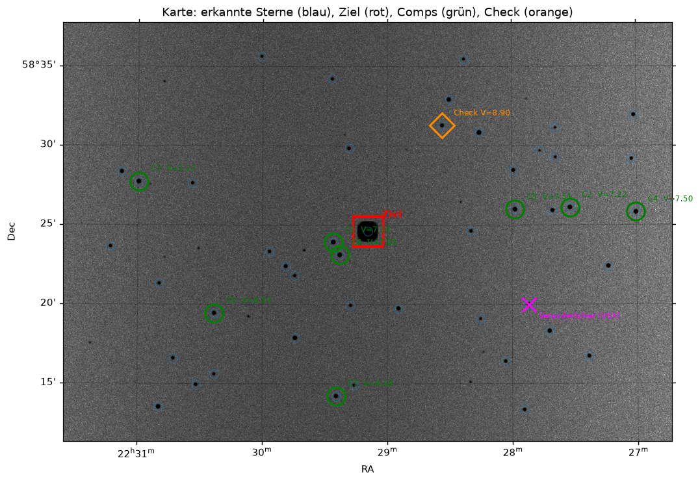
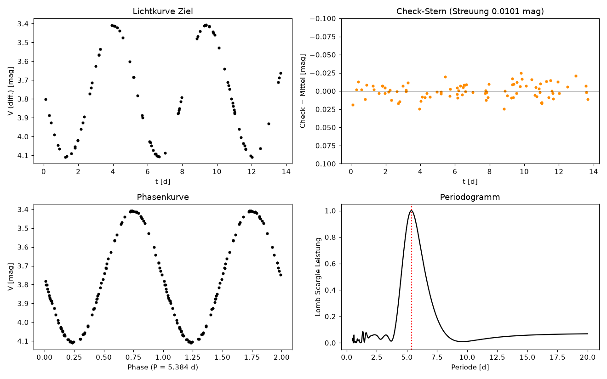

# photometrie-py

Differentielle Aperturphotometrie für veränderliche Sterne — Python 3.13, Jupyter, astropy, photutils, ASTAP.

> **Zielgruppe**: Amateurastronomen mit eigenem Teleskop und FITS-Kamera, die Lichtkurven veränderlicher Sterne (Cepheiden, Be-Sterne, symbiotische Sterne u. a.) selbst auswerten wollen.

---

## Überblick

Das Projekt liefert eine vollständige Auswertekette: von kalibrierten FITS-Rohbildern über Plate Solving, Felderkennung und Vergleichsternauswahl bis zur Lichtkurve und Periodenbestimmung.

```
          00_planung        Vorbedingungen, Probebilder (scharf/defokussiert), Plan, Apertur, Sitzung anlegen
              │
              ▼
          01_vorbereitung   Kalibrierung (Siril-Skript), Referenz + ASTAP, Gaia-Gegenprobe, Comps/Check → field_config.json
              │
              ▼
          02_messung        Photometrie (WCS aus Kopf oder Registrierung), Bildflags, Lichtkurve, Periode
              │
              ▼
          03_bericht        AAVSO-Export (Format + Inhalt geprüft), Offene Punkte, Reifegrad, KI-Zweitlesung

  Werkzeuge:  07_kamera_charakterisierung (einmalig, vor 00)   08_transformation (Farbkamera/RGB-Filter)
```

---

## Schnellstart

```bash
# Repository klonen
git clone https://github.com/apos/photometrie-py.git
cd photometrie-py

# Virtuelle Umgebung anlegen
python3.13 -m venv .venv
source .venv/bin/activate
pip install -r requirements.txt   # installiert auch das Paket varphot (editierbar) und nbstripout
nbstripout --install --attributes .gitattributes   # einmalig je Klon: Notebook-Outputs nie committen

# Einmalig: Sternbild-Positionen aus SIMBAD laden (~1–3 Min)
python tools/make_const_data.py

# End-to-End-Test mit synthetischen Daten ausführen
python varphot_demo.py

# Notebook in VSCode öffnen
code notebooks/00_planung.ipynb      # Modus „LCO-Testdaten“ zum Ausprobieren (vorher: python tools/download_testdata.py lco-dcep)
```

**Externe Abhängigkeit**: [ASTAP](https://www.hnsky.org/astap.htm) muss installiert sein (`/Applications/ASTAP.app` auf macOS).

---

## Zielsterne

Das Projekt ist für **jeden beliebigen veränderlichen Stern** ausgelegt, nicht nur Delta Cephei.
Typische Einstiegsziele:

| Stern         | Typ        | Periode  | Helligkeit (V) | Sternbild  |
|---------------|------------|----------|----------------|-----------|
| δ Cephei      | Cepheid    | 5,37 d   | 3,5 – 4,4 mag  | Cepheus   |
| η Aquilae     | Cepheid    | 7,18 d   | 3,5 – 4,4 mag  | Aquila    |
| ζ Geminorum   | Cepheid    | 10,15 d  | 3,6 – 4,2 mag  | Gemini    |
| (später)      | Be-Sterne, symbiotische Sterne, RR-Lyrae-Typ … | | | |

Das AAVSO VSP liefert automatisch passende Vergleichssterne im Feld.

---

## Was jedes Notebook tut

| Nr. | Notebook               | Entscheidungen (Formular)                       | Ergebnis                          |
|-----|------------------------|-------------------------------------------------|-----------------------------------|
| 00  | `00_planung`           | Modus, Sitzungsordner, Ziel, Methode, Kamera, Brennweite | Vorbedingungen, Bereitschaft (NB07/NB08, Standardfeld), Defokus-Folgen, Plate-Solve-Test, Apertur (Wachstumskurve), Plan, **Sitzung** |
| 01  | `01_vorbereitung`      | Kalibrierweg, Referenzbild, Gaia-Optionen       | kalibrierte Bilder, gelöstes Referenzbild, Comps/Check (`field_config.json`) |
| 02  | `02_messung`           | WCS-Modus, Apertur, Kernmaske, Periodenbereich  | `messtabelle.csv`, `zeitreihe.csv`, Lichtkurve, Periode |
| 03  | `03_bericht`           | eigene Daten?, Betriebsart, Band, OBSTYPE, CHART, KI | AAVSO Extended Format, **geprüft** (Format + Inhalt), „Offene Punkte“, Reifegrad, optional KI-Zweitlesung, kein Upload |
| 07  | `07_kamera_charakterisierung` | Kamera, Einstellung, Bilder              | Kameraprofil (Gain, Rauschen, Linearität, RAW-Kompression) |
| 08  | `08_transformation`    | Standardfeld, Kanäle                            | Koeffizienten `Tbv`, `Tb_bv`, `Tv_bv`, `Tr_bv`, Gütetest |

**Bedienung:** In jedem Notebook steht oben ein Formular; danach *Ausführen → Diese Zelle und alle folgenden* ab „Ab hier automatisch“. Die **Sitzung** (`session.json` im Siril-Arbeitsordner) verbindet die Notebooks; der Nutzer gibt nichts doppelt an.

---

## Sternkarte (`varphot.plot.chart_map`)

Die generische Sternkarte zeigt automatisch die Sternbilder rund um den Zielstern:



Alle 88 IAU-Sternbilder werden unterstützt. Beim ersten Start werden Sternpositionen aus der SIMBAD-Datenbank geladen und in `data/constellation_lines.json` gecacht (einmaliger Vorgang, ~1–3 Min).

---

## Lichtkurve (NB02)



4-Panel-Plot: differentielle Lichtkurve, Check-Stern-Residuen, Luftmasse, FWHM. Periode via Lomb-Scargle.

---

## Lokale KI-Zweitlesung (optional)

NB03 kann den Bericht von einer **lokalen** KI gegenlesen lassen (Widersprüche, Unklares, Fehlendes; nie Zahlen, ändert nichts). Weg und Reihenfolge: stärkerer Rechner im Heimnetz (Opencode-Prüfung, sonst Ollama), sonst lokal (Opencode, dann Ollama);
Opencode nur mit lokalem Modell, Aufrufe nur an Rechner im privaten Netz. Einrichtung: Schlüssel `ai` in der privaten `observer.json` (Beispiel im Kopf von `varphot/aireview.py`); NB00 zeigt, welcher Weg gefunden wurde. Abschalten: `VARPHOT_AI=off`.
Kleine Modelle irren (Fehlalarme, Übersehenes) — maßgeblich bleiben die festen Prüfungen, Details und Probelauf in KONZEPT §11.14.

---

## Entwicklung

Tests: `pytest` (mit Abdeckung: `pytest --cov=varphot --cov-report=term-missing`, aktuell 91 %); statische Prüfung: `ruff check varphot tools tests`.
Git-Regeln, Datenschutz (das Repo ist öffentlich), Test- und **Dokumentationsrichtlinie** (Warum/Wie/Grenzen/Validierung/Quellen
in jedem Docstring): [docs/entwicklung.md](docs/entwicklung.md). Farbkamera (Siril, TG/TB/TR, AAVSO): KONZEPT.md §11.

## Paketstruktur

```
photometrie-py/
├── varphot/            # Python-Paket (Kernlogik)
│   ├── config.py       # CFG-Dict: Aperturradien, Detektionsschwellen, …
│   ├── detect.py       # Quellendetektion (DAOStarFinder)
│   ├── catalog.py      # Crossmatch, Comp/Check-Auswahl mit QC-Flags
│   ├── photometry.py   # Aperturphotometrie, Ensemble-Differenzmagnitude
│   ├── plot.py         # Sternkarte, Lichtkurven-4-Panel
│   ├── batch.py, plan.py, transform.py, aavso.py, camera.py, cfa.py   # Stapelphotometrie, Planung, Transformation, AAVSO-Export, Kamera, Kanaltrennung
│   ├── maturity.py     # Reifegrad: was ist an echten Daten geprüft
│   ├── aireview.py     # lokale KI-Zweitlesung (Opencode/Ollama), nur privates Netz
│   └── synthetic.py    # Synthetische Testdaten (nur für Tests)
├── notebooks/          # Jupyter-Notebooks (00–08)
├── data/
│   ├── const_topology.json        # 88 IAU-Sternbilder (topologisch, gebündelt)
│   └── constellation_lines.json   # Sternpositionen aus SIMBAD (generiert)
├── tools/
│   ├── make_const_data.py         # Einmaliger SIMBAD-Datenaufbau
│   ├── split_cfa.py               # Bayer-FITS → R, G, B (WCS angepasst)
│   └── siril_calibrate_cfa.ssf    # Siril-Kalibrierung im CFA-Bereich (ungetestet)
├── demo/               # Synthetischer Demo-Workspace (Siril-Struktur)
├── varphot_demo.py     # End-to-End-Test / Regressions-Check
├── KONZEPT.md          # Architektur, ADRs, Roadmap (arc42)
└── CHANGELOG.md        # Versionsgeschichte
```

---

## Nachbar-Erkennung bei Comp-Auswahl (PSF / crowded field)

Das Skript erkennt Nachbarsterne automatisch bei der **Vergleichsstern-Auswahl**: Ein Stern wird als Comp/Check verworfen, wenn ein anderer Stern innerhalb des Aperturradius `r_iso` liegt (`catalog.py`, `_comp_reject_reason`). Der Zieltern selbst wird nicht auf Überlapper geprüft — für enge Doppelsterne oder sehr dichte Felder wäre PSF-Fitting (z. B. `photutils.psf`) nötig (Roadmap-Item P2).

---

## `varphot_demo.py`

Vollständiger End-to-End-Test mit **synthetischen Daten** (kein echtes FITS nötig):

```
make_wcs() → make_catalog() → render_frame()   # Synthetischer Himmel
→ detect() → crossmatch() → select_comps()     # Quellenauswahl
→ 90 × aperture_flux() → diff_mag()            # Photometrie-Zeitreihe
→ plot_lightcurve() → Lomb-Scargle Periode     # Auswertung
→ assert (≥5 Comps, Streuung <0,05 mag, Periode ±0,5 d)
```

Erwartete Ausgabe:

```
Detektion: 46 Quellen, gematcht: 46, Comps: 8, Check: 19
Check-Stern: Soll V=8.903, Messung Mittel 8.904, Streuung 0.0101 mag
Lomb-Scargle Periode: 5.384 d (Soll 5.366)
chart.png und lightcurve.png geschrieben.
```

---

## Beispieldaten

Die Pipeline wird an echten, öffentlichen Bildern geprüft. Sie liegen **nicht** im Repo; ein Skript lädt sie
(nach `PHOTOMETRIE_PY_DATA/testdata/` im Nextcloud-Ordner, MD5-/Größenprüfung, Zertifikate werden geprüft):

```bash
python tools/download_testdata.py --list
python tools/download_testdata.py lco-dcep hatp32
```

| Name | Inhalt | Quelle |
|---|---|---|
| `lco-dcep` | δ Cep (Cepheide), Filter V, 156 Bilder, 0,4-m-Teleskop (McDonald), 2018–2020, BANZAI-reduziert, 1,1 GB | Las Cumbres Observatory, öffentliches Archiv <https://archive.lco.global> (Programme FTPEPO2014A-004, LCOEPO2018B-001) |
| `hatp32` | HAT-P-32 b Transit, Clear-Filter, 142 Bilder, MicroObservatory (CfA), 89 MB | <https://github.com/rzellem/EXOTIC_sampledata> (Beispielsatz des Programms EXOTIC) |

Mit `lco-dcep` ist die Pipeline durchgelaufen: 98 von 156 Bildern brauchbar, Lomb-Scargle-Periode 5,363 d
(Literatur 5,366 d). Auswahl, Aussortierung und Befunde: [docs/testdaten.md](docs/testdaten.md). Die Daten unterliegen
den Bedingungen der jeweiligen Quelle; bei Veröffentlichungen Quelle nennen.

---

## Hardware (Referenz-Setup)

- **Teleskop**: Celestron C9.25 SCT (235 mm, f/10 → f/7 mit Reducer)
- **Kamera**: QHY268M (APS-C Mono, 6252×4176 px, 3,76 µm Pixel)
- **Weitere Kameras** (Vorlagen in `varphot/camera_presets.py`, Messung mit NB07): Player One Ares-C Pro (Farbe, IMX533, gekühlt), Panasonic Lumix S9 (Vollformat, spiegellos, RAW → Siril → FITS)
- **Filter**: Johnson-Cousins B, V, Rc, Ic (Baader Bessel, 2"); zusätzlich ein Standard-RGB-Filterrad (Methode `monorgb`, KONZEPT §11.12)
- **Plate Solver**: ASTAP (lokal, offline)

Das Paket läuft mit jedem anderen Teleskop/Kamera-Kombination, das kalibrierte FITS mit WCS-Header liefert.

---

## Stack

| Komponente       | Version  | Zweck                              |
|------------------|----------|------------------------------------|
| Python           | 3.13     |                                    |
| astropy          | 8.0.2    | WCS, FITS, Zeitumrechnung          |
| photutils        | 3.1.1    | Detektion, Aperturphotometrie      |
| astroalign       | –        | Bildregistrierung ohne WCS         |
| astroquery       | 0.4.11   | Katalogabfragen                    |
| scipy            | –        | Lomb-Scargle                       |
| matplotlib       | –        | Plots                              |
| ASTAP            | extern   | Plate Solving                      |

---

## Lizenz

MIT
