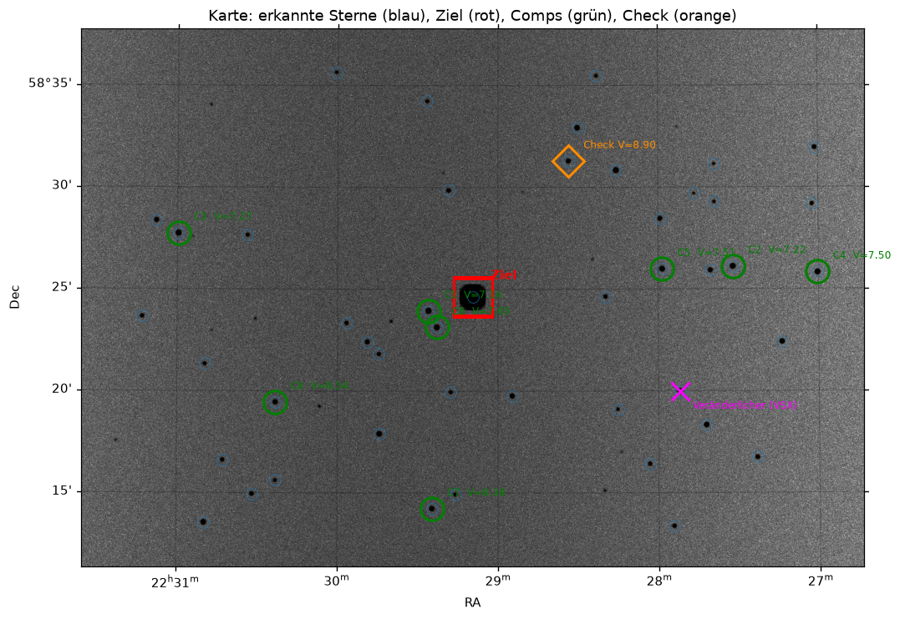
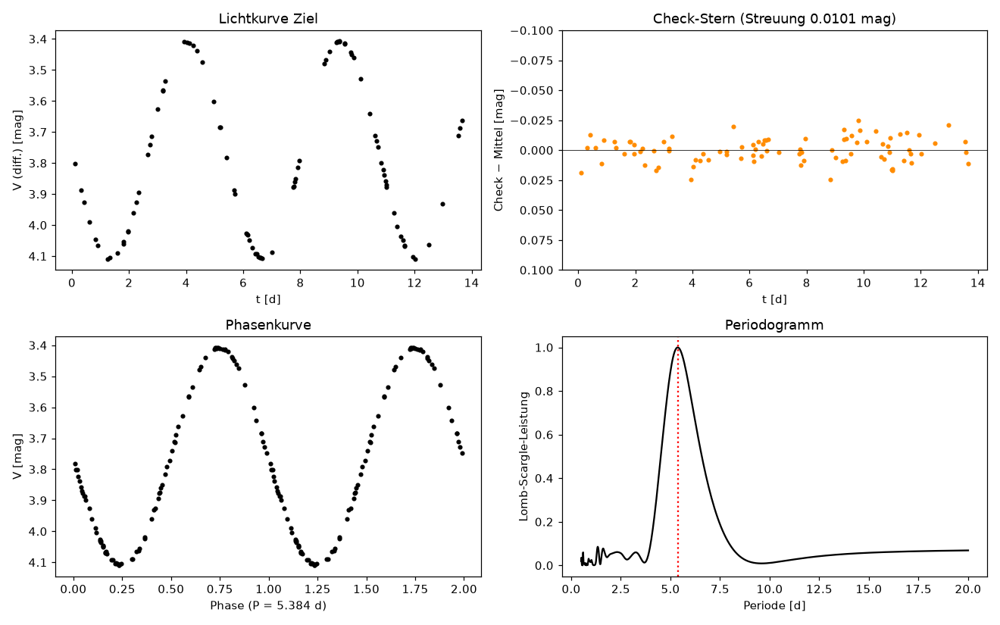

# photometrie-py

Differentielle Aperturphotometrie für veränderliche Sterne — Python ≥ 3.12, Jupyter oder Datalore, astropy, photutils, ASTAP, Siril.

> **Zielgruppe**: Amateurastronomen mit eigenem Teleskop und FITS-Kamera, die Lichtkurven veränderlicher Sterne (Cepheiden, Be-Sterne, symbiotische Sterne u. a.) selbst auswerten wollen.

---

## Überblick

Das Projekt liefert eine vollständige Auswertekette: von kalibrierten FITS-Rohbildern über Plate Solving, Felderkennung und Vergleichsternauswahl bis zur Lichtkurve und Periodenbestimmung.

```
          00_planung        Vorbedingungen, Probebilder (scharf/defokussiert), Plan, Apertur, Sitzung anlegen
              │
              ▼
          01_vorbereitung   Kalibrierung (Siril-Skript), Referenz + ASTAP, Gaia-Gegenprobe, Comps/Check → field_config.json
              │
              ▼
          02_messung        Photometrie (WCS aus Kopf oder Registrierung), Bildflags, Lichtkurve, Periode
              │
              ▼
          03_bericht        AAVSO-Export (Format + Inhalt geprüft), Offene Punkte, Reifegrad, KI-Zweitlesung
              │
              ▼
          04_langzeitkurve  mehrere Nächte desselben Ziels: gemeinsame Lichtkurve, Phasenkurve
          05_archivierung   Archiv im Datenordner: Bericht, Index, Excel, kumulative PDF (nach 03)

  Werkzeuge:  07_kamera_charakterisierung (einmalig, vor 00)   08_transformation (Farbkamera/RGB-Filter)
```

---

## Schnellstart

```bash
# Repository klonen
git clone https://github.com/apos/photometrie-py.git
cd photometrie-py

# Virtuelle Umgebung anlegen
python3 -m venv .venv          # Python 3.12 oder neuer
source .venv/bin/activate
pip install -r requirements.txt   # installiert auch das Paket varphot (editierbar) und nbstripout
nbstripout --install --attributes .gitattributes   # einmalig je Klon: Notebook-Outputs nie committen

# End-to-End-Test mit synthetischen Daten ausführen
python varphot_demo.py

# Notebook in VSCode öffnen
code notebooks/00_planung.ipynb      # Modus „LCO-Testdaten“ zum Ausprobieren (vorher: python tools/download_testdata.py lco-dcep)
```

**Externe Programme**: [ASTAP](https://www.hnsky.org/astap.htm) (Plate Solving, nötig für echte Bilder; `/Applications/ASTAP.app` auf macOS) und [Siril](https://siril.org) (Kalibrierung, RAW-Umwandlung, Kanaltrennung; optional). Das Notebook NB00 zeigt unter „Software“, was gefunden wurde.

**Ohne eigene Installation:** Notebooks und Programme laufen auch in **Datalore** (Docker-Image mit Python, ASTAP und Siril) — Einrichtung für Linux amd64 und Mac Apple Silicon in [deploy/datalore/README.md](deploy/datalore/README.md), Konzept in KONZEPT §17. Die Cloud-KI (Claude, Gemini) lässt sich dort ebenfalls nutzen: Anmeldung siehe [KI-Zweitlesung](#ki-zweitlesung-optional-lokal-oder-cloud-claude-gemini).

---

## Zielsterne

Das Projekt ist für **jeden beliebigen veränderlichen Stern** ausgelegt, nicht nur Delta Cephei.
Typische Einstiegsziele:

| Stern         | Typ        | Periode  | Helligkeit (V) | Sternbild  |
|---------------|------------|----------|----------------|-----------|
| δ Cephei      | Cepheid    | 5,37 d   | 3,5 – 4,4 mag  | Cepheus   |
| η Aquilae     | Cepheid    | 7,18 d   | 3,5 – 4,4 mag  | Aquila    |
| ζ Geminorum   | Cepheid    | 10,15 d  | 3,6 – 4,2 mag  | Gemini    |
| (später)      | Be-Sterne, symbiotische Sterne, RR-Lyrae-Typ … | | | |

Das AAVSO VSP liefert automatisch passende Vergleichssterne im Feld.

---

## Was jedes Notebook tut

| Nr. | Notebook               | Entscheidungen (Formular)                       | Ergebnis                          |
|-----|------------------------|-------------------------------------------------|-----------------------------------|
| 00  | `00_planung`           | Modus, Sitzungsordner, Ziel, Methode, Kamera, Brennweite | Vorbedingungen, Bereitschaft (NB07/NB08, Standardfeld), Defokus-Folgen, Plate-Solve-Test, Apertur (Wachstumskurve), Plan, **Sitzung** |
| 01  | `01_vorbereitung`      | Kalibrierweg, Referenzbild, Gaia-Optionen       | kalibrierte Bilder, gelöstes Referenzbild, Comps/Check (`field_config.json`) |
| 02  | `02_messung`           | WCS-Modus, Apertur, Kernmaske, Periodenbereich  | `messtabelle.csv`, `zeitreihe.csv`, Lichtkurve, Periode |
| 03  | `03_bericht`           | eigene Daten?, Betriebsart, Band, OBSTYPE, CHART, KI | AAVSO Extended Format, **geprüft** (Format + Inhalt), „Offene Punkte“, Reifegrad, optional KI-Zweitlesung, kein Upload |
| 04  | `04_langzeitkurve`     | Ziel, Zeitraum, Periode                         | gemeinsame Lichtkurve aller Nächte, Phasenkurve, Nacht-für-Nacht-Übersicht |
| 05  | `05_archivierung`      | Archivordner, Bilder behalten (alle/beste)      | Archiv je Nacht: `zeitreihe.csv`, AAVSO-Datei, Plots, `bericht.md`, `index.md`, Excel, PDF-Zusammenfassung je Ziel |
| 07  | `07_kamera_charakterisierung` | Kamera, Einstellung, Bilder              | Kameraprofil (Gain, Rauschen, Linearität, RAW-Kompression) |
| 08  | `08_transformation`    | Standardfeld, Kanäle                            | Koeffizienten `Tbv`, `Tb_bv`, `Tv_bv`, `Tr_bv`, Gütetest |

**Bedienung:** In jedem Notebook steht oben ein Formular; danach *Ausführen → Diese Zelle und alle folgenden* ab „Ab hier automatisch“. Die **Sitzung** (`session.json` im Sitzungsordner, zugleich Siril-Arbeitsordner; Standard `PHOTOMETRIE_PY_DATA/sessions/<Datum>`) verbindet die Notebooks; der Nutzer gibt nichts doppelt an. Die Notebooks sind nummeriert in der Reihenfolge des Ablaufs; ältere Verweise auf NB04/NB06 gelten nach der Umnummerierung nicht mehr (Zuordnung: KONZEPT §12).

---

## Sternkarte (`varphot.plot.chart_map`)

Die generische Sternkarte zeigt automatisch die Sternbilder rund um den Zielstern:



Alle 88 IAU-Sternbilder werden unterstützt. Die Sternpositionen (aus SIMBAD) liegen fertig in `data/constellation_lines.json`; neu erzeugen nur bei Bedarf mit `python tools/make_const_data.py` (~1–3 Min, braucht Netz).

---

## Lichtkurve (NB02)



4-Panel-Plot: differentielle Lichtkurve, Check-Stern-Residuen, Luftmasse, FWHM. Periode via Lomb-Scargle.

---

## KI-Zweitlesung (optional): lokal oder Cloud (Claude, Gemini)

NB03 kann den Bericht von einer KI gegenlesen lassen: Widersprüche, Unklares, Fehlendes — nie Zahlen, ändert nichts. Kleine Modelle irren (Fehlalarme, Übersehenes); maßgeblich bleiben die **festen Prüfungen**, Details und Probeläufe in KONZEPT §11.14 (lokal) und §11.15 (Cloud). Die KI bekommt zusätzlich Kontext aus der Software und muss jedes Urteil mit einem wörtlichen Zitat belegen (§11.15.8). Wie zuverlässig sie ist, misst der **Prüfstand** `tools/eval_ai_review.py` mit eingebauten Fehlern und Kontrollfällen (Übersehens- und Fehlalarmrate, §11.15.9; `--list` zeigt die Fälle, ohne `--run` wird nichts ausgeführt, Cloud nur mit `--run --yes-send-cloud`). Im Formular von NB03 steht die Auswahl **KI-Zweitlesung: Aus / Lokal / Claude (Cloud) / Gemini (Cloud)**; Standard ist „Lokal“, die Cloud nie von selbst.

### Weg 1: lokal (Standard)

Stärkerer Rechner im Heimnetz (Opencode-Prüfung, sonst Ollama), sonst lokal (Opencode, dann Ollama); Opencode nur mit lokalem Modell, Aufrufe nur an Rechner im privaten Netz. Einrichtung: Schlüssel `ai` in der privaten `observer.json` (Beispiel im Kopf von `varphot/aireview.py`). NB00 zeigt unter „Vorbedingungen“, welcher Weg gefunden wurde. Abschalten: `VARPHOT_AI=off`.

### Weg 2: Cloud (Claude oder Gemini) — drei Schritte, auf dem eigenen Rechner und in Datalore gleich

Die Cloud ist **standardmäßig aus**. Der Berichtstext verlässt dann das Heimnetz; vorher werden Beobachtercode, Standort, Koordinaten, Namen, Pfade und Adressen durch Platzhalter ersetzt (`varphot/anonymize.py`). NB03 zeigt den **genauen** anonymisierten Text, gesendet wird erst nach Ihrer Bestätigung; der gesendete Text liegt danach als `…_ki_gesendet.md` neben dem Bericht, die Antwort wird lokal zurückübersetzt. Zielstern, Beobachtungszeiten und Gerätetyp bleiben im Text (akzeptiertes Restrisiko, KONZEPT §11.15.3).

**1. Einschalten** — in der privaten `observer.json` (liegt im Datenordner `PHOTOMETRIE_PY_DATA`, sonst unter `~/.config/varphot/`; NB00 Schritt 1.2 behält den Schlüssel `ai` beim Speichern bei):

```json
{ "ai": { "cloud": { "enabled": true, "gemini_model": "gemini-3.1-flash-lite" } } }
```

Weitere Schlüssel unter `ai.cloud`: `model` (Claude; leer = Standard der Kommandozeile), `gemini_model` (Gemini; leer = die Kommandozeile wählt selbst, siehe unten), `max_chars` (Obergrenze des gesendeten Textes, Standard 20000). Jederzeit abschalten: Umgebungsvariable `VARPHOT_AI_CLOUD=off`.

**2. Anmelden** (einmal; die Anmeldung gehört nie in `observer.json`, ins Repo oder ins Image):

| Anbieter | Eigener Rechner (Mac/Linux) | Datalore (auf dem Docker-Host, Ordner `deploy/datalore`) |
|---|---|---|
| **Claude** (Kommandozeile `claude`, Abo-Konto) | `claude auth login`, prüfen mit `claude auth status` | `./ai-login.sh claude` (Adresse im Browser öffnen, Code ins Terminal einfügen) |
| **Gemini** (Kommandozeile `gemini`, API-Schlüssel aus [Google AI Studio](https://aistudio.google.com/apikey)) | Umgebungsvariable `GEMINI_API_KEY` **oder** Zeile `GEMINI_API_KEY=…` in `~/.gemini/.env` | `./ai-login.sh gemini-key` (Schlüssel wird verdeckt abgefragt und nur im Docker-Volume abgelegt) |

Beide Kommandozeilen müssen installiert sein (eigener Rechner: Claude Code und Gemini CLI nach deren Anleitung; Datalore: sind im Image, siehe [deploy/datalore/README.md](deploy/datalore/README.md)). Eine bereits zwischengespeicherte Google-Anmeldung der Gemini CLI wird ebenfalls erkannt; Google hat „Login mit Google“ für private Konten ohne Bezahltarif aber am 2026-06-18 auf die Antigravity CLI verlegt, ein API-Schlüssel ist daher der verlässliche Weg.

**3. Prüfen** — NB00 zeigt unter „Vorbedingungen“ die Zeilen *Cloud-KI Claude* und *Cloud-KI Gemini* (ohne Netzaufruf: Programm und Anmeldung vorhanden?). In NB03 steht hinter der Auswahl „nicht verfügbar“, solange etwas fehlt; Schritt 6 nennt dann die Ursache (z. B. „keine Anmeldung“). Ob ein Schlüssel **gültig** ist, zeigt erst der erste Lauf.

**Gemini — Besonderheiten:**
- **Datennutzung:** Bei der **kostenlosen** Stufe darf Google Eingaben laut Nutzungsbedingungen (Sekundärquellen, KONZEPT §11.15.1) zur Produktverbesserung nutzen und von Menschen lesen lassen; die **bezahlte** Stufe nicht (Abrechnungskonto aktiv). Die Software kann nicht erkennen, welche Stufe ein Schlüssel hat; NB03 weist vor dem Senden darauf hin. Bis zur Klärung: nur Testdaten oder bezahlte Stufe.
- **Modell:** Ohne `gemini_model` entscheidet die Kommandozeile („auto“); bei hoher Last bei Google dauerte das am 2026-11-17 bis zum Zeitlimit oder endete mit „503 … high demand“. Mit `gemini_model: "gemini-3.1-flash-lite"` antwortete derselbe Aufruf nach 16 s. Welche Modelle es gibt: `gemini --list-models` (veraltete Namen, z. B. `gemini-2.5-pro`, werden abgelehnt).
- **Isolation:** Der Aufruf läuft in einem leeren Wegwerf-Ordner, der zugleich als Heimordner der Kommandozeile dient (keine eigene `GEMINI.md`, keine Einstellungen oder Erweiterungen, kein Heimverzeichnis in der Anfrage), mit eigener Systemanweisung, **ohne jedes Werkzeug** (Richtlinie „alles verboten“) und mit dem Text über die Standardeingabe. Gemessen gegen einen Attrappen-Server (KONZEPT §11.15.2); die Tests in `tests/test_aireview.py` halten das fest.
- **Stand der Prüfung:** Ein echter Aufruf mit einem Schlüssel und einem harmlosen Text („OK“) lief am 2026-11-17 durch. Ein Lauf von NB03 mit Gemini auf einem ganzen Bericht ist noch nicht ausgewertet.

---

## Entwicklung

Tests: `pytest` (mit Abdeckung: `pytest --cov=varphot --cov-report=term-missing`, Stand 2026-11-16 89 %); statische Prüfung: `ruff check varphot tools tests`. Make-Ziele: `make help` (u. a. `test`, `strip`, `sync-datalore`).
Git-Regeln, Datenschutz (das Repo ist öffentlich), Test- und **Dokumentationsrichtlinie** (Warum/Wie/Grenzen/Validierung/Quellen
in jedem Docstring): [docs/entwicklung.md](docs/entwicklung.md); Gestaltung der Notebook-Oberfläche: [docs/gui.md](docs/gui.md); Testdaten und Befunde: [docs/testdaten.md](docs/testdaten.md). Farbkamera (Siril, TG/TB/TR, AAVSO): KONZEPT.md §11.

## Paketstruktur

```
photometrie-py/
├── varphot/            # Python-Paket (Kernlogik)
│   ├── config.py, detect.py, catalog.py, photometry.py, aperture.py   # Konfiguration, Detektion, Comp/Check-Auswahl (QC-Flags), Aperturphotometrie
│   ├── astrometry.py, wcscheck.py, registration.py, siril.py          # Plate Solving (ASTAP), WCS-Prüfung, Registrierung ohne WCS, Siril-Aufrufe
│   ├── batch.py, plan.py, workflow.py, session.py                     # Stapelphotometrie, Beobachtungsplan, Abläufe der Notebooks, Sitzung
│   ├── transform.py, camera.py, camera_presets.py, cfa.py             # Transformation, Kameraprofile, Kanaltrennung (Bayer)
│   ├── aavso.py, vsp.py, vsx.py, visibility.py, timeutil.py           # AAVSO-Export und Prüfung, Vergleichssterne (VSP), Katalogbereich (VSX), Sichtbarkeit, Zeit
│   ├── periodfit.py, longterm.py, archive.py, plot.py                 # Periode, Langzeitkurve, Archivierung, Sternkarte/Lichtkurve
│   ├── maturity.py, readiness.py, hints.py, nbui.py, observer.py      # Reifegrad, Vorbedingungen, Hinweise, Notebook-Oberfläche, Beobachter-/Standortdaten
│   ├── aireview.py, anonymize.py                                      # KI-Zweitlesung (lokal/Cloud), Anonymisierung für die Cloud
│   └── synthetic.py, testdata.py, cache.py                            # Synthetische Daten (Tests), Testdatensätze, Zwischenspeicher
├── notebooks/          # Jupyter-Notebooks 00–05, 07, 08 (*_dl_ids.json: Zuordnung zu Datalore-Zellen)
├── data/
│   ├── const_topology.json        # 88 IAU-Sternbilder (topologisch)
│   └── constellation_lines.json   # Sternpositionen aus SIMBAD (im Repo, bei Bedarf neu erzeugbar)
├── tools/
│   ├── download_testdata.py       # öffentliche Testdaten laden (LCO, EXOTIC)
│   ├── sync_datalore.py           # Notebook-Zellen nach Datalore übertragen
│   ├── run_notebook.py            # Notebook headless ausführen (Beleg mit Ausgaben)
│   ├── make_const_data.py         # SIMBAD-Datenaufbau
│   ├── split_cfa.py               # Bayer-FITS → R, G, B (WCS angepasst)
│   ├── siril_convert_raw.ssf, siril_calibrate_cfa.ssf   # Siril: RAW umwandeln, CFA kalibrieren (Kalibrierskript ungetestet)
│   └── check_*.py, compare_gaia_vsp.py, benchmark_registration.py, …   # Prüf- und Messwerkzeuge
├── deploy/
│   ├── datalore/       # Datalore mit varphot als umziehbares Docker-Paket (Image, Compose, Backup)
│   └── imgstore/       # Image-Ablage als Ordner im Nextcloud-Sync
├── docs/               # Entwicklungsrichtlinien, Notebook-Oberfläche, Testdaten, Bilder
├── tests/              # pytest-Tests
├── demo/               # Synthetischer Demo-Workspace (Siril-Struktur)
├── varphot_demo.py     # End-to-End-Test / Regressions-Check
├── KONZEPT.md          # Architektur, ADRs, Roadmap (arc42)
├── QUELLEN.md          # Quellen und Lizenzen
└── CHANGELOG.md        # Versionsgeschichte
```

---

## Nachbar-Erkennung bei Comp-Auswahl (PSF / crowded field)

Das Skript erkennt Nachbarsterne automatisch bei der **Vergleichsstern-Auswahl**: Ein Stern wird als Comp/Check verworfen, wenn ein anderer Stern innerhalb des Aperturradius `r_iso` liegt (`catalog.py`, `_comp_reject_reason`). Der Zieltern selbst wird nicht auf Überlapper geprüft — für enge Doppelsterne oder sehr dichte Felder wäre PSF-Fitting (z. B. `photutils.psf`) nötig (Roadmap-Item P2).

---

## `varphot_demo.py`

Vollständiger End-to-End-Test mit **synthetischen Daten** (kein echtes FITS nötig):

```
make_wcs() → make_catalog() → render_frame()   # Synthetischer Himmel
→ detect() → crossmatch() → select_comps()     # Quellenauswahl
→ 90 × aperture_flux() → diff_mag()            # Photometrie-Zeitreihe
→ plot_lightcurve() → Lomb-Scargle Periode     # Auswertung
→ assert (≥5 Comps, Streuung <0,05 mag, Periode ±0,5 d)
```

Erwartete Ausgabe:

```
Detektion: 46 Quellen, gematcht: 46, Comps: 8, Check: 19
Check-Stern: Soll V=8.903, Messung Mittel 8.904, Streuung 0.0101 mag
Lomb-Scargle Periode: 5.384 d (Soll 5.366)
chart.png und lightcurve.png geschrieben.
```

---

## Beispieldaten

Die Pipeline wird an echten, öffentlichen Bildern geprüft. Sie liegen **nicht** im Repo; ein Skript lädt sie
(nach `PHOTOMETRIE_PY_DATA/testdata/` im Nextcloud-Ordner, MD5-/Größenprüfung, Zertifikate werden geprüft):

```bash
python tools/download_testdata.py --list
python tools/download_testdata.py lco-dcep hatp32 lco-sa98
```

| Name | Inhalt | Quelle |
|---|---|---|
| `lco-dcep` | δ Cep (Cepheide), Filter V, 156 Bilder, 0,4-m-Teleskop (McDonald), 2018–2020, BANZAI-reduziert, 1,1 GB | Las Cumbres Observatory, öffentliches Archiv <https://archive.lco.global> (Programme FTPEPO2014A-004, LCOEPO2018B-001) |
| `hatp32` | HAT-P-32 b Transit, Clear-Filter, 142 Bilder, MicroObservatory (CfA), 89 MB | <https://github.com/rzellem/EXOTIC_sampledata> (Beispielsatz des Programms EXOTIC) |
| `lco-sa98` | Landolt-Standardfeld SA 98, B und V, 40 Bilder, LCO 1 m (Transformation), 1,5 GB | <https://archive.lco.global> (öffentliches LCO-Archiv) |

Mit `lco-dcep` ist die Pipeline durchgelaufen: 98 von 156 Bildern brauchbar, Lomb-Scargle-Periode 5,363 d
(Literatur 5,366 d). Auswahl, Aussortierung und Befunde: [docs/testdaten.md](docs/testdaten.md). Die Daten unterliegen
den Bedingungen der jeweiligen Quelle; bei Veröffentlichungen Quelle nennen.

---

## Hardware (Referenz-Setup)

- **Teleskop**: Celestron C9.25 SCT (235 mm, f/10 → f/7 mit Reducer)
- **Kamera**: QHY268M (APS-C Mono, 6252×4176 px, 3,76 µm Pixel)
- **Weitere Kameras** (Vorlagen in `varphot/camera_presets.py`, Messung mit NB07): Player One Ares-C Pro (Farbe, IMX533, gekühlt), Panasonic Lumix S9 (Vollformat, spiegellos, RAW → Siril → FITS)
- **Filter**: Johnson-Cousins B, V, Rc, Ic (Baader Bessel, 2"); zusätzlich ein Standard-RGB-Filterrad (Methode `monorgb`, KONZEPT §11.12)
- **Plate Solver**: ASTAP (lokal, offline)

Das Paket läuft mit jedem anderen Teleskop/Kamera-Kombination, das kalibrierte FITS mit WCS-Header liefert.

---

## Stack

| Komponente       | Version  | Zweck                              |
|------------------|----------|------------------------------------|
| Python           | ≥ 3.12   | entwickelt unter 3.13, Datalore-Image 3.12 |
| astropy          | 8.0.2    | WCS, FITS, Zeitumrechnung          |
| photutils        | 3.1.1    | Detektion, Aperturphotometrie      |
| astroalign       | –        | Bildregistrierung ohne WCS         |
| astroquery       | 0.4.11   | Katalogabfragen                    |
| scipy            | –        | Lomb-Scargle                       |
| matplotlib       | –        | Plots                              |
| ASTAP            | extern   | Plate Solving                      |
| Siril            | extern, optional | Kalibrierung, RAW-Umwandlung (Skripte in `tools/`) |

---

## Lizenz

MIT
